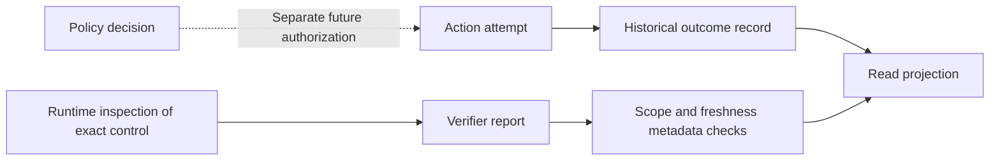

# v5 action history and scoped control reports

Status: executable WP02 development contracts for review. Refs #224 and #230.
These records have no production consumers and do not implement a response
engine or kernel verifier. The published stable version remains v4.10.4.

## Separate questions, separate records

An observation, policy decision, historical action and current control answer
different questions. The [policy decision](POLICY_DECISION.md) records what
the evaluator decided. `syswarden.action-outcome.v1` records one reported
outcome of one identified attempt. `syswarden.control-snapshot.v1` records
what a separate verifier reported about one owner's exact control.



There is deliberately no arrow that turns action history into current
protection. A verified action may later expire, be rolled back, be replaced
by an administrator or become unobservable. An unreachable node does not
prove its control absent. A reachable node does not prove it effective.

The [evidence descriptor](EVIDENCE_DESCRIPTOR.md) separately pins stored object
bytes and transformation lineage. A descriptor or hash match alone does not
prove that an action succeeded or that a control is effective.

These are declared statements. A forged well-formed statement can pass the
codec. Authenticated producers, authorized scope, immutable journal context,
resolved target/plan definitions and validated evidence are mandatory before
trusted display. The metadata helpers below do not provide those guarantees.

## Exact scope and ownership

Both records carry a complete `NodeIdentity` plus a `ControlScope`:

| Scope member | Meaning |
| --- | --- |
| `control_id` | Opaque identifier for one defined control. It is not a global protection flag. |
| `target_ref` | Reference to an immutable exact target definition. A mutable fleet group, display name or IP alone cannot substitute for it. |
| `target_sha256` | SHA-256 of the exact resolved target-definition bytes. Changing bytes under the same reference breaks binding. |
| `owner_id` | Explicit owner of this control/claim. It is not authority to mutate another source or a shared resource. |

Comparison requires exact equality of all scope members and the cluster,
node and opaque epoch. The caller resolves expected scope from independently
authenticated, authorized records. Copying the incoming record's scope into
the expected context would defeat this boundary.

Target bytes are not a newly defined executable language. This slice neither
resolves them nor defines a target catalog or signed plan format. The inert
synthetic target/plan fixtures only exercise byte binding. Later resolvers
must verify that their immutable definitions agree with the declared owner,
control, identity and plan. An opaque identifier does not establish ownership.

## Historical action outcome

The [action contract](../../src/core/syswarden-core/contracts/v5/action.go)
requires an outcome ID, action ID, attempt ID, identity, scope, reporter,
recording time, clock quality, exact plan reference and plan byte digest.
It includes separate authority, reason, evidence and verification references
with explicit field availability.

| `state` | Declared historical meaning, once its evidence is validated |
| --- | --- |
| `pending` | The identified attempt has not reported an applied effect. No execution or approval is implied. |
| `applied` | The executor reported an effect, without a verified outcome claim. |
| `verified` | The reporter claims the planned outcome was verified at that point, with an explicit verification record. |
| `expired` | The attempt's authority/plan lifetime was reported expired. This does not establish cleanup or the absence of a runtime effect. |
| `rolled_back` | The reporter claims rollback was verified, with an explicit verification record. A rollback attempt alone cannot use this state. |
| `failed` | The attempt failed, including rejected preconditions or failed rollback. The exact reason/evidence must describe it; no absence of partial effects is inferred. |
| `partial` | Effects are incomplete or only partly established. This must not render as success. |
| `unknown` | The outcome cannot be established. Do not silently map it to pending, failed, applied or safe. |

Every non-unknown outcome requires a present reason and evidence reference.
Reported effects (`applied`, `verified`, `rolled_back`, `partial`) also require
an identified authority reference. Verified/rolled-back reports require a
present verification reference. A present reference does not prove success:
other states may reference negative verification findings. Readers must not
recompute the outcome by testing only whether that reference exists.

`CheckActionOutcomeBinding` compares the exact identity, scope, action,
attempt and plan reference/digest with independently resolved context.
Success may describe failure or uncertainty. The helper does not verify the
reporter, authority or evidence, approve a retry, establish idempotence or
authorize rollback. Different attempts cannot borrow one another's outcome.

Records are immutable historical statements. Decode/re-encode does not select
the latest attempt, enforce legal state transitions, create a durable commit
or suppress replay. Clock-skewed timestamps remain representable and do not
invent a total order. These execution/journal obligations remain WP03/WP08.

## Independent control snapshot

The [control contract](../../src/core/syswarden-core/contracts/v5/control.go)
requires a snapshot ID, identity, exact scope, observer, collection time,
report expiry, observation time, clock quality and basis. It contains explicit
state, effect expiry, evidence and optional historical action references.

`state.value` is either `effective` or `absent`, only when a value is known.
These values refer to the exact resolved control definition and this owner.
They never mean that the entire host is protected, an address is trusted or
all traffic is allowed. Proving one owner's claim absent says nothing about
another owner's independently effective claim on the same resource.

The basis is `live_verification`, `cached` or `unavailable`:

- A valued state needs an observation timestamp and evidence reference.
- A present state needs live verification with present observation/evidence.
- Cached state, observation time, effect expiry and evidence values must stay
  stale. Collecting an outage report cannot refresh an old measurement.
- Unavailable verification cannot carry valued state/measurement/expiry/evidence.
  A separately identified historical action link may remain visible.
- Missing, unavailable, stale, partial, rejected and not-applicable states
  remain explicit. The decoder never upgrades them to a current result.

`effect_expires_at` is independent of the report's `valid_until`. A temporary
effective control has its own observed expiry, even when the read report is
still fresh. `not_applicable` means the verifier positively established that
this control has no expiry; it is not a default for missing TTL information.
An absent control has no active effect expiry and uses `not_applicable`.

`action_ref`, when known, identifies an immutable `ActionOutcome.outcome_id`.
It is an explanatory link, not evidence of current protection. A control may
be observed without any known prior action. Scope-authorized reference
resolution still needs to validate any claimed relationship before display.

## Contextual currency and expiry

`CheckCurrentControlSnapshot` requires expected current identity/scope,
caller time and an explicit positive maximum age. It accepts only complete,
present live-verification metadata with a declared synchronized clock. A
caller must authenticate and validate the actual evidence separately. The
function is not a cryptographic or kernel verifier.

Let `O` be observation time, `C` collection time, `U` report expiry and `A`
the caller's maximum age. The metadata check requires:

```text
O <= C <= now
now < U
now < O + A
```

For an effective temporary control, it additionally requires:

```text
O < effect_expires_at
now < effect_expires_at
```

Exact expiry is rejected. The effective deadline is the earliest of these
limits; a later collection, report lifetime or historical action never extends
the measurement's age or the control's TTL. An unknown, partial or stale TTL
cannot become an indefinite effective control. A clock-skewed, incomplete or
expired record can still be decoded for a visibly historical/degraded view.

The shared 24-hour `MaxSnapshotLifetime` is a wire ceiling for report lifetime
and caller maximum age, not an operational default. WP01 must define shorter
freshness policies appropriate to each actual verifier/control. Verification
time and collection time must use the comparable trusted clock domain required
by that policy; declaring `synchronized` is not evidence of synchronization.

A successful check may describe **absence**. Consumers must read the explicit
state and cannot use the helper's nil error as a generic protected indicator.
No boolean enforcement inference or mutation is performed by these APIs.

## Encoding, migration and BunkerWeb compatibility

Both codecs reuse the existing strict bounded parser: 16 KiB documents,
128-byte ASCII identifiers, exact required members, canonical UTC timestamps,
bounded nesting/collections and no unknown fields. Invalid Unicode, duplicate
decoded keys, aliases, nulls, wrong types, trailing documents and unsupported
schemas fail without returning a partially usable record or echoing input.
Output is compact struct-order JSON without a final newline, not JCS or an
approved signing/execution format.

Frozen v4 events and their conservative projections cannot attest these
records. Nor can a policy decision or node reachability snapshot. All are
rejected by these codecs instead of manufacturing plan, ownership or runtime
verification. Action and control schemas are rejected by each other's codec.

The [BunkerWeb wire/runtime contract](BUNKERWEB_COMPATIBILITY.md) is unchanged.
No existing integration request gains these new mandatory fields or requires
a human approval, dashboard or browser. An eventual integration adapter must
use actual retained source/TTL/HA authority and evidence, not guess it from an
IP or action label. `authority_ref` does not prescribe interactive approval:
existing explicitly enabled automatic integration authority remains separate
from future human-initiated fleet transactions.

## Validation and remaining work

Synthetic golden vectors cover verified/failed/unknown action outcomes and
effective/absent/cached/unavailable control reports. Tests cover every outcome
and availability state, exact retry/plan/target/owner binding, clock skew,
measurement age, report expiry, independent control TTL, hostile JSON,
unknown versions, cross-schema and frozen v4 rejection. Two bounded fuzz
targets cover round trips, zero output on failure and cross-owner rejection.

This is targeted development validation. It does not demonstrate an actual
firewall effect, durable response engine, reference resolver, partner IVV,
cross-consumer agreement or full v5 Upgrade acceptance. No runtime or server
is changed. WP02 remains open for incident schemas, the shared rate catalog,
remaining evidence relationships and consumer adoption. WP08 remains open for
response execution and all its acceptance criteria.
