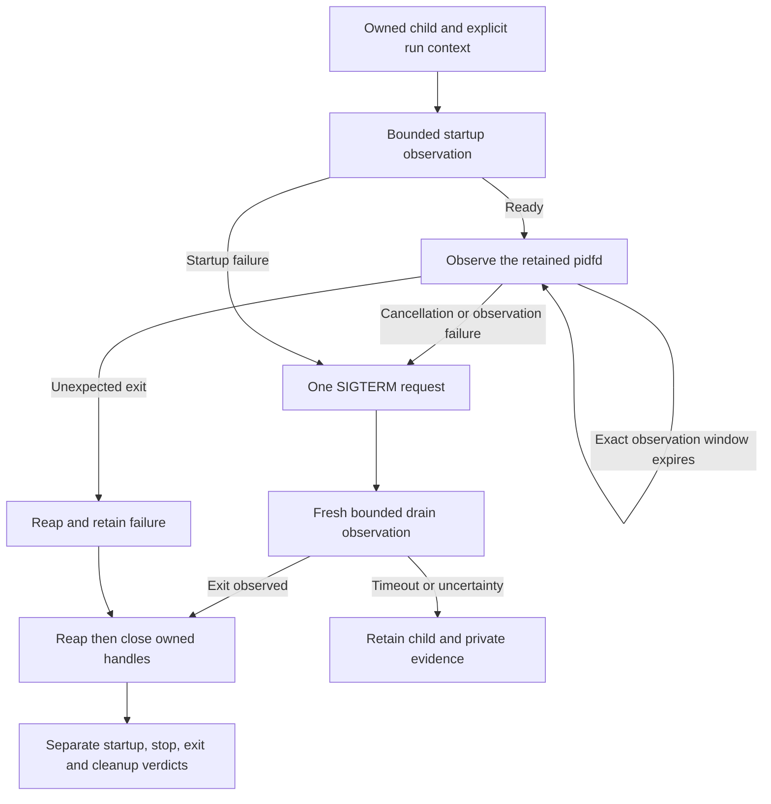

# Authority child lifecycle orchestration

Status: inactive Linux v5 library component. Refs #224, #225 and #337 remain
partial and open. Stable remains v4.10.4. No package, installed service or
existing BunkerWeb integration invokes this component.

## Ownership and entry

`SuperviseAuthorityChild` accepts one already owned `AuthorityChild` and an
explicit run context. Use [protected startup](AUTHORITY_CHILD_STARTUP.md) first
and retain any non-null child even if creation also returned an error. This
operation neither creates nor restarts a process. It discovers no path, account,
deployment approval, trust root or recovery authority.

An admitted lifecycle is single-use, including after failure. A second concurrent
or later lifecycle is refused. The caller must exclusively own lifecycle methods
during the call, must not consume readiness beforehand, and must not install a
competing child reaper. A nil context or invalid child is rejected before admission.
The API accepts only the concrete owned child, not configurable process callbacks.

## Independent observations

The returned `AuthorityChildOutcome` records four facts independently:

| Field | Meaning and limit |
| --- | --- |
| `Ready` | One valid startup notification was observed. This is not ongoing health or authorization. |
| `StopRequested` | The retained pidfd accepted the lifecycle's SIGTERM request. This does not establish exit or successful drain. |
| `State` | A non-null value is the actual reaped process state, including unsuccessful or signaled exit. Null requires continued ownership and later observation. |
| `Closed` | Owned supervisor handles closed without error after reaping. This does not authorize removal of private endpoint or journal evidence. |

Success requires all four observations, a successful exit and no retained error.
Startup/handoff uncertainty, readiness failures, unexpected exits, signal errors,
observation errors and cleanup failures remain failures even if later cleanup
succeeds. Private paths and diagnostic error strings are not a public wire format;
an eventual executable must retain bounded generic diagnostics.

## Healthy operation and graceful stop

After the existing bounded readiness check, observation continues while the run
context remains active. Each [child wait](AUTHORITY_CHILD_SUPERVISION.md) is
bounded. Only its exact observation-window timeout is retried while the run context
remains active; a joined kernel error is never discarded because it also contains
a timeout. There is no busy loop, background waiter or automatic process restart.
Healthy operation has no fixed overall lifetime.

An exit observed before this lifecycle requests termination is unexpected, even
if its exit code is zero. The process is reaped and handles may close, but the
service lifecycle remains unsuccessful. Cancellation requests one SIGTERM through
the retained pidfd. Readiness or observation failure also leads to one stop
attempt while preserving the original failure.

Following that stop attempt, one fresh 30-second observation window allows drain
without reusing the canceled run context. This bounds the supervisor's observation,
not the service's durable operation or total shutdown. On timeout or lost exit
observation, the function returns with a null `State` and without closing the
child. The caller must retain it and use the existing `Wait`, `RequestStop` and
`Close` contracts as appropriate. It must not call this single-use lifecycle again,
abandon the child, infer a clean exit, delete evidence or silently escalate to
SIGKILL. No goroutine survives the call.

An early stop can interrupt startup before signal handling or endpoint cleanup is
ready. A process exit and closed handles therefore do not prove complete private
cleanup. Existing exact evidence inspection and separately authorized recovery
remain necessary after interrupted or uncertain lifecycle results.

## Verification and remaining integration

Fourteen deterministic decision cases cover normal cancellation, repeated healthy
observation windows, joined errors, startup cancellation/refusal, stop refusal,
drain timeout, failed or missing observation, unexpected zero exit and cleanup
failure. Actual-program cases exercise authorized client access followed by
cancellation, concurrent lifecycle refusal, unexpected clean termination and early
startup cancellation using independent synthetic provisioning. They check exit
verdicts, unchanged journal resources and absence of supervisor descriptor leaks.
The mandatory executable gate includes these cases normally and under race
instrumentation. The independent 132-case separate-UID gate remains required.

This component does not install a signal handler or supervisor executable, forward
service-manager signals, notify systemd, provision accounts, constrain the resident
supervisor, approve dynamic dependencies or implement restart/recovery policy.
Those integrations, native OS isolation/IVV, human MFA and audit providers, fleet
enrollment and full v5 Upgrade IVVQ remain open. BunkerWeb's independent API,
source-owned temporary bans, expiry, retries and HA acquire no dashboard or
supervisor dependency.
