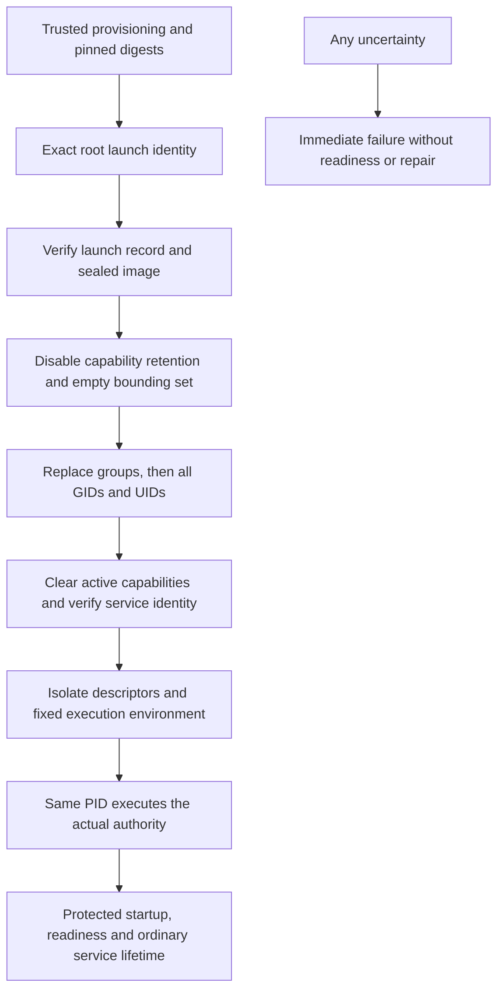

# Root-to-service authority launch

Status: inactive Linux v5 entry point. Refs #224, #225 and #337, all partial.
Stable remains v4.10.4. No installed package, account or service is changed.

## One process and an explicit identity

`cmd/syswarden-authority-launch` starts as a dedicated root process and replaces
itself with the verified authority after permanently dropping to its configured
service identity. It creates no child and leaves no root supervisor resident.
The same PID becomes the service, preserving the existing direct signal and
exit-status contract. This command is not a setuid helper and must never be
installed with setuid/setgid bits or file capabilities to grant callers authority.

It accepts exactly the same two pinned digests as the
[non-root exec bootstrap](AUTHORITY_EXEC_BOOTSTRAP.md):
`--launch-sha256 <digest> --image-sha256 <digest>`. Both must be lowercase
64-character SHA-256 values. The argument parser is shared. Descriptors 3 through
6 carry the protected launch record, state directory, endpoint directory and
nonblocking write-only readiness pipe; descriptor 7 carries the independently
approved sealed authority image. There is no account name, path, shell, repair,
configuration discovery or identity override on the command line.

A trusted provisioner still supplies those handles, the independently reviewed
digests and a trusted launcher executable/environment. It must establish correct
host namespace ancestry, initial path resolution, account allocation, approved
release provenance and freshness. Root inside an arbitrary user namespace is not
proof of host-root provenance. The command cannot turn untrusted provisioning
into an approved deployment merely by matching a hash.

## Credential transition

All real, effective and saved UIDs and GIDs must initially equal zero. Partial
root identities and ordinary accounts are refused. The locked exec thread first
validates the protected launch record and immutable image, then sets no_new_privs.
The decoded service UID, service GID and endpoint GID must be explicit nonzero
values within the existing signed 32-bit identity range.

The transition then performs these steps, stopping at the first error:

1. Disable keep-capabilities and verify that it is disabled. Clear ambient
   capabilities on the exec thread.
2. Read the kernel capability bounding set, drop every present capability and
   verify each removal. Stop only at the kernel's end marker. Bound discovery
   to the two-word capability ABI; an unknown larger range or uncertain result
   fails instead of silently omitting capabilities.
3. Replace supplementary groups with only the endpoint group.
4. Set real, effective and saved GIDs to the exact service GID.
5. Set real, effective and saved UIDs to the exact service UID.
6. Explicitly clear both capability words, including inheritable capabilities.
7. Apply the shared startup guard and readback: exact non-root identity/groups,
   zero active capability sets and no_new_privs. Disable dumpability, seal startup
   handles and establish the restrictive umask and fixed working directory.
8. Isolate the descriptor table and execute the sealed image through the existing
   exec path, with only the four startup handles beyond trusted stdio and the
   fixed target environment.

The standard library's `Setgroups`, `Setresgid` and `Setresuid` wrappers synchronize
credential changes across Go threads, using libc's process-wide wrappers when
cgo is linked. They are deliberately used instead of a raw thread-only group
syscall. Capability bounding and no_new_privs are established on the locked exec
thread; successful exec destroys the other launcher threads and all new authority
threads inherit the restricted state. This routine is only for its dedicated
entry point. It must not be embedded in an already running application.

The behavior follows the [Go syscall implementation](https://go.dev/src/syscall/syscall_linux.go),
[Linux identity semantics](https://man7.org/linux/man-pages/man2/setresuid.2.html)
and [exec semantics](https://man7.org/linux/man-pages/man2/execve.2.html).

No failed transition is reversed or retried. A failure returns only to the
command's fixed diagnostic and immediate exit 1; readiness remains the actual
service's responsibility after complete protected startup. Invalid arguments exit
2. A successful exec never returns. The independently usable non-root bootstrap
continues to refuse unexpected privileges and does not acquire a root-drop mode.

## Required evidence and remaining work

The mandatory [executable campaign](AUTHORITY_EXECUTABLE_ASSURANCE.md) builds,
verifies and seals all three product programs. Its ordinary lifecycle now starts
the actual root launcher with unrelated inherited groups and an ambient/inheritable
capability. The fixture no longer drops service credentials for that path. It
observes the final service's exact UIDs/GIDs/groups, empty active and bounding
capability sets, no_new_privs and umask across every enumerated thread. It checks
that all three images and the unrelated descriptor canary are absent after exec.

The prior non-root bootstrap gets an independent successful start/drain check,
and existing direct startup-guard negative probes remain. New launcher negatives
reject a non-root caller, wrong launch/image digests and absent/unsealed images.
Private state inventories and lack of readiness are checked after every rejected
start. Existing real client operations, SIGTERM/SIGINT drain, crash retention and
stale restart refusal now exercise the root-to-service path. The verifier requires
all 258 executable cases. The separate 132-case cross-UID gate is unchanged.
Fault-injection units verify operation order, immediate failure at every credential
stage and complete bounding-set readback, including policy denials and unknown
capability ranges. Normal and race evidence remain distinct.

This implements credential transition, not full provisioning or deployment.
Account/directory creation, trusted digest distribution, release approval,
dynamic-loader dependency validation, native SELinux/AppArmor/IMA policy, seccomp,
service-manager integration, installation/reboot and human MFA/audit remain open.
The isolated fixture is not native distribution acceptance. No policy is disabled
and there is no fallback around a kernel denial. Same-service identity, root and
kernel compromise remain outside the ordinary-user assurance claim.

BunkerWeb keeps its independent authenticated API, source-owned temporary bans,
expiry, retries and HA. It gains no dependency on the new launcher, local journal,
dashboard or identity provider.

The [bounded native ELF profile](AUTHORITY_EXECUTABLE_FORMAT.md) now checks the
actual authenticated image before either exec transition. Its 258-case mandatory
campaign includes correctly hashed malformed images, with no readiness or private
state changes after refusal. Loader and dependency trust remain separate from
format admission; no installed service or stable release behavior is changed.
