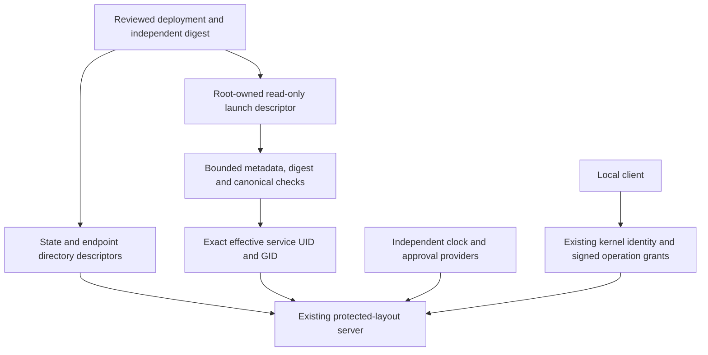

# Protected local authority launch configuration

Status: inactive Linux v5 component, linked to #224, #225 and #337. Stable remains
v4.10.4. Native packages and installed units do not activate this interface.
The separate opt-in [process entry point](AUTHORITY_PROCESS.md) consumes it.

## Independent provisioning

`AuthorityLaunch` moves the server's public trust roots, explicit enrollment and
resource limits into one bounded offline record. `EncodeAuthorityLaunch` produces
canonical bytes; it does not authorize their contents or write a file.
`DecodeAuthorityLaunch` validates their shape only. Trusted provisioning must
independently approve and pin the exact SHA-256 before starting the service.
Do not obtain the expected digest from the same discovered or requester-controlled
file. A digest is neither an approval nor an anti-rollback registry.

`LoadAuthorityLaunch` receives an already open file and that independent expected
digest. It accepts only a root UID/GID 0 regular file, exactly `0400` with no special
bits or POSIX ACL, one link, and a read-only descriptor. Its size must be positive
and at most 8,192 bytes before allocation. One positional read uses a bounded
size-plus-one buffer, requires the exact observed size, and rechecks inode, mode,
owner/group, links, size and modification/change timestamps. The exact bytes must
match the expected lowercase digest before decoding. Short reads, changed metadata,
unexpected types, writable descriptors, extra links and all other uncertainty fail
without exposing partially decoded configuration. The caller retains the descriptor;
its current offset is unchanged. No pathname is opened, followed, repaired or removed.

A privileged launcher can open the protected file before dropping privileges and
pass its read-only descriptor to the selected service. The service need not be able
to traverse the file's private parent. That parent, initial pathname resolution,
digest source, descriptor delivery, host user namespace and account lifecycle remain
part of trusted provisioning. Root ownership inside an untrusted user namespace is
not host-root provenance. The record contains public keys, never issuer private keys,
passwords, bearer tokens, arbitrary paths or executable commands. Keep deployment
identity and enrollment private despite the absence of secret keys.

## Exact format and startup binding

Schema: `syswarden.authority-launch.v1`. Compact JSON uses fixed struct field order,
explicit decimal-string integers, lowercase hex public keys/digests and an explicit
boolean enabled state. Unknown, missing, duplicate, null, reordered or alternate
encodings fail exact re-encoding. There are no default permissions or limits.

| Field | Binding |
| --- | --- |
| `service_uid`, `service_gid`, `endpoint_gid` | Explicit nonzero numeric identities through 2147483647. No name lookup, root-service fallback or inferred membership. |
| `policy_root` | Existing protected history root: enabled state, policy ID/revision/digest and independent issuer key. |
| `enrollment` | Existing canonical custody encoding with the exact initial anchor, checkpoint key and inclusive sequence range. Head equals initial and pending is null. It is not a replacement current head. |
| `limits` | Segment bytes/frames, total/per-UID peers, read/write timeouts, per-UID admission budget, history slots, rate window and accept interval. Durations are explicit nanoseconds. |

The initial anchor must match the policy root and enrollment. Issuer and checkpoint
keys must differ. All established storage, transport, rate and pacing bounds apply;
the transport constructor and record encoder share the same limit predicate.
Revision and sequence fields retain full exact 64-bit range where their existing
contracts allow it. Linux 386 conversion checks use bounded values before conversion.

`OpenAuthorityFromLaunch` verifies the record and compares its service UID/GID to the
process's effective identities before opening storage or creating an endpoint. It
then invokes [protected-layout startup](PROVISIONED_AUTHORITY.md). State and endpoint
descriptors are separate trusted inputs, not paths in the record. The real current
signed policy and custody history are still verified by their existing stores;
this record cannot bypass a missing or inconsistent enrolled resource. Disabled or
expired policy retains the existing per-operation denial semantics.

Clock and recovery/policy approval providers remain explicit trusted Go inputs.
They cannot be selected or serialized by this document. Missing providers continue
to deny their operations. The record grants no administration or recovery approval,
and the service UID is not a human identity or MFA session.

The decoded values are owned snapshots. Later file replacement or editing does not
reload a running service, revoke an existing operation, or update its roots. A new
startup must use a separately reviewed digest. Protect rollback and deployment
freshness externally; root/service-identity compromise and hostile kernels remain
outside the ordinary-user claim.

## Verification and activation boundary

Codec tests cover trust/enrollment mismatch, duplicate and missing fields, malformed
and excessive values, ownership of decoded keys and explicit disabled state. A
bounded fuzz target checks failure atomicity and exact accepted round trips.

The mandatory ordinary-user gate now has 132 named cases. Nineteen added cases run
in its isolated privileged fixture to test the loader against a valid file, unsafe
metadata/ACL/types, hardlinks, writable descriptors, malformed sizes/bytes, incorrect
digests and a mismatched service identity. These are adversarial fixture mutations,
not claims that an ordinary account can edit a root-owned record. The existing
non-root service receives only the read-only launch descriptor plus its lifecycle
pipes; clients inherit no launch or storage descriptor. Real client identities
cannot read or write the protected launch path. Before/after inventories verify
unchanged bytes and metadata. Commit, restart, crash preservation and independently
reviewed endpoint recovery use the actual startup loader without adding child
processes or weakening the existing timeout.

This remains component integration. A trusted privileged launcher, provisioning
workflow, installed OS isolation, real human authentication/MFA, durable approval
and denial audit, partial-state recovery, key lifecycle and native acceptance still
require implementation and review. BunkerWeb retains its independent authenticated
API, per-source temporary bans, duration/expiry/retry and HA behavior without a
journal, dashboard or new identity-provider dependency.
