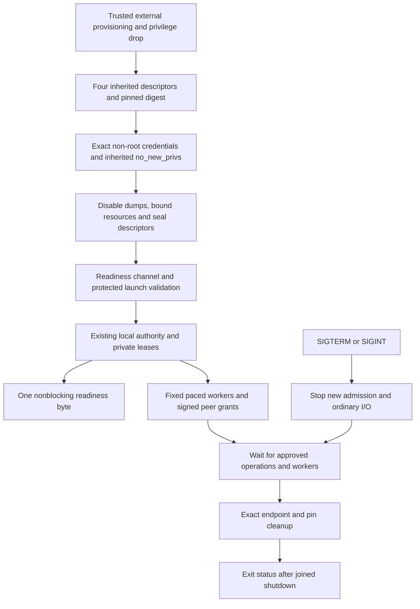

# Explicit local authority process

Status: opt-in Linux v5 process implementation. Stable remains v4.10.4. Refs #224,
#225 and #337, all partial. Native packages neither install this executable nor
start a service. The existing v4 core and BunkerWeb integration do not call it.

## Startup contract

`cmd/syswarden-authority` is a separately buildable executable. A trusted launcher
must provision and validate the existing [launch record](AUTHORITY_LAUNCH.md),
[private layout](PROVISIONED_AUTHORITY.md), service identity and endpoint first.
The [executable image primitive](AUTHORITY_EXECUTABLE_IMAGE.md) prepares a sealed,
byte-bound program for that future launcher; it does not start the service itself.
The process accepts exactly `--launch-sha256` followed by one lowercase SHA-256.
There is no environment fallback, configuration discovery, executable path in the
record, test clock switch, automatic enrollment or default approval.

The launcher supplies these descriptors in the new process:

| Descriptor | Purpose | Required source |
| --- | --- | --- |
| 3 | Launch record | Independently pinned root-owned `0400`, read-only, single-link regular file without ACL. |
| 4 | State directory | Existing service-owned `0700` layout with the five fixed private children. |
| 5 | Endpoint directory | Existing separate service-owned `0750` directory with the reviewed client group. |
| 6 | Readiness | Write-only nonblocking pipe/FIFO delivered only to the service and its trusted supervisor. |

No pathname or account-name lookup occurs in this executable. Before opening
private storage, the command verifies the protected public launch record and
checks real, effective and saved UID/GID against its explicit non-root service
identity. Supplementary groups must contain exactly the endpoint group; an empty
list is also accepted when the primary service group equals that endpoint group.
Unexpected groups, retained identities, or any effective, permitted or inheritable
capability cause startup refusal. On Linux, empty permitted and inheritable sets
also exclude ambient capabilities.

`no_new_privs` must already be set by the launcher on the thread that executes the
program. The command checks it rather than trying to apply it to one thread after
the Go runtime has created others. Exec replaces the other launcher threads, and
new runtime threads inherit this irreversible restriction. Setting it does not
remove existing credentials or capabilities, which are checked separately.

After these checks, the command disables dumpability and verifies the kernel
result, applies the verified [kernel resource ceilings](AUTHORITY_RESOURCE_LIMITS.md),
seals the four inherited descriptors with `FD_CLOEXEC`, and sets umask
`0077`. Descriptor control retains Go's descriptor lifetime protection and never
changes readiness blocking flags. These operations complete before the private
stores are opened or readiness can be sent. Failure produces the same fixed
startup diagnostic, without deleting evidence or attempting privilege repair.
The command performs no later identity transition that could reset dumpability.

This guard belongs to the standalone command. The reusable `RunAuthorityProcess`
library does not change its embedding process's dumpability, umask or credentials.
The trusted launcher remains responsible for ancestry, user/mount namespace
provenance, independently protected digest delivery, account lifecycle, uniform
pre-exec credentials, capability bounding, MAC policy and unrelated descriptor
closure. Checking the initial calling thread is not a runtime monitor of arbitrary
future thread changes. Root or service-identity compromise is outside the
ordinary-user boundary. The guard is not a privileged launcher or installed sandbox.

The kernel documents [no_new_privs inheritance](https://docs.kernel.org/userspace-api/no_new_privs.html),
[capability sets](https://man7.org/linux/man-pages/man7/capabilities.7.html),
[dumpability](https://man7.org/linux/man-pages/man2/PR_SET_DUMPABLE.2const.html) and
[exec identity transitions](https://man7.org/linux/man-pages/man2/execve.2.html).
Native acceptance must also verify MAC transitions with no_new_privs on each
supported platform; this process guard does not prove those transitions.

The command uses the system clock and supplies no recovery or administrative
approval provider. Their independent authorization continues to deny those
operations. Signed ordinary operation grants still apply. A launcher or dashboard
must not turn this explicit absence into automatic approval. Missing authentication,
human MFA, durable decision/denial audit and recovery integration remain open work.

`RunAuthorityProcess` is the shared implementation used by the executable and the
non-root process fixture. It accepts explicit Go clock and approval providers for
trusted embedding. These are not selectable by a client request or CLI flag. The
caller retains all input descriptors; owned internal leases survive until drain.

## Readiness and exit

Readiness metadata is checked before protected startup and again before writing.
Only a write-only nonblocking pipe/FIFO is admitted. A raw descriptor-held write
emits exactly one ASCII `R`; no poller wait, flag mutation, unbounded buffering or
retry is allowed. A full or disconnected channel causes startup failure and exact
owned cleanup. No readiness byte is emitted after a failed startup. After receipt,
the supervisor must continue observing process exit; this is a startup snapshot,
not a health guarantee, operation grant or durable event. Cancellation can race
with notification, and a ready process may fail immediately afterwards.

SIGTERM or SIGINT cancels the process context. Cancellation stops new admission,
accepts and ordinary I/O, while approved durable operations retain their existing
non-cancellable semantics. Endpoint and pin evidence and locks remain held until
workers finish. The cancellation watcher is joined before final cleanup. Repeated
signals do not bypass drain. An external forced kill can leave stale or incomplete
evidence that requires separate verified recovery.

A fixed set of workers and one cancellation watcher bound concurrency. There is no
hard shutdown deadline: a blocked trusted provider or storage operation may delay
exit. Imposing a timeout and claiming complete cleanup would contradict the custody
contract. Future service-manager policy must distinguish clean drain from forced
termination and preserve the corresponding evidence.

The executable returns 0 only after clean drain and cleanup, 2 for invalid command
arguments and 1 for startup or shutdown failure. Error output contains a fixed
English diagnostic, without paths, roots, digests or operation details. Joined
shutdown errors remain failures even when accompanied by expected draining/busy
sentinels. There is no automatic retry, repair, stale takeover or uncertain reply.

## Verification and remaining deployment work

Unit tests cover real/effective/saved identity rejection, exact group membership,
both capability words, no_new_privs, invalid numeric identities, descriptor
sealing and closed handles. They also cover exact command arguments, missing/closed/unsafe readiness handles,
full and disconnected pipes, startup failure without readiness, cancellation,
deadlines, readiness failure, concurrent cancellation, worker failure, retained
changed evidence and approved policy completion through drain. They preserve
unrelated journal state and reject lost shutdown errors.

The existing 132-case mandatory separate-UID campaign now uses the shared process
runner for actual non-root commit, restart, crash preservation and reviewed restart.
Its existing readiness and stop fixture supplies synthetic provisioning and clock;
it is not the standalone executable's installed systemd path. No child process,
assertion relaxation, skipped mandatory case or timeout extension is introduced.
Command parsing and builds are checked separately. The separate [executable campaign](AUTHORITY_EXECUTABLE_ASSURANCE.md) now checks
the actual binary, direct SIGTERM/SIGINT, SIGKILL preservation and stale restart
refusal. Tests do not establish service-manager signal forwarding, native reboot,
every supported MAC profile or human MFA.

Next work must integrate reviewed privileged provisioning, real process launch and
signal supervision, account and descriptor lifecycle, installed OS isolation and
independent approval/audit providers. Package activation requires its own tests and
native IVV. Keep BunkerWeb's authenticated API, source ownership, temporary-ban
lifetime, retry and HA independent of this optional local process and dashboard.

The separate [exec bootstrap](AUTHORITY_EXEC_BOOTSTRAP.md) now supplies the
non-root pre-exec transition and descriptor/environment isolation. Both commands
share the startup guard in `internal/authorityentry`; the standalone authority
still enforces its checks when launched directly. Trusted provisioning and native
service-manager integration remain required.

The [root-to-service launcher](AUTHORITY_CREDENTIAL_LAUNCH.md) now drops explicit
credentials before the same-PID exec transition. It does not create or supervise
a child. Direct signal and exit behavior remain those of the actual authority.
Trusted resource provisioning and native service-manager integration remain open.
