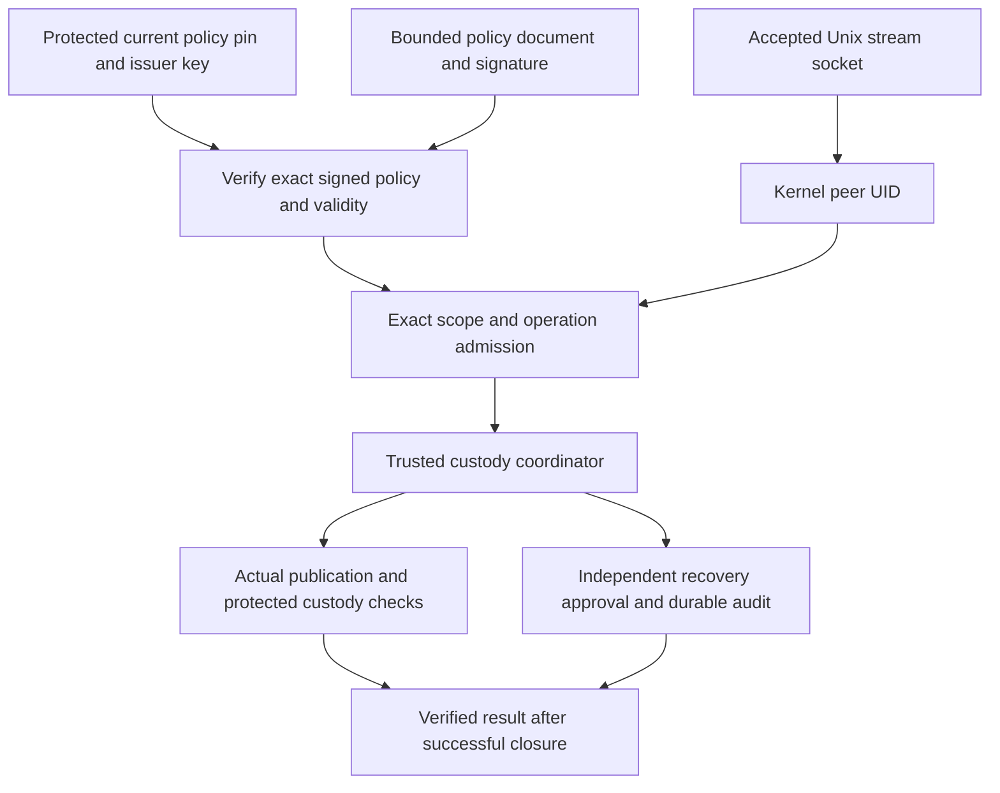

# Signed policy and local custody admission

Status: inactive WP03 admission component for v5.00.0. Stable remains v4.10.4.
This adds authenticated policy verification and Linux peer admission ahead of
future authority orchestration. It creates no listener, service, account,
configuration file or production dependency. It is not a deployed authorization
service or a complete provisioning/key-lifecycle implementation.

## Independent trust before enrollment

The [local custody backend](LOCAL_CUSTODY_STORAGE.md) accepts explicit enrollment
from a trusted caller. `CustodyAccessPolicy` now provides a bounded, signed
statement for that boundary. It binds one exact initial anchor, journal/node/epoch,
checkpoint key and inclusive sequence range, plus explicit local UID grants.
An Ed25519 issuer signs domain-separated canonical bytes. Its public key must be
independently provisioned and distinct from the checkpoint key. A compromised
checkpoint signer cannot sign its own access policy with that same key.

`CustodyPolicyTrust` is protected current configuration, supplied independently
of the policy document and client. It pins the issuer/key ID, policy ID, exact
current revision and document SHA-256, exact initial anchor, and enabled state.
A valid signature alone cannot select the current policy. Both an older revision
and a different document reusing the current revision fail against this pin.
Disabled trust denies every admission. A different journal, node, epoch or initial
root is ineligible even when the issuer signature is valid.

The verifier itself does not persist that trust configuration. The separate
[protected policy store](CUSTODY_POLICY_STORAGE.md) now retains serialized
transitions and supplies per-operation policy leases. Loading an
old pin together with an old signed document can restore old authority; preventing
that is the protected registry and deployment boundary, not a property of hashing.
Neither a file discovered in the journal nor a client-supplied pin is independent
trust. The caller must authenticate provisioning and protect configuration,
ancestors, issuer credentials, authority storage and the service process.

## Format and limits

The compact struct-order JSON schema is `syswarden.custody-access-policy.v1`.
Fields are `schema`, `policy_id`, `revision`, `issuer_key_id`, `not_before`,
`not_after`, `initial`, `authority` and `grants`. Initial anchor and checkpoint-key
fields reuse the established private custody encodings. The signature message is
ASCII `syswarden/custody-access-policy/v1`, one zero byte, then exact JSON bytes.
The detached Ed25519 signature is exactly 64 bytes. No private key is serialized.

Documents are at most 16,384 bytes. There are at most 32 UID grants, sorted by
numeric UID with no duplicate. Each contains one to four explicitly named
operations, sorted lexically without duplicates. An empty grants array admits
nobody. UID zero needs an explicit grant; no root, group or service-name shortcut
exists. UID 4294967295 is rejected. Group membership is not resolved through NSS.

Revisions use decimal strings from 1 through 18446744073709551614. UID values and
Unix-second validity bounds also use exact decimal strings. Times are positive,
ordered, and end no later than Unix second 253402300799. Policy/issuer/checkpoint
key IDs are 1 to 128 ASCII letters, digits, periods, underscores or hyphens.
Unknown, missing or duplicate fields, null aliases, alternate numeric spellings,
unknown operations and noncanonical encodings are rejected. Error returns expose
no partially verified enrollment or admission.

`EncodeCustodyAccessPolicy`, `DecodeCustodyAccessPolicy` and
`CustodyAccessPolicySigningMessage` validate shape or provide signing bytes only.
`VerifyCustodyAccessPolicy` additionally requires current independent trust,
valid signature and trusted wall time within `[not_before, not_after)`. There is
no grace period. Zero time is rejected. Detecting clock rollback or stale caller
configuration requires the future service/registry; a caller timestamp is not
self-authenticating. Returned data owns its key and collection storage.

## Kernel identity and least-privilege operations

`AdmitLocalCustody` takes the accepted `*net.UnixConn`, signed document, independent
current trust, trusted current time and exact requested operation. It rechecks
policy on each call, requires a connected Linux Unix stream socket, and reads
`SO_PEERCRED` through Go's protected raw-connection callback. It neither consumes
request bytes nor takes ownership of the socket. Nil, closed, unconnected and
datagram sockets fail. Missing or invalid credentials fail.

| Operation | Admission scope | Additional requirement |
| --- | --- | --- |
| `resume` | Request verification of the retained current head. | Exact independent custody and complete matching continuity. |
| `commit` | Request a commit of a bounded actual publication. | Signature/content verification, durable intent, local synchronization and exact custody completion. |
| `inspect-recovery` | Request a private recovery plan. | Existing one-complete-extra-anchor eligibility and scope checks. |
| `apply-recovery` | Request application of an exact reviewed plan. | Independent principal/scope-bound approval and durable audit through the recovery authorizer. |

No operation grants bootstrap, direct `Prepare`/`Finish`, key changes, cancellation,
truncation or repair. Commit does not imply recovery; inspection does not imply
application. A successful apply admission does not approve a plan. The existing
coordinator and authorizer still enforce that separate decision. Admission results
are observations for one call, not bearer tokens or reusable serialized grants.

The [Linux Unix-socket manual](https://man7.org/linux/man-pages/man7/unix.7.html)
documents that peer credentials reflect connection creation. They do not identify
every later sender after socket inheritance or descriptor delegation. PID/GID are
recorded observations, not role inputs; this code does not inspect `/proc` or trust
a claimed PID. A UID grant covers processes with that host UID. It does not prove
a human login, MFA, executable provenance or SELinux domain. The authority must
prevent untrusted descriptor delegation and protect its own UID and namespace.
Deployment must pin the host user namespace and account lifecycle; UID reuse or
a different namespace mapping must not silently transfer a grant to another
principal. This component does not attest those deployment conditions.
The [Go raw-connection contract](https://pkg.go.dev/syscall#RawConn) keeps the
socket descriptor valid during the credential callback.

## Required service integration and lifetime

The inactive [policy coordinator](CUSTODY_POLICY_STORAGE.md) now composes
protected current-policy storage, kernel admission and custody operations under
one policy lease. A connection handler, authenticated administrative orchestration
and isolated service deployment are not implemented.

Before activation, a dedicated authority must own custody storage under an
isolated OS identity. Producers must not write that storage or its ancestors.
Provisioning must bind trusted directory descriptors to the signed scope. A
request must not select arbitrary paths, issuer keys, pins, enrollment or a caller
UID. Never expose low-level backend mutation methods through IPC.

The authority must acquire its policy lease before admission, serialize all
policy changes with custody leases across processes, and stop admitting new work
when policy is disabled or expired. It must define bounded request processing,
transaction lifetime, rechecks before writes, expiry during a transaction and
uncertain completion. An old admission must not be queued and replayed after
revocation. Closing an existing storage factory alone does not revoke its leases.
Re-enrollment or a changed checkpoint key must not silently reopen or rewrite a
ledger pinned to a different enrollment. Those protocols remain unfinished.

Admission does not provide request framing, rate limits, durable denial auditing,
peer sandboxing, policy installation, revocation distribution, clock integrity,
key rotation, operator authentication, systemd/OpenRC units or native IVV.
No same-UID/root tamper resistance, remote identity or HA fencing is claimed.
BunkerWeb retains its independent authenticated API, source ownership, TTL,
retry/HA behavior and autonomy from dashboard identity and journal admission.

## Verification and remaining work

Synthetic checks cover signature/key-purpose separation, scope substitution,
current-pin rollback rejection, validity boundaries, canonical/malformed inputs,
collection limits, per-operation grants, no implicit root grant and current-policy
rechecks on an existing connection. Real local sockets and a child process verify
kernel identity independently of claimed request bytes. Concurrent calls return
owned results. A real-file recovery fixture proves that apply admission cannot
bypass the absent independent recovery authorizer or change stored evidence.

A canonical vector is independently reproduced with Python JSON/SHA-256 and
OpenSSL Ed25519 signing of public synthetic seeds. Fixed-budget fuzzing includes
both malformed signatures and issuer-signed malformed documents. Race, Linux 386,
full-core and static checks supplement these component tests. They do not establish
cross-UID deployment isolation, physical persistence or native acceptance.

The policy-storage follow-up provides bounded persistence and component lifetime
checks, including preserved uncertain completion. Provisioning orchestration,
OS isolation, key lifecycle, incomplete recovery, retention, loss,
redaction and shared consumers remain open in #225 and #224.
