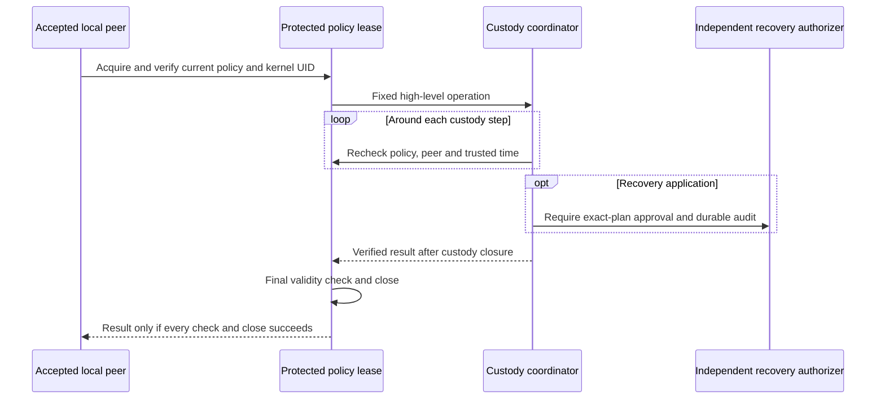

# Protected policy storage and custody leases

Status: inactive WP03 component for v5.00.0. Stable remains v4.10.4.
This composes [signed local admission](CUSTODY_ADMISSION.md) with the existing
[custody coordinator](JOURNAL_CUSTODY.md). It creates no listener, service,
production caller or deployment identity. It does not implement human RBAC/MFA.

## Explicit administration and protected history

`BootstrapLocalCustodyPolicy` requires an independently approved initial pin and
exact signed document. It exclusively creates `custody-policy-v1.swp` in an
already provisioned private directory. `OpenLocalCustodyPolicy` never bootstraps:
it requires the original independent root pin and verifies all retained records.
No journal file, producer request or newest-looking local policy selects trust.

The directory must be mode 0700 and owned by the effective UID. The ledger must
be a regular mode-0600 file with one link and the same owner. Descriptor-relative
opens reject symbolic links and unsafe metadata; acquisition uses a fresh open
file description and a nonblocking exclusive directory lock. Each acquisition
verifies the bounded history, synchronizes file and directory, then reads it back.
All cooperating administrators and operational writers must use these locks.
Protection of ancestor directories and isolation from producers remain deployment
requirements. Same-UID or root replacement with a valid older history is outside
this protection. Hash chaining is not an external monotonic witness.

`Current` returns owned administrative state, including expired or disabled
policies. It is not admission. Historical signatures are verified at their stated
validity start so that expiry cannot prevent inspection or emergency disable.
Operational admission always checks the current trusted clock and enabled state.

| Administrative primitive | Required transition |
| --- | --- |
| `Install(expected, next, now)` | Exact current-pin comparison, valid issuer signature at trusted current time, exactly the next revision, same policy/issuer/initial anchor/checkpoint enrollment. |
| `Disable(expected)` | Exact current-pin comparison, enabled to disabled, unchanged signed bytes and revision. It remains available after expiry. |
| Re-enable | Independently approved, newly signed next revision. Replaying the old signed revision is rejected. |

These are trusted storage primitives, not authenticated administrative endpoints.
The embedding authority must independently authorize the caller and update
intent before invoking them. Possession of a signed document or an operational
UID grant does not approve installation or disable. The
[reviewed administrative coordinator](REVIEWED_POLICY_ADMINISTRATION.md) now
requires a separate authorizer and retains the exact decision binding with its
policy transition. The actual authentication/audit provider, provisioning,
distribution and key rotation remain unfinished.
A change in checkpoint enrollment cannot silently migrate the custody backend.

## Bounded canonical ledger

Each frame contains a four-byte big-endian JSON length, exact compact JSON and a
32-byte chained SHA-256. The hash input is ASCII
`syswarden/custody-policy-record/v1`, one zero byte, the previous checksum
(32 zero bytes for bootstrap), then the JSON. Fields in struct order are `schema`,
`sequence`, `operation`, `enabled`, `policy` and `signature`, followed by optional
`approval` for reviewed administrative changes. Older records omit that field
without changing their canonical bytes. The schema is
`syswarden.custody-policy-record.v1`; the signed policy is embedded canonical JSON
and its Ed25519 signature is lowercase hexadecimal. Sequence is a decimal string.
Unknown/duplicate fields, alternate encodings and transitions fail closed.

Limits are 256 records, 17,408 JSON bytes per record and 4,465,664 bytes per file.
The last record is reserved for a disabled state: an enabled install cannot consume
it. `Disable` requires no fresh issuer signature and can use that reserved slot.
A full ledger refuses further changes. There is no eviction, compaction, truncation
or implicit reset. These are component ceilings, not an accepted fleet retention
or availability budget. Planned rotation/compaction must precede activation.

Every append uses one write, file synchronization, directory synchronization and
whole-history readback. Any uncertain write/close exposes no successful result.
All existing bytes remain. A partial/corrupt record blocks the entire history;
no valid prefix becomes current. A complete valid transition in protected history
is authoritative on reopen even if its caller did not receive success. Inspect
current state before a reviewed next action; do not blindly replay an update.

## Policy lease around each operation

The four public entry points choose their operation internally:
`ResumePolicyCustody`, `CommitPolicyPublication`, `PlanPolicyRecovery` and
`ApplyPolicyRecovery`. They acquire the policy lease first, then invoke the
existing coordinator through a private wrapper. Lock order is policy, custody,
anchor directory, journal directory. The policy lease remains held through
custody closure and a final validity check. Competing operations or policy changes
receive a lock error; there is no queue or automatic retry of old admission.

Every check re-reads the unchanged policy history, verifies the signed current
pin, reads kernel peer credentials again, and checks trusted wall time within
`[not_before, not_after)`. Nil/zero clocks, backwards wall time within one operation,
changed peer identity, unsafe/changed files, disabled or expired policy fail.
The clock source must be independently trusted, bounded and concurrency-safe.
Rollback between operations, clock integrity and indefinite kernel I/O stalls are
not solved by these checks. A connection still has the creation-time credential
limitations described in the admission document.

The backend's actual initial anchor and checkpoint authority must exactly match
the signed enrollment. Low-level `Prepare`/`Finish` are never exposed as admitted
client operations. Recovery still requires the separate exact-plan authorizer
and retained decision audit; a local grant cannot replace either.

## Expiry and uncertain completion

Checks surround custody steps, not every individual filesystem syscall. Expiry is
not a hard wall-clock cutoff that can undo disk I/O. A deadline crossed during
local synchronization or a backend method may leave durable effects. The next
check returns an error, exposes no result and preserves pending/completed state.

| State when validity is lost | Retained outcome |
| --- | --- |
| Before preparation | No new intent or local commit. |
| After preparation, before local append | Intent remains pending; existing incomplete-intent recovery limitations apply. |
| After a complete local anchor, before custody completion | Pending intent and local bytes remain. A newly valid policy permits inspection; applying recovery still requires exact independent approval. |
| Inside/after custody completion or closure | Completed independent state may already exist. A newly valid policy can resume only after exact retained-state verification. |

No rollback, hidden repair, duplicate commit or recovery approval is inferred.
Closing a factory prevents new acquisitions but does not revoke an already owned
lease. Revocation becomes effective only when its serialized update succeeds;
administration must not report a lock error as a completed revocation.

## Verification and activation boundary

Synthetic private-file and real Unix-socket tests cover canonical history,
signature/enrollment substitution, compare-and-install conflicts, expiry,
emergency-disable capacity, independent-process locks, file faults, pending and
completed recovery, separate recovery approval and policy locking through closure.
Python/OpenSSL independently reproduce the canonical signed bootstrap vector.
Fixed-budget fuzzing, race detection, Linux 386 and full-core regression complement
these tests. They do not prove physical power-loss durability or native IVV.

Before activation: the actual authentication/audit provider, OS/service isolation,
bounded request processing and denial auditing, key lifecycle, incomplete-state
recovery, compaction/retention, visible loss, redaction and consumer integration
remain open in #225 and #224. No live socket or authority service is installed.
BunkerWeb keeps its existing API, source-owned bans, TTL, retries and HA behavior,
independent of dashboard identity and journal availability.

The [fixed-resource authority composition](LOCAL_AUTHORITY.md) now routes the
existing coordinators through a bounded canonical dispatcher with owned startup
resources. It does not implement a listener, authentication/audit provider or
OS-isolated provisioning, and remains disconnected from production.
