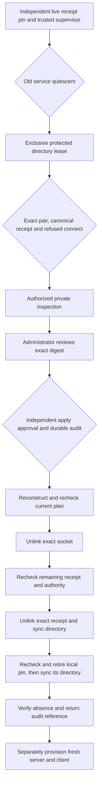

# Reviewed recovery of a stale local authority endpoint

Status: inactive Linux v5 component. `PlanEndpointRecovery` and
`ApplyEndpointRecovery` retire one complete, independently pinned endpoint pair
left by an interrupted [local server](LOCAL_AUTHORITY_SERVER.md). They do not
start a service, discover ownership, authorize themselves or change the journal.
The published baseline remains v4.10.4. Refs #224, #225 and #337, all partial.

## Trust and admission

Trusted offline provisioning supplies an open endpoint-directory descriptor, its
explicit group, exactly one trusted pin source, a kernel-observed Unix
administrator peer, a trusted clock and an independent authorization provider.
The executor uses the service identity. The administrator does not receive direct
access to protected files. No pathname, identity, trust root or provider comes
from an ordinary request, and there is no new dispatcher operation or CLI command.

The preferred local source is `PinDirectory`, the distinct service-owned `0700`
directory provisioned to the creator. The server writes its exclusive `0600`
`.authority-v1-pin` before listening. Recovery opens this directory independently,
holds its exclusive nonblocking lock, and reads the existing file without writes
or symlink following. Directory/file permissions, identity, single link, absence
of ACLs, bounded canonical JSON and exact descriptor/entry metadata are checked.
The pin binds its directory device/inode and UID/GID to the exact receipt and hash.
It is at most 2,048 bytes. No pin is created by inspecting stale endpoint bytes.

Alternatively, trusted provisioning may supply `ExpectedRecordSHA256` retained
independently while the creator was known and attested. Both sources together,
or neither source, are refused. The external-digest mode has no pin descriptor
and cannot retire a local pin; a caller must select the correct provider rather
than bypass local custody. A complete discovered receipt alone supplies no trust.
Neither source authenticates an administrator or proves that a previous `fsync`
completed. Private filesystem provisioning, ancestor protection and trusted
service identity remain necessary deployment obligations.

Admission requires both the socket and its complete private receipt. The component
opens an independent directory description and takes the same nonblocking exclusive
lock as startup. It verifies the service UID, selected group, exact `0750` directory,
exact `0660` socket, one socket link and absence of POSIX ACLs. The receipt must be
regular, service-owned, `0600`, single-linked, without ACL, at most 1,024 bytes and
opened without following symlinks. Descriptor and entry metadata must agree.

The exact receipt hash must match the independently supplied pin. Decoding is
followed by reconstruction against the actual directory/socket inode, device,
UID/GID and socket change timestamp, with a canonical 32-byte hexadecimal nonce.
Byte equality rejects unknown or duplicate fields, whitespace variants, changed
bindings and malformed records. The nonce is not a credential.

An additional nonblocking Unix connection probe must return `ECONNREFUSED`.
Success, pending connection, full backlog and every indeterminate error are
refusals; the probe sends no application bytes and always closes its descriptor.
This uses the Linux semantics in
[connect(2)](https://man7.org/linux/man-pages/man2/connect.2.html).

Neither this probe nor the advisory directory lock proves that all old accepted
connections or durable work have stopped. The separately trusted supervisor must
establish and maintain service quiescence for the complete recovery call. Locks
serialize cooperating lifecycle operations, as described in
[flock(2)](https://man7.org/linux/man-pages/man2/flock.2.html). Compromise of the
service UID, root, kernel, supervisor or trusted provisioning is outside the
ordinary-user assurance claim.

## Exact review and separate approval

The private plan uses schema `syswarden.authority-endpoint-recovery.v1` and digest
domain `syswarden/authority-endpoint-recovery/v1` followed by a zero byte. It binds:

- The single operation `retire-stale-endpoint` and exact receipt bytes and hash.
- Directory, socket and receipt device/inode, permissions, UID/GID, links, size,
  modification and change timestamps, represented as exact decimal strings.
- When local custody is selected, the private pin directory and file resource
  bindings plus exact pin SHA-256. Replacing an identical pin invalidates an
  already retained review through its changed inode and timestamps.
- The requesting peer's kernel UID, GID and PID. These are bindings, not inferred
  human identities or administrator roles.

`EndpointRecoveryAuthorizer` is distinct from operational grants and journal or
policy administration. It must authenticate the administrator, enforce current
scope and separate inspect/apply rights, validate independent approval of the
exact apply plan, verify supervisor quiescence, and durably record the complete
plan and decision before returning. The complete audit preserves the evidence
about to be retired. A returned decision reference alone cannot implement audit
storage. This component provides no default provider, human login or MFA.

Inspection is authorized too. Its digest is a review identifier, never a bearer
token. Apply reconstructs the plan from current protected state and requires an
exact match before requesting a fresh apply decision. Decisions bind mode, plan,
actor UID and an independent durable audit reference, with at most five minutes
of validity. Missing, denied, mismatched, expired or unbounded decisions fail.
The clock must remain valid and nondecreasing; the peer is rechecked throughout.
Providers receive their own copy of the plan bytes.

## Removal, uncertainty and restart

The lease remains held through authorization and removal. Apply rechecks the
complete plan after the provider returns, then unlinks only the fixed socket.
Because unlink changes directory timestamps, the next check verifies directory
identity and protections, exact remaining receipt, absence of the socket, peer
and decision lifetime. Only then is the receipt unlinked. The directory is
synchronized and absence/protections are checked again. With local custody, only
then is the exact pin rechecked and unlinked, its directory synchronized, and
absence verified. The private lock remains held throughout. Failed endpoint
cleanup preserves the pin; failed pin cleanup reports an uncertain outcome.

Once an unlink has been attempted, any error is reported as an uncertain outcome.
Synchronization is attempted even after an intermediate failure. Remaining
artifacts are preserved; no retry, replacement adoption or broad cleanup occurs.
A failed directory synchronization may follow removal of both entries. The
pre-mutation external audit is therefore essential even when no local receipt
remains. See [fsync(2)](https://man7.org/linux/man-pages/man2/fsync.2.html) for
parent-directory persistence and [unlink(2)](https://man7.org/linux/man-pages/man2/unlink.2.html)
for the distinction between removing a name and closing existing references.

Both directories and unrelated entries are retained. A renamed original directory
remains anchored by its descriptor; a replacement at the old path is untouched.
Every error returns an empty result, even if part of the change already happened.
Successful output identifies the reviewed plan and external audit decision. It is
not a journal checkpoint, a credential or proof of physical power-loss durability.

A cleanly retired pair and local pin allow separately provisioned startup to
create a new socket, random receipt and independent pin. Existing clients pin the previous endpoint and must
be reopened against trusted provisioning; there is no silent reconnection or
replay. Journal resume still verifies its existing independently trusted state.
The recovery functions receive no journal, custody, policy or anchor descriptors.

## Evidence and explicit limits

Focused tests cover actual stale sockets, lock exclusion, live-listener refusal,
independent-pin failures, malformed/noncanonical receipts, metadata/ACL changes,
missing entries, wrong and stale reviews, separate apply denial, actor binding,
clock expiry/rollback, provider mutation, borrowed-descriptor closure, renamed
directories, failed unlinks and synchronization, and changed state during cleanup.
Pin tests cover private directory separation, collisions, locks, canonical content,
foreign receipts, inode replacement, dual trust sources, failed writes/readback,
pin-bound review changes, ordered retirement and retained uncertain remnants.
They verify preserved evidence on refused operations and retained intermediate
state on uncertain outcomes.

The mandatory [ordinary-user gate](UNPRIVILEGED_ASSURANCE.md) has 112 named cases.
Its real non-root service is killed after readiness. A fresh process first refuses
automatic takeover; a different ordinary UID cannot inspect or apply recovery.
A separately provisioned service process reads the durable private pin itself,
without receiving a receipt hash from the parent. It then runs synthetic reviewed recovery,
starts a new endpoint, serves verified resume to another process and shuts down
cleanly. Protected journal resources remain unchanged. The test provider models
approval and supervisor coordination; it is not a production authentication or
audit implementation. Dedicated skipped or incomplete evidence fails the gate.

Receipt-only remnants, unmarked sockets, partial or corrupted receipts, lost
independent pins, pin-only remnants and uncertain completed deletion remain
refused by recovery. A completely absent endpoint and pin cannot itself reveal
a previous uncertain deletion; the external supervisor and audit must retain
that result and gate restart. They need a
separate bounded procedure, not a fabricated ownership claim. Deployed identity,
quiescence enforcement, approval/audit providers, private directory provisioning, OS sandboxing,
package lifecycle and native IVV remain pending. This component is not installed
or automatically invoked. BunkerWeb keeps its independent authenticated API,
source-owned temporary bans, expiry/retry and HA contract without a new dependency.
