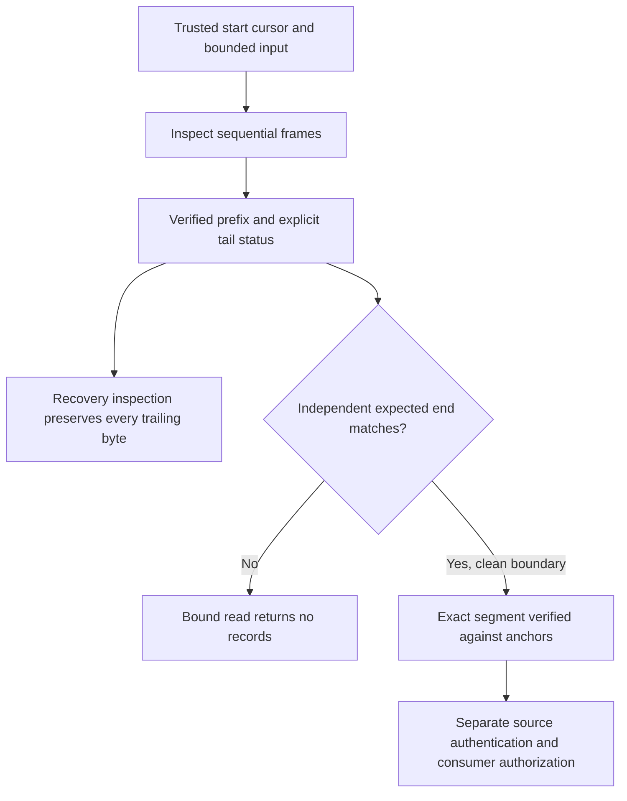

# Bounded event journal frames and recovery inspection

Status: inactive WP02/WP03 development contract for v5.00.0, linked to #224
and #225. This slice defines in-memory encoding and inspection of exact event
bytes. It implements no file writer, authenticated checkpoint, retention or
production consumer. The published baseline remains v4.10.4.

## Responsibility and trust boundary

A journal entry records one ingestion occurrence of an identified
[event envelope](EVENT_ENVELOPE.md). It must preserve the exact JSON payload,
including formatting and a final newline, rather than replace the observation
with a normalized interpretation. A valid frame is not proof of an authentic
source, complete acquisition, a security verdict or successful enforcement.

The independently supplied `JournalCursor` identifies the journal, cluster,
node, membership epoch, next sequence and preceding frame digest. Never take
these expected values from an untrusted first frame. The initial cursor and
every continuation anchor must come from a separately trusted authority.
There is no automatically trusted zero-digest genesis convention.

The event must have a present event ID and present node ID matching the
cursor's node. The event envelope itself does not carry cluster or membership
epoch. A future authenticated ingestion boundary must establish those from
the source session and authorized enrollment before constructing the cursor.
Checking the node string alone does not establish membership. Frozen v4
projections with missing identifiers remain inspectable through their existing
adapter; the journal codec must not invent identifiers to make them fit.

Sequences are local ingestion order, not cross-node causal order or source
timestamp order. Two distinct entries may contain the same event ID. A future
deduplicator must resolve observation identity before calculating rates;
counting journal entries as unique observations would violate the rate catalog.

## Versioned binary format

The implementation is in
[journal.go](../../src/core/syswarden-core/contracts/v5/journal.go). Integers
in the fixed prefix are unsigned, big endian. A frame has these fields:

| Field | Size or limit | Meaning |
| --- | --- | --- |
| Magic | 8 bytes | ASCII `SWJEV1` followed by two zero bytes. |
| Header length | 4 bytes | Positive JSON header byte length, at most 2,048. |
| Payload length | 4 bytes | Positive exact event byte length, at most 16,384. |
| Header | Declared length | Canonical `syswarden.event-journal-frame.v1` metadata. |
| Payload | Declared length | Exact strict event JSON, without rewriting. |
| Frame digest | 32 bytes | Raw SHA-256 of prefix, header and payload together. |

The header carries `schema`, `journal_id`, `identity`, `sequence`,
`previous_sha256`, `event_id` and `payload_sha256`. Its encoding is compact Go
struct-order JSON, including the defined nested identity field order. This is
not JCS. Header whitespace variations, aliases, missing or duplicate fields,
unsupported schemas, malformed Unicode and noncanonical forms are rejected.
Future semantic or format changes require a new version and pinned fixtures.

`sequence` is a canonical decimal string from 1 through 2^64 - 2. The cursor
may reach 2^64 - 1 only as an exhausted next position; encoding then fails
without wrapping. Digests in metadata and cursors are 64 lowercase hex digits.
`payload_sha256` covers exact payload bytes; `previous_sha256` is the preceding
frame's trailer value. The trailer covers the complete current frame except
itself. Header event identity must agree with the decoded payload.

`EncodeEventJournalFrame` returns an owned frame and a proposed next cursor.
On error it returns neither. It performs no I/O. Advancing durable state before
a future writer commits all frame bytes would violate the storage contract;
the returned cursor alone is never evidence that a write has reached disk.

## Two explicitly different read operations

`ScanEventJournal` inspects a candidate prefix using a trusted start cursor
and caller-selected byte/frame budgets. It stops at the first unverified
position, never searches for a later magic marker and never repairs or removes
bytes. Records own copies of their exact payloads. Offsets are relative to the
supplied byte slice, with `NextOffset` and `VerifiedBytes` exclusive.

| Tail status | Interpretation |
| --- | --- |
| `clean_boundary` | All supplied bytes end at a valid frame boundary. This alone does not establish a complete journal or segment. |
| `incomplete_tail` | The supplied prefix or declared frame is incomplete. Preserve the tail; do not infer a harmless crash or permission to truncate. |
| `corrupt_tail` | A magic, length, digest, header, chain or event check failed. Later bytes are not inspected or accepted. |
| `frame_limit` | The frame budget ended while bytes remain. Resume only through an explicit bounded continuation. |

Every successful inspection reports a reason code, accepted records, the next
cursor, verified byte count and unverified byte count. Those counts cover the
entire input, including corruption or an incomplete tail. Error messages and
reason codes do not echo payload content. Invalid context or an input exceeding
the byte budget returns an error and a zero result, not a silently cut prefix.
Exceeding a frame budget is visible and never reported as a clean completion.

A syntactically complete prefix can still be a truncated journal. Therefore
`ReadEventJournalSegment` takes an independently established expected end
cursor in addition to the start context and exact bytes. It performs the scan
itself and requires a clean boundary with exactly that end cursor. A mismatch
returns an error and no usable records. This detects removal of complete
frames, extension and rollback relative to the trusted expected endpoint.
Explicit recovery inspection can separately call `ScanEventJournal` to retain
the verified prefix and all unverified tail bytes for investigation.

An empty input is a valid empty inspection. It is a valid bound segment only
when the trusted end is exactly the trusted start. A claimed empty journal
cannot replace a previously known nonempty segment. Starting mid-journal
requires the independently trusted cursor for that position.

SHA-256 provides consistency relative to trusted anchors, not authentication.
An attacker who can replace both journal bytes and locally stored anchors can
recompute the chain. No current helper authenticates checkpoints, detects all
events lost before ingestion or defeats a compromised root account. Do not
advertise this codec as tamper-proof or as a complete durable evidence journal.

## Bounds and sensitive data

Each call requires `MaxBytes` from 1 through 8 MiB and `MaxFrames` from 1
through 1,024. These are hard framing ceilings, not measured runtime or disk
retention budgets. Apply the caller's byte cap before reading or allocating
the input too. A valid maximum-sized frame is 18,480 bytes. Declared wire
lengths are checked before conversion, slicing or payload copying, including
on 32-bit hosts. Payload parsing retains the existing strict document limits.

The codec reads already supplied memory and makes bounded payload copies. It
does not bound a caller's upstream queue or all repeated calls. An integrating
reader must enforce aggregate work, cancellation, input acquisition, response
size and authorization limits. The per-call limits do not freeze WP01's final
agent memory, flood, disk reserve or recovery-time budgets.

Payloads may contain sensitive observations. The raw frame format is not a
public export or redaction boundary. A future authorized exporter must retain
the relationship between original and transformed bytes using the
[evidence descriptor](EVIDENCE_DESCRIPTOR.md), without rewriting the original
journal to conceal transformations. Do not put real operational inputs in
public fixtures or hosted CI artifacts.

## Validation and remaining WP03 delivery

The synthetic hex fixture pins two consecutive event frames. Tests inspect
every possible interruption position, whole-frame truncation, replay/reorder,
changed scope/epoch/anchors, hostile wire lengths, invalid canonical headers,
payload identity substitution with recomputed hashes, input ownership, budgets
and sequence exhaustion. Fuzzing checks bounded inspection and exact encoding
round trips. These are component tests, not real disk crash or reboot tests.

WP03 remains open for the actual storage authority and owner-only file access,
safe creation and locking, partial-write and synchronization handling, durable
commit semantics, authenticated checkpoint key lifecycle and anti-rollback
authority, bounded retention/rotation, disk pressure, visible acquisition loss,
redacted exports and measured recovery. Native interruption, service restart,
flood and disk-pressure campaigns must validate those implementations before
any production reader or writer is enabled.

No existing event producer, v4 protocol, BunkerWeb synchronization, TTL,
source ownership, HA fencing, dependency or stable version changes here.
BunkerWeb continues independently of future journal and dashboard availability.
