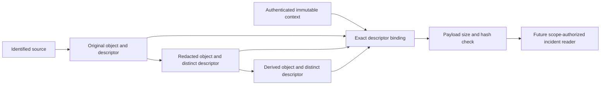

# v5 evidence objects and explicit transformation lineage

Status: executable WP02 development contract for review. Refs #224 and #232.
This slice has no production consumers, evidence store or signer. It prepares
object references for incidents and future capsules. Stable remains v4.10.4.

## What the record establishes

`syswarden.evidence-descriptor.v1` is a collector's historical statement about
one object. It identifies a node generation, collector, source, collection
time, representation, exact content and optional transformation lineage.
Identifiers are opaque, not paths, URLs or lookup permissions.

A hash match establishes byte equality with an independently pinned record.
It does not establish an honest source, an observed incident, complete capture,
safe redaction or sufficient evidence to act. An explicitly empty object does
not mean that no attack occurred or that a missing source was healthy.

The arrows between objects describe declared lineage. This package does not
execute transformations or verify their correctness. Incident correlation,
causal links and severity remain separate work. No byte match is a verdict
or authority to act.

## Metadata and exact digest domains

The [descriptor type](../../src/core/syswarden-core/contracts/v5/evidence.go)
requires these members:

| Member | Meaning |
| --- | --- |
| `schema`, `evidence_id` | Exact schema version and immutable record ID. Reusing an ID with different bytes is a journal conflict, not an update. |
| `identity` | Cluster, node and opaque epoch. Declared scope is not authentication. |
| `collector_id`, `source_id` | Identified producer and source, neither authenticated by decoding. |
| `collected_at`, `clock_quality` | Historical collection metadata, not observation time or trusted global order. Clock skew remains representable. |
| `representation` | `original`, `redacted`, `derived` or `unknown`, as declared by the collector. |
| `content` | Matching availability states for reference, lowercase SHA-256 and byte count. |
| `parent` | Exact parent evidence ID and descriptor digest. |
| `transformation` | Immutable transformation-definition reference and exact definition digest. |

The digest domains are distinct:

1. `content.sha256` hashes **exact raw object bytes**, including newlines,
   binary data, encoding and whitespace. Never normalize these bytes.
2. `EvidenceDescriptorSHA256` hashes `EncodeEvidenceDescriptor` output. It
   pins all metadata, including availability and lineage. It is not the hash
   of the incoming JSON layout.
3. `parent.sha256` is the parent's descriptor digest, not its content digest.
   Identical content cannot substitute another parent's collection context.
4. `transformation.sha256` hashes the exact resolved transformation definition.
   The inert text fixtures define no executable transformation language or
   approved redaction policy.

Future resolvers must authenticate producers, authorize the complete scope
and resolve exact immutable references independently. An IP, display name,
content hash or descriptor alone cannot establish that scope. No reference
confers read or export permission. An unknown source must not be replaced by
a fabricated identifier just to satisfy this contract; retain such input
separately until its collection context is established.

## Availability and transformation rules

`content.ref`, `content.sha256` and `content.size_bytes` must use the same
availability state. Present, stale and partial contain all three values.
Missing, unavailable, rejected and not-applicable contain none. Mixed states
are rejected rather than guessed.

Present identifies a complete stored **object**, without asserting a complete
upstream capture, timeline or incident. A retained partial capture fragment
stays partial even when all its retained bytes are available. Stale/partial
metadata remains decodable, but the binding helper never promotes it to
present. Recovery needs a separate evidenced record, not an in-place rewrite.

- `original` requires not-applicable parent and transformation. This is a
  claimed source object, not necessarily authentic or safe to disclose.
- `redacted` and `derived` require present, digest-pinned parent and
  transformation references. The child evidence ID differs from its parent.
  Content can be unavailable while the immutable lineage is known. Redaction
  denotes intentional omission; derivation denotes other processing. Neither
  inherits original status, completeness or authenticity.
- `unknown` permits only missing, unavailable or rejected content/lineage.
  It carries no asserted bytes and cannot declare lineage not applicable.
  Preserve unresolved input privately instead of inventing original status
  or a transformation history.

Each transformation receives a distinct descriptor and immediate parent. A
derivative of an expurgated object must not skip to the original and conceal
an omission. A future reader must expose unresolved/withheld ancestors without
automatically fetching or disclosing them in an export.

## Payload binding and bounds

`CheckEvidencePayloadBinding` takes a descriptor, independent
`EvidenceReadContext` and caller-supplied bytes. The context pins the exact
identity, evidence ID, descriptor digest and a positive byte budget. Obtain
it from separately authenticated, authorized immutable journal context.
Copying expected values from untrusted input defeats the check.

The helper validates metadata/context, compares the entire descriptor binding,
requires present content, checks the caller budget and exact byte count, then
compares SHA-256. It does not mutate the payload.

Metadata uses the existing 16 KiB parser limit. Object sizes are canonical
decimal **strings** from zero through `9223372036854775807`. Signs, leading
zeroes, exponents, whitespace, fractions and overflow fail. This wire range
is not an allocation or retention policy. Choose a smaller positive `MaxBytes`
per source and enforce it **before loading content**, with bounded concurrency.
The helper receives an already allocated slice, performs no file/network access
or payload copy, and rejects over-budget data before hashing it. It cannot
undo its caller's unsafe allocation. WP01/WP03 retain operational budget choices.

An empty object needs an explicit zero size and the digest of empty bytes.
Missing evidence never becomes empty evidence. Call the helper only after a
successful bounded read; passing an empty slice after an I/O failure would
lose that distinction. The exact byte budget is allowed;
oversized, truncated, normalized or modified bytes fail.

Success may describe a **redacted or derived** object. Consumers must retain
representation and lineage. No helper returns a trusted/complete/protected
verdict. Payloads remain untrusted and potentially sensitive. Inert rendering,
terminal escaping, data minimization and export authorization remain mandatory
consumer work. There is no payload renderer in this package.

## Local lineage binding and limits

`CheckEvidenceParentBinding` checks one immediate edge: valid records, a
transformed child, the same node identity/epoch, exact parent ID and exact
parent descriptor digest. Changed parent metadata breaks the binding.
Cross-node aggregation needs a separate explicit contract.

Success checks reference equality, not custody, parent accessibility,
transformation execution, redaction safety or causal order. An unavailable
parent's known descriptor can still be linked, retaining its availability.
No recursive resolver exists here. Future resolvers must bound depth, fan-out,
total bytes and work, detect ID conflicts/cycles and reject unauthorized lookup.

## Capsules, integration and validation

The strict parser is unchanged. All fields are required. Unknown versions or
members, aliases, duplicates, nulls, invalid Unicode, wrong types and excess
size/depth fail with a zero record and without echoing input. Encoding is
compact explicit struct-order JSON without a final newline, not JCS or a
signed capsule format. Dedicated evidence key ownership, rotation, revocation,
trust distribution and compromise recovery remain WP01/WP10 prerequisites.
Release signing keys are not reused.

Other v5 records and frozen v4 observations cannot become descriptors through
decoding. No legacy event gains invented proof. The
[BunkerWeb compatibility contract](BUNKERWEB_COMPATIBILITY.md) is unchanged:
automatic source-owned TTL bans, HA fences, synchronization and log ingestion
gain no descriptor, dashboard or interactive-approval dependency.

Synthetic golden fixtures cover original, redacted, derived, unavailable and
unknown records. Tests cover raw bytes, empty versus missing data, availability,
metadata/parent substitution, caller budgets, overflow, hostile JSON, unknown
schemas and cross-record rejection. Two bounded fuzz targets check round trips,
zero output on failure, epoch isolation and byte tampering.

This is contract development validation, not incident correlation, durable
storage, authenticated ingestion, safe redaction, signed capsules, native
partner IVV or v5 acceptance. WP02 and WP10 stay open. Incident schemas, the
shared rate catalog and consumer adoption follow separately.
