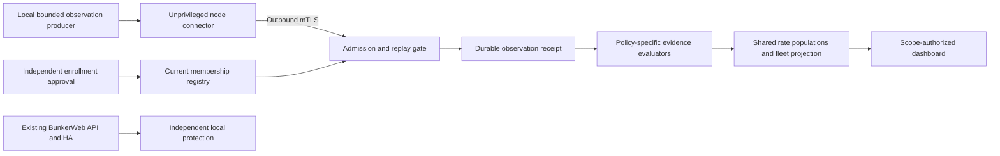
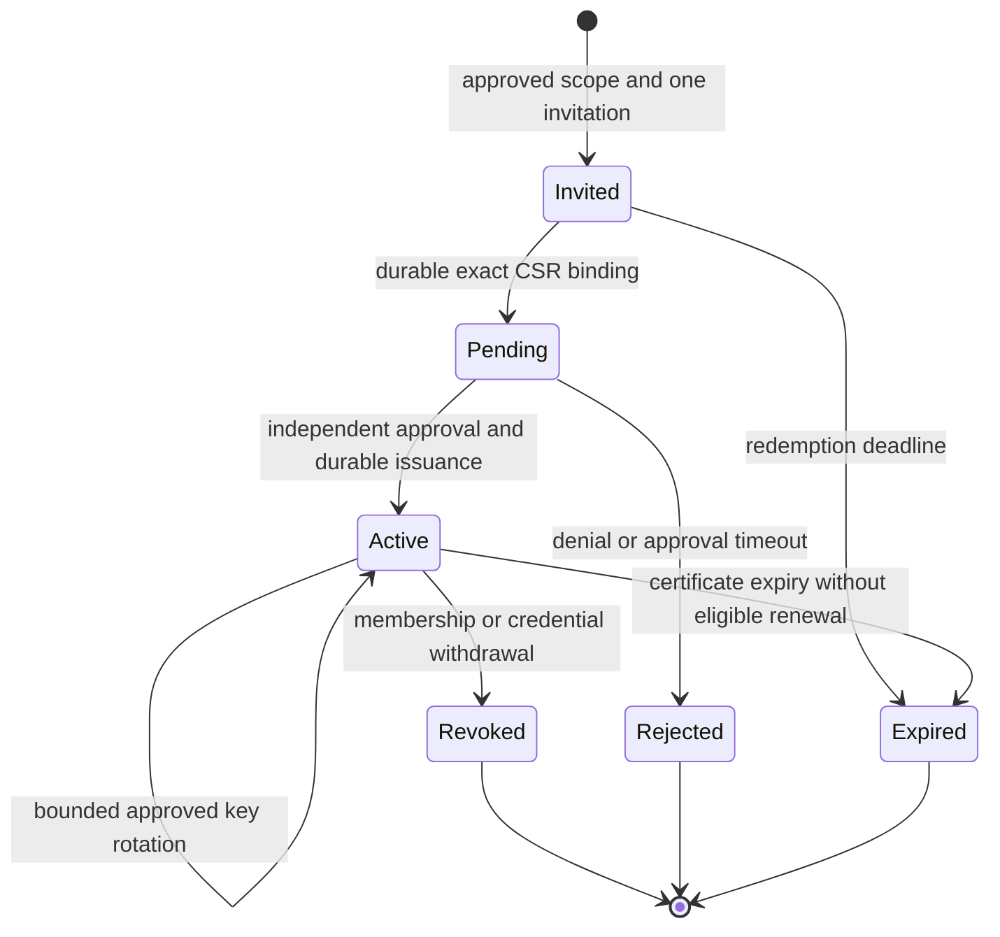

# ADR: fleet enrollment and observation admission

Status: proposed for owner review. Refs #223, #224, #233 and #315. This document
is the WP11/WP18 design prerequisite requested in #233, not an implemented
connector, accepted deployment profile or final v5.00.0 IVVQ result. Stable
remains v4.10.4. A reviewed merge accepts the design direction; each executable
slice still needs its own review and evidence before activation.

## Decision and boundary

Use an optional, node-initiated HTTPS connector, individual short-lived client
certificates and an independently administered membership registry. Keep the
first network plane read-only: nodes submit observations about themselves and
receive bounded receipts. They cannot read another node, enroll themselves,
change a policy, approve an action or execute commands through this channel.

The existing [node snapshot](NODE_SNAPSHOT.md) is a **collector statement**.
It must not become the node upload format: an upload cannot choose a collector
identity, receipt time, authorized scope, exposure class or protection verdict.
The [fleet KPI projection](FLEET_RATE_PROJECTION.md) consumes already evaluated
assessments. This ADR supplies the boundary that must precede their production.

| Separate decision | Required authority | Insufficient evidence |
| --- | --- | --- |
| Enroll a node | Approved identity, key possession and independent administrative approval | An invitation, IP address, hostname or self-reported label alone |
| Admit an observation | Valid TLS identity, current membership, allowed source/schema, freshness and durable replay checks | A valid certificate chain alone |
| Report timely coverage | A current admitted report under the exact reporting policy | An open socket or a refreshed cached collector report |
| Verify protection or conformity | Assigned verifier, exact requirements and current evidence for the complete intended scope | Reachability, an agent version, a policy reference or an authenticated assertion alone |
| Execute a response | The separate reviewed response and evidence contract | Any enrollment, observation or dashboard read permission |

An authenticated compromised node can still lie about itself. Software keys do
not attest boot integrity or honest collection. Remote identity checks contain
impersonation and scope abuse; they do not remove that residual risk. Present
source provenance and verification limits with the resulting assessments.

## Process separation and delivery

- Run the connector under a dedicated non-root account. It owns only its private
  transport key, bounded retry state and narrow producer-read capability. It has
  no shell RPC, package-manager access, nftables write capability, CA signing key
  or permission to read arbitrary paths supplied by the console.
- A separate local producer exposes fixed, bounded observation operations and
  authenticates the connector using kernel peer credentials. Its least-privilege
  collection and protected source access require separate implementation and
  ordinary-user tests. The connector must not tail every file as root.
  The connector also verifies the expected local producer identity. That socket
  check alone is not remotely verifiable producer provenance; use the separately
  enrolled producer-signature boundary defined below.
- The central admission service has no node root credential. Separate its
  observation operations from enrollment approval, certificate issuance and
  browser administration. The browser receives authorized public fingerprints
  and states, never node keys, bootstrap secrets or CA keys.
- No new inbound listener is required on a managed node. The explicitly
  provisioned central listener is private by default; an external node requires
  an administrator-approved management route. Exposure classification never
  automatically opens a firewall, discovers an endpoint or changes routing.
- Use the existing supported Linux AMD64/x86_64 scope. No mandatory external
  service, paid PKI, service mesh or additional test infrastructure is required.
  Packaging, systemd/OpenRC confinement and SELinux policy remain native gates.

## TLS profile and credential binding

Use maintained Go TLS/X.509 implementations, TLS 1.3 and full certificate
verification. The node checks the provisioned server name and explicit private
trust bundle. The observation listener requires and verifies client certificates.
It then checks the exact admitted credential against the current registry.
Do not use `InsecureSkipVerify`, optional client authentication, public system
roots as a fallback, trust-on-first-use or HTTP redirects.

The initial profile disables TLS session tickets/resumption and early data.
This keeps the first admission path on full handshakes and avoids introducing
ticket lifetime as another authorization cache. It does not replace application
replay protection. Keep-alive connections still need authorization on **every
request** and again at the durable commit boundary. A future resumption profile
needs separate revocation tests and review.

Choose ECDSA P-256 node keys for the initial certificate profile, generated on
the node using the maintained cryptographic library and system randomness.
This is not a FIPS certification claim. The client leaf has digital-signature
key usage, client-authentication EKU only and an issuer-assigned opaque
credential identifier. Proposed SAN form: `urn:syswarden:node:<credential_id>`.
The credential ID uses the bounded ASCII identifier grammar of the shared
contracts, with no URL decoding, case folding or identity inference.

The protected registry maps the exact leaf DER digest, public-key digest,
credential ID and approved issuer to one exact `cluster_id/node_id/epoch`,
credential validity interval and observation permission set. Reject ambiguous
SANs, extra identities, unapproved algorithms, wrong EKUs, unknown critical
extensions and mismatched registry entries. A correctly signed but unregistered
certificate has no membership. Renewal gets a new credential ID and leaf digest.

Keep node-client issuance and server-endpoint trust in separate explicit trust
stores and key purposes. Use dedicated fleet issuers, not release, evidence,
browser/OIDC, local custody or BunkerWeb keys. Offline root custody and an
isolated bounded intermediate issuer are the initial operating model; the
admission worker cannot sign certificates. Corporate PKI integration requires
an explicitly reviewed profile with the same registry constraints.

Standard chain validation does not implement the application's current
membership or revocation policy. In particular, Go's X.509 `Verify` does not
perform revocation checking. Use the current protected registry for immediate
credential and membership denial, including on already established connections.
CA compromise also requires replacing the affected trust purpose and reviewing
affected credentials; a leaf revocation list alone is insufficient.

## Enrollment without a reusable fleet secret

An existing trusted administrative channel provisions the central endpoint and
trust bundle. Bootstrap remains separate from the mTLS observation listener.
The bootstrap service accepts only bounded admission requests and returns no
normal observation capability while approval is pending.

1. An authorized administrator reserves the exact intended node scope and
   creates a 32-byte random invitation with a ten-minute redemption lifetime.
   Store only its verifier and protected scope/expiry. Deliver the secret through
   the trusted provisioning channel, never through the dashboard browser, URLs,
   process arguments/environment, logs, audit payloads or exports. The node reads
   it from a protected descriptor or file and retires that temporary copy after
   confirmed redemption. Secret creation and delivery tooling need their own
   permission checks; the browser manages public request metadata only.
2. The node creates its key and a signed CSR. Verify the CSR signature and
   allowed public-key profile, but ignore requested identity, role and CA
   extensions. The service, not the CSR, determines certificate identity.
3. Atomically bind the invitation to the exact CSR/public-key digest and intended
   scope. Record a pending request and consume the invitation in one durable
   operation. An identical retry may retrieve that same pending state within its
   original lifetime; a changed key or scope is denied. No retry creates another
   invitation, extends expiry or establishes membership.
4. An authorized approver verifies the key fingerprint and intended identity
   through an independent trusted channel or an already approved provisioning
   manifest. Separately approve the producer verification keys and their exact
   source/schema permissions through that channel. A transport CSR cannot grant
   producer authority. Reviewing the pending request's own labels is not independent
   verification. Apply strong reauthentication and the reviewed separation-of-duty
   policy from #315. Pending approval expires after one hour and grants nothing.
5. Recheck the exact request, approval, scope and current registry before issuance.
   Record the issued certificate and activation transition durably. On a partial
   signing or persistence failure, keep the request pending/uncertain, preserve
   evidence and deny observation admission. Never issue a second identity as a
   retry fallback. Certificate retrieval retries return the recorded public
   certificate; subsequent mTLS proves possession of the private key.

Pending-state queries and certificate retrieval require a fresh bounded
bootstrap challenge signed by the request's bound key, under a distinct
bootstrap-proof domain. This proof permits only that request's status/retrieval,
not approval or observation admission. The consumed invitation is not a polling
credential. Freeze the proof bytes and replay rules with the bootstrap schema;
never interpret a public CSR or request ID alone as current key possession.

A stolen invitation can consume a pending slot or obstruct legitimate admission;
it cannot bypass independent approval. Bound this denial-of-service exposure,
expire pending requests and require an audited new invitation after rejection.
Do not silently accept a replacement key for a consumed invitation.

The diagram is a lifecycle model, not permission to delete audit history.
Recovery from an expired or lost credential is a new reviewed operation, with
the old identity and history accounted for. It is not automatic re-enrollment.

## Renewal, revocation and recovery

The proposed client certificate lifetime is 24 hours. Begin renewal after
12 hours with jitter. A renewal proves the existing authorized key and the new
key, and checks current membership and the independent renewal policy. It may
not change identity, epoch, roles or source permissions. Allow at most two
credentials per node during a maximum one-hour overlap, bounded further by each
certificate's expiry. Retire the predecessor after successful activation of the
successor. Repeated renewals cannot accumulate active credentials.

Certificate validity, membership generation and observation sequence are
different things. Renewal does not reset the node's sequence or replay history.
An inactive, revoked, expired or obsolete-epoch credential cannot renew through
the normal path. A long console outage can therefore require reviewed recovery;
local protection continues and TLS checks are never weakened to reconnect.

Commit revocation under the same serialization boundary as admission. After its
durable acknowledgement, no later observation commit may use the withdrawn
authority. Cancel that identity's pending challenges and close its existing
connections; the close notification target is one second. Commit exclusion is
the security invariant even if connection closure is delayed. Reauthorize each
consumer read/export against current membership and mark retained reports as
historical or outside current scope. Previously delivered data cannot be recalled.

The initial registry has one authoritative writer. No active-active collector,
eventual-consistency authorization cache or automatic leader election is implied.
Readers use its current committed generation. If that generation or its durable
continuity cannot be established, stop new admissions and display unavailable
authority rather than accepting a last-known permissive state.

CA rotation requires independently approved distribution of the successor trust
bundle, bounded dual trust and explicit predecessor retirement. Proposed maximum
overlap: seven days. The local trust bundle itself has a protected generation and
retirement time, so a disconnected node cannot trust an old root indefinitely.
Offline nodes that miss the transition require trusted administrative recovery.
Never obtain a replacement root solely from the endpoint it would authorize.

Snapshot restore, cloned node keys, lost sequence state and registry rollback
require explicit recovery. Startup must compare protected continuity with an
independent approved recovery anchor before admitting requests. A copied key
cannot be distinguished cryptographically from its original: suspected clones
require revocation and separately approved identity/epoch replacement. Do not
claim that sequence checks detect every clone. Reuse the existing journal and
custody principles with separate fleet resources and authority; their integration
and backup/recovery ceremony remain implementation prerequisites.

## Observation protocol, freshness and replay

The first transport profile is HTTPS with HTTP/1.1, fixed paths, no redirects,
compression, arbitrary fetch URLs, uploaded executable content or mutation RPC.
Reject unsupported methods, versions and content types. Enforce byte, time and
concurrency limits before parsing. Reject noncanonical/duplicate JSON fields,
unknown schemas, invalid identities and oversized collections with no partial
admission. Define exact wire fields and golden vectors in the next schema slice;
this ADR does not publish a usable endpoint or CLI command.

An admitted upload contains one approved node identity, a sequence, a collector
challenge and bounded source records. The authenticated credential determines
the expected identity and allowed producer/schema set independently. Reject a
whole batch on foreign scope or malformed records. Raw logs, arbitrary evidence
objects and source-provided URLs are outside this initial upload profile.

1. After current mTLS/registry checks, the collector issues one unpredictable
   challenge bound to the node epoch, credential, registry generation, required
   producer policy and next sequence. It expires after ten seconds. Keep at most
   one outstanding challenge per node; issuing another invalidates the first.
2. The node requests a new local producer sample for that challenge. Retained
   observations preserve their original source time and quality. A new challenge
   must not turn cached evidence into a live verification. The local producer
   contract must bind the sample and its provenance before this path is enabled.
3. The collector validates the exact challenge and source bindings, then
   rechecks current credential, policy, certificate validity and registry under
   the commit boundary. Retain both collector-established timing and source
   timing/clock quality. Source time cannot extend collector freshness.
4. Persist the admitted exact-content digest, node sequence, receipt times,
   registry/policy bindings and audit reference before acknowledgement. A failed
   or uncertain durable write yields no success receipt and no fresh projection.
5. A retry of the latest committed sequence with the identical content digest
   can return only its original receipt and expiry after current authorization.
   It does not refresh a sample, consume another sequence or duplicate evidence.
   A changed digest, older sequence, gap or exhausted counter is refused. The
   node cannot resume from an invented collector sequence after state loss.

After structural and current-authorization checks, resolve the exact committed
retry case before requiring a new unexpired challenge. It returns only the old
receipt, including an already expired receipt. New admission still requires the
live challenge. This distinction allows recovery of a lost acknowledgement
without making an old sample current again.

Sequences are canonical unsigned decimal strings, starting at one and bounded
by `uint64`. Allocation and receipt state are durable across restart. Challenge
state need not survive restart: uncommitted challenges become invalid, while
the exact committed receipt remains retryable. A new challenge may replace a
failed attempt at the same next sequence only after the collector establishes
that no commit occurred. Never reuse a sequence for different committed bytes.

Collector policy initially targets a sample every 60 seconds, randomized over
the interval, with at most 90 seconds of report freshness measured from challenge
issuance. Receipt or later rendering cannot restart that window. Keep trusted
wall-clock continuity for durable times and monotonic deadlines during a process.
Detected clock rollback or unresolved clock integrity stops new current-state
claims; recovery never grants an extra expiry grace period.

The registry authorizes **which** local producer may report each source. Each
admissible producer sample needs a signature from a separately approved
observation key, inaccessible to the unprivileged connector. The signature binds
the exact node epoch, source/schema, complete sample bytes and quality/times,
collector challenge, sequence and producer policy. Use maintained ECDSA P-256 /
SHA-256 signing with a distinct domain and canonical bounded payload; freeze its
wire representation and golden vectors before implementation. It is not a
release signature, transport signature or generic action authorization.

An independent registry grant pins the producer public key, source permissions
and validity. Neither a certificate, a source identifier nor a matching digest
replaces that signature and grant. Reject absent, changed, revoked or wrong-scope
producer proofs. Apply the same explicit approval, rotation, revocation and
recovery boundaries to these keys, without coupling their rotation to transport
certificate renewal. Cache an uncertain upload's exact signed bytes for retry;
do not re-sign different bytes at a sequence that might already be committed.

The initial producer-key grant has a maximum 30-day validity, renewal beginning
after 15 days and at most one hour of overlap. Renewal needs proof of both keys
and a separately approved current renewal policy; it cannot widen sources,
schemas or epochs. Expired grants need reviewed recovery. An unavailable issuer
or registry may therefore interrupt admitted observations without interrupting
local enforcement. Key-storage isolation and unattended eligible renewal must
both be tested before fleet activation.

A compromised connector can still withhold reports, and a compromised producer
or host root can sign false local observations. Even a valid live report is only
authenticated source evidence, not independent proof that the node is
uncompromised. Historical, partial, stale, missing and rejected source states
remain explicit through journal, evaluator and presentation.

## Evaluator boundary before the three node KPIs

Each evaluator produces `NodeRateAssessment` only for the independently selected
`NodeRateBasis`: exact formula, membership, policy, scope and measurement time.
Pin the admission receipt and all evidence references. Never create that basis
from the submitted report or replace complete membership with responders.

| Formula | Evidence needed for `matched` | Other outcomes |
| --- | --- | --- |
| Reporting coverage | Timely admitted report from the approved node/producer under the reporting policy | Proven missed deadline with healthy collector continuity may be `other`; collector uncertainty is `unknown`; expired supporting evidence is `stale` |
| Verified protection coverage | Current authorized verification of every required control over the exact intended scope | An explicitly verified missing required control is `other`; incomplete, conflicting or unverifiable evidence is `unknown`; expired verification is `stale` |
| Policy conformity | Current authorized measurement against the exact independently assigned policy digest and required checks | A verified mismatch is `other`; a label/digest asserted without the required measurement is `unknown`; expired measurement is `stale` |

An exclusion requires an independently authorized eligibility decision. An
unreachable, revoked-within-history, missing or rejected report must not silently
shrink the population. Registry removal changes the independently selected
membership generation; it cannot rewrite an already sealed historical rate.

Keep the three outcomes independent. Reporting may be current while protection
and conformity are unknown. A subset of verified controls does not establish
whole-node protection. Conflicting assessments remain unknown with their support
retained, rather than selecting the most optimistic record. The existing rate
resolver and projection enforce counts/bindings, not source truth. Separate
evaluator implementations and evidence criteria are still required.

## Proposed bounded profile

These values are reviewable initial ceilings and test targets, not measured
capacity claims. The implementation must reject absent/inconsistent limits and
must not silently expand them. A policy can choose stricter limits.

| Resource | Initial profile and failure behavior |
| --- | --- |
| Membership | 500 simulated active nodes as the target; 4,096 maximum registered identities, consistent with the shared population bound |
| Enrollment | 512 pending requests, one active invitation per intended identity, two concurrent signing operations; full capacity refuses new requests |
| Connections | 32 active TLS connections globally, two per admitted node, one observation commit per node; a maximum 64-entry accept queue before TLS |
| Pre-authentication work | 16 handshakes/second, burst 32, bounded globally before expensive verification; no unbounded per-address history |
| Admitted request work | Two requests/second per node, burst four, separately bounded from bootstrap and browser work; reserve fairness between eligible identities |
| Timing | Five-second TLS handshake, three-second header read, ten-second whole request and five-second response-write ceilings; close idle connections after ten seconds |
| Wire size | 8 KiB HTTP headers, 16 KiB enrollment/CSR envelope, 64 KiB observation body, 4 KiB receipt; enforce before allocation/decoding |
| TLS and keys | 64 KiB pre-handshake input; at most three transmitted certificates, 4 KiB each; at most 16 registered producer sources per node and two approved keys per source during bounded rotation |
| Source records | At most 16 source records per upload, each bounded to 4 KiB, additionally constrained by the complete body limit |
| Retry | One pending upload per node; bounded exponential backoff with jitter, one-second initial delay and 60-second cap; no extra queue while offline |
| Protected storage | 32 MiB registry/receipt working state and 256 MiB admission audit budget, with 1 MiB reserved for explicit disable/recovery state; no success when required durable evidence cannot fit |
| Retention | No automatic deletion of current identity, replay or revocation state; an approved checkpoint/retention transition is required before reclaiming historical admission evidence |

Check TLS certificate-chain and handshake byte limits before expensive parsing,
not only the later HTTP limits. Bound log volume, pending denial metadata and
issuer verification work too. Ensure a compromised credential cannot exhaust all
workers indefinitely. Shared NAT addresses are not node identities; any optional
site-level address rate limit must disclose its effect on legitimate shared egress.

At the target cadence, 500 nodes produce about 8.3 reports/second and about
16.7 challenge-plus-report requests/second before retries or enrollment. That is
only a workload calculation. Simulate all 500 distinct identities, synchronized
reconnection, enrollment, rotation and hostile peers on existing hardware. Measure
generator costs separately and retain the dashboard's reviewed CPU/RAM budgets.
No claim of 500 physical servers, additional spending or passed load tests follows.

The admission audit budget is not an indefinite archive. Define an authorized
automatic checkpoint/retention policy and prove its continuity before enabling
sustained collection. Preserve required evidence and replay/denial state across
compaction. Until that transition is verified, storage exhaustion refuses new
admission; it must not silently discard evidence or stop local enforcement.

## Failures, compatibility and lifecycle

Console, issuer, registry or network loss leaves autonomous local enforcement,
the local TUI/alerts and BunkerWeb operation running. Show unavailable or stale
fleet observations and reject new unauthorizable work. Neither dashboard health
nor node enrollment can enable, disable or renew existing plugin authority.

Preserve BunkerWeb's API, source-owned temporary claims, TTL, retries, withdrawal
and HA fencing. A plugin token cannot enroll a node; a node certificate cannot
submit a plugin ban. The pending/expired credential states above do not change
partner cache semantics or make an old HTTP block report a current SysWarden ban.
Retain the [withdrawal regression](BUNKERWEB_WITHDRAWAL.md) and native partner
matrix. The known independent API/Geo forwarding fixes remain separately tracked.

Enrollment is opt-in on upgrade. Existing installations receive no inferred
identity, listener, remote trust or credential. Separate disable, de-enroll and
native uninstall/remove/purge semantics: local removal retires only owned local
connector artifacts; it cannot claim remote revocation succeeded when the
console is unavailable. Central membership and historical audit retention need
their own explicit administrative result. Preserve administrator trust bundles,
shared PKI, unrelated firewall rules and deliberately retained recovery backups.

## Implementation order and evidence required

| Stage | Reviewable deliverable | Required negative and recovery evidence |
| --- | --- | --- |
| FA-01 | Registry/credential, producer-key and source-permission schemas with golden vectors | Foreign identity, ambiguous SAN, wrong issuer/purpose, stale epoch, missing current policy and cross-source impersonation |
| FA-02 | Protected membership administration and continuity | Concurrent approval/revocation, process death at each durable transition, full storage, restore/rollback and read-only/unprivileged file attacks |
| FA-03 | Invitation, CSR, independent approval and isolated issuance | Stolen/replayed invitation, changed CSR/scope, concurrent redemption, denial, expiry, partial issuance and secret absence from every output surface |
| FA-04 | Real TLS admission and bounded request transport | Missing/wrong certificate, wrong endpoint, revoked live connection, expiry during work, slow/malformed input, exhaustion, fairness and no action capability |
| FA-05 | Signed source sample, challenge, receipt and replay persistence | Connector-forged producer proofs, wrong key/purpose, cached sample relabeling, delay, duplicates without freshness renewal, reorder/gap, uncertain acknowledgement, restart and cloned state limits |
| FA-06 | Three independent evidence evaluators and shared consumers | Reachable-but-unverified nodes, current receipt of stale evidence, partial control scope, policy substitution, conflict and complete outage denominators |
| FA-07 | Native lifecycle and bounded fleet campaign | Real renewal/revocation, outage/recovery, separate uninstall/remove/purge, BunkerWeb independence and 500-identity capacity with private evidence |

Merge of this ADR does not complete any row. The first FA-01 slice provides
[individual grants and credential binding checks](NODE_ADMISSION_GRANTS.md).
The [bounded registry snapshot](NODE_ADMISSION_REGISTRY.md) adds collection
constraints and explicit admission windows inside credential validity. This
allows one-hour retirement overlap without modifying an old signed certificate.
Its first profile permits one payload schema per source and limits the complete
snapshot to 16 MiB inside the 32 MiB aggregate working-state budget. Protected
registry administration and aggregate resource measurement remain open; network
activation waits for the dependent stages. Source-reference
encoding, protected layouts, exact wire schemas and recovery tooling are reviewed
in those stages, not guessed by an installer. Any change to the security or
resource decisions above requires an explicit ADR update with its migration and
evidence impact. WP01/WP02/WP11/WP18 and final v5.00.0 IVVQ remain open.

## Technical references

- [TLS 1.3, RFC 8446](https://www.rfc-editor.org/rfc/rfc8446.html), particularly
  client authentication and section 8 on early-data replay. TLS protects a
  connection; the registry and receipt rules above are application decisions.
- [X.509 profile, RFC 5280](https://www.rfc-editor.org/rfc/rfc5280.html),
  certificate path processing, validity and extended key usage. The bounded
  lifetimes, exact credential registry and enrollment policy are SysWarden
  design choices, not requirements attributed to that RFC.
- [Go TLS configuration](https://pkg.go.dev/crypto/tls#Config) and
  [Go certificate verification](https://pkg.go.dev/crypto/x509#Certificate.Verify).
  Recheck behavior in the repository's pinned toolchain when implementing;
  upstream documentation does not authorize a dependency/toolchain upgrade.
