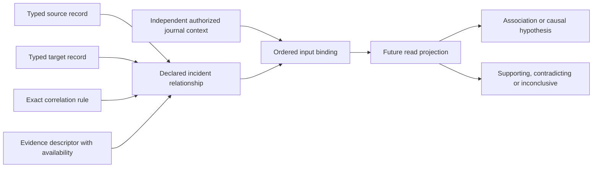

# v5 incident relationships without invented causality

Status: executable WP02 development contract for review. Refs #224 and #228.
This is one immutable relationship record, not an incident correlation engine,
incident lifecycle or authoritative incident severity. No production consumer
is connected. The published stable release remains v4.10.4.

## Association, hypothesis and support are separate

`syswarden.incident-relation.v1` describes one directed relationship claimed
by an identified correlator, within one identified node-local incident. It
pins the correlation rule, both typed endpoints and the evidence descriptor.

| Field | Meaning |
| --- | --- |
| `relation_id`, `incident_id` | Immutable relation ID and stable incident group ID, assigned by the future journal/correlator. IDs are not IPs or display labels. |
| `identity` | Exact cluster, node and opaque epoch for the incident and all resolved records. |
| `correlator_id`, `recorded_at`, `clock_quality` | Producer and historical report metadata, not authentication or a global event order. |
| `rule_ref`, `rule_sha256` | Immutable correlation-definition reference and SHA-256 of its exact bytes. |
| `from`, `to` | Ordered typed endpoints with schema, record ID and deterministic record digest. |
| `kind` | `association` or `causal_hypothesis`. Neither is proof of causation. |
| `support` | Explicit availability and declared `supporting`, `contradicting` or `inconclusive` assessment. |
| `reason_code`, `evidence` | Bounded explanation code and availability-aware evidence descriptor reference/digest. |

A temporal coincidence, shared address, reputation match or successful action
cannot automatically become a causal relationship. Even a present supporting
assessment remains the correlator's statement about its inputs. It is not an
independent finding, proof of an attack, an enforcement result or permission
to act. Contradicting and inconclusive assessments remain first-class values.
External enrichment stays advisory; it cannot independently assign severity.

There is no edge from this projection to action execution. Endpoint order is
part of the claim, not a temporal sorting rule. Reversing endpoints changes
its meaning and fails the expected-input check. Known clock skew stays
representable; the decoder never repairs timestamps or invents causality.

## Exact typed references

Each endpoint's `schema`, `record_id` and `sha256` must be fully identified.
Supported endpoint schemas are the reviewed event envelope, node snapshot,
policy decision, action outcome, control snapshot and evidence descriptor.
Unknown versions and incident relations themselves are rejected as endpoints.
There is no recursive embedded graph or automatic reference traversal.

An edge cannot target its own typed record ID, even with a different digest.
That would be an identity conflict, not a second endpoint. The same textual ID
under a different schema is a distinct typed identity. IDs still require the
independently authorized node scope; equal strings never establish ownership.

`IncidentRecordReferenceFromJSON` accepts an explicit schema, at most 16 KiB
of record JSON and its independent ingestion `NodeIdentity`. It decodes with
that schema's strict codec and checks the complete identity where available.
For an event, both event ID and node ID must be present. Its authenticated
journal context supplies the cluster and epoch absent from the event schema.
Copying those values from the relation would defeat that isolation.

The helper hashes the corresponding `Encode...` output. Formatting changes
therefore preserve a reference, while changing any canonical metadata breaks
it. This digest does not cover an evidence payload: evidence endpoints pin
**descriptor** bytes. Exact object bytes remain governed by the separate
[evidence contract](EVIDENCE_DESCRIPTOR.md).

Malformed records, unsupported types and unidentifiable frozen v4 projections
return a zero reference. Historical failed actions, cached controls, outages
and unavailable evidence descriptors can still be referenced without losing
their meaning. Their successful decoding is never a health or protection flag.

## Evidence and availability

The `evidence` pair pins an evidence descriptor ID and the SHA-256 of its
`EncodeEvidenceDescriptor` output. Both fields must have matching availability.
A valued support assessment, including stale or partial support, requires a
present explanation code and present evidence reference. This identifies its
explanation; it does not attest that the payload is accessible or sufficient.

Missing, unavailable, stale, partial, rejected and not-applicable assessments
remain explicit. A relationship with unknown support can retain its endpoints
and known evidence links. Without identified evidence it can still be decoded
for an unresolved display, but cannot pass complete input binding. Unknown
endpoints must be retained separately as unresolved observations rather than
invented IDs that make a relationship appear complete.

A pinned descriptor may describe redacted, derived or unavailable content.
The reader must carry that distinction into the incident view. A complete
metadata link does not fill a missing payload, validate a redaction or upgrade
the support assessment. Payload equality, custody/authenticity and semantic
support are separate verification obligations.

## Binding with independent context

`CheckIncidentRelationBinding` requires independently established incident
membership, relation ID, node identity, exact rule reference/digest, the two
resolved endpoint records and the resolved evidence descriptor. The rule hash
covers exact definition bytes; this slice defines no executable rule language.

The helper validates both endpoint codecs and ingestion identities, then
compares their ordered typed references with the relation. It requires the
same cluster/node/epoch throughout and pins the entire evidence descriptor.
Changed rule bytes, endpoint content under an unchanged ID, reversed endpoints,
substituted evidence or another node generation fail.

A nil error means input equality, not approval of the claim. It can describe
contradicting, unavailable or stale support and an unavailable evidence payload.
It does not authenticate the correlator, validate incident membership, suppress
replay, prove completeness or evaluate the rule. The caller must independently
establish authentication and scope before trusted display or lookup.

Nor does input binding verify every semantic relationship inside an endpoint.
For example, a relation linking an event and a policy decision does not establish
that the decision evaluated that event. Use the separate decision-input binding
and authorized correlation logic before making that narrower statement.
The same separation applies to action plans, current control and evidence
transformation lineage.

Cross-node or cross-epoch aggregation is deliberately outside this node-local
contract. A fleet projection needs separately authorized links and provenance.
Never turn an IP match into a shared incident identity or erase an epoch fence.

## Immutability, bounds and remaining work

A new assessment gets a new immutable relation ID. Duplicate delivery,
conflicting IDs, supersession, deterministic incident grouping and ordering,
loss markers, retention and complete revision sets belong to WP03/WP06.
The codec neither sorts timestamps nor picks a latest or majority assessment.
Readers must not hide contradictions merely because one record arrived later.

Each metadata document uses the existing strict parser: 16 KiB, bounded depth
and members, 128-byte identifiers, exact fields and valid Unicode. A binding
check reads two bounded endpoint documents and one bounded descriptor; it has
no file/network access and does not traverse relationships. Future journal,
graph and UI implementations still need explicit bounds on relation count,
fan-out, history, work and concurrent reads.

Encoding uses explicit compact struct-order JSON without a trailing newline,
not JCS or a signed capsule format. Unknown versions/members, aliases,
duplicates, nulls, wrong types and malformed input fail with zero output and
without reflecting input data into errors. Other records cannot decode as
incidents, and incidents cannot decode as verdicts, action results or controls.

Synthetic fixtures and tests cover association, contradiction, missing support,
all availability states, typed endpoint substitution, scope/epoch mismatch,
exact rule/evidence digests, self-edges, clock skew, byte bounds, hostile JSON
and two bounded fuzz targets. These are contract tests, not a replay engine,
causal validation, consumer agreement or native IVV result.

[BunkerWeb](BUNKERWEB_COMPATIBILITY.md) retains its wire API, automatic
source-owned TTL bans, HA fencing and log ingestion. No dashboard, incident
record or interactive approval becomes mandatory for the integration.
WP02/WP06 stay open for the remaining schemas, rate catalog, journal/replay,
authoritative correlation and shared consumer adoption.
