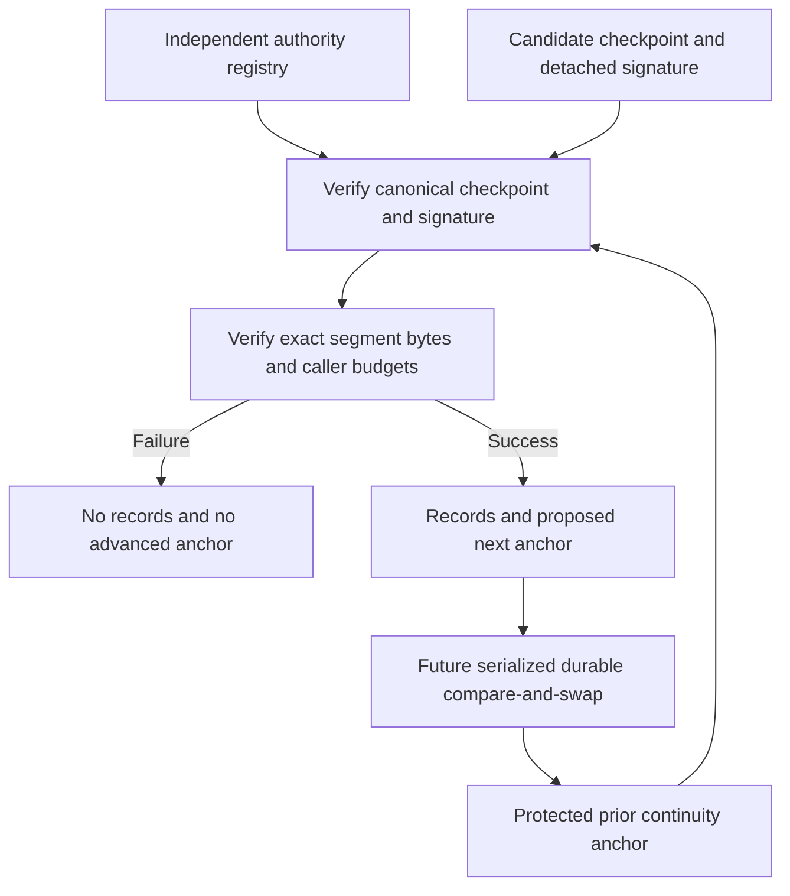

# Authenticated journal segment checkpoints

Status: inactive WP03 contract for v5.00.0, building on the
[event journal frames](EVENT_JOURNAL.md). This slice authenticates bounded
segment statements and verifies their exact bytes against independently
provided trust. It does not implement durable storage, key provisioning,
retention or production ingestion. Stable remains v4.10.4.

## What is authenticated

`syswarden.journal-checkpoint.v1` contains a checkpoint ID and local sequence,
signer key ID, journal ID, exact cluster/node/membership epoch, preceding
checkpoint digest, start/end journal positions, segment byte count, declared
recording time and clock quality. The two positions contain the next frame
sequence and preceding frame SHA-256. A checkpoint covers one contiguous
bounded segment. It is not an inventory of all historical segments.

The canonical document is compact Go struct-order JSON, at most 4,096 bytes,
with no final newline. Every field is required. Duplicate keys, aliases,
unknown fields, malformed Unicode, nulls and noncanonical formatting are
rejected. Numeric quantities are exact decimal strings, not JSON numbers.
This encoding is not JCS. Format changes require a new version and fixtures.

The signature is 64 raw bytes of ordinary Ed25519 over the concatenation of
ASCII `syswarden/journal-checkpoint/v1`, one zero byte and the exact canonical
document. It is not a signature of a digest, Ed25519ph or Ed25519ctx. There is
no algorithm negotiation. The implementation uses Go's standard
[crypto/ed25519](https://pkg.go.dev/crypto/ed25519@go1.26.9), implementing the
Ed25519 scheme specified by [RFC 8032](https://www.rfc-editor.org/rfc/rfc8032).
Public keys must have the exact 32-byte size before verification is called.

`JournalCheckpointSigningMessage` returns the message for a future authorized
signer. It neither handles a private key nor signs anything. Its existence does
not authorize a writer to sign uncommitted data. The future durable writer
must establish the exact committed bytes before requesting a signature.

`previous_checkpoint_sha256` hashes the preceding canonical document, without
the domain prefix or signature. The independently provided initial digest may
use a deployment-specific trust convention. Zero digits and sequence one are
not automatically trusted. Checkpoint IDs are signed labels, not a global
uniqueness registry or a substitute for continuity validation.

## Independent authority and continuity

The reader supplies both of these from trusted state, never from the candidate:

| Input | Required binding |
| --- | --- |
| `JournalCheckpointAnchor` | Exact journal cursor at the start, next checkpoint sequence and preceding checkpoint document digest. |
| `JournalCheckpointAuthority` | Same journal and cluster/node/epoch, authorized key ID and public key, and explicit inclusive checkpoint sequence range. |

The authority resolver must establish enrollment, the key's origin and its
authorization for that exact scope. It must apply the appropriate revocation
policy at the time of the operation. This package does not discover keys,
fetch URLs, read key files, enroll nodes, manage a registry or implement
revocation distribution. An untrusted key ID is never sufficient to choose
an authority. A well-formed public key alone does not confer permission.

Key rotation is an independent authority decision. The new key can be
authorized from a precise checkpoint sequence; the old key's allowed range
can end immediately before it. A document cannot extend that range, change
membership epoch or enroll its replacement key. The checkpoint hash chain
continues across an authorized rotation. No production rotation service is
introduced here.

Both frame and checkpoint sequences increase within one journal and membership
epoch. Checkpoint sequences range from 1 through 2^64 - 2. The proposed next
anchor can reach 2^64 - 1 only as an exhausted state, which cannot verify a
further checkpoint. Counter gaps, rollback, replay and a substituted preceding
digest fail against the expected anchor. No timestamp-based ordering or
numeric comparison of opaque membership epochs is used.

Recording time is signed declared metadata, not a trusted timestamp. Clock
quality remains `unknown`, `synchronized` or `unsynchronized`. Historical
signature and segment verification do not expire merely because a host was
offline. Freshness for live displays or actions must be established separately;
a recently presented historical checkpoint does not make observations current.

## Metadata verification and complete segment reads

`VerifyJournalCheckpoint` checks canonical shape, exact trust scope and next
continuity position, the key's authorized sequence range and the signature.
It returns metadata and a proposed next anchor only on success. It does not
read the segment, prove persistence or update any trusted state.

`ReadAuthenticatedJournalSegment` takes raw checkpoint bytes and a detached
signature and performs verification itself. It does not accept a mutable
object labeled verified as a substitute. It then requires the declared exact
byte count and validates the entire segment against its signed start and end
positions, subject to the caller's explicit byte/frame budgets. A failure
returns no records and no next anchor. Prefix inspection for recovery remains
a separate operation that preserves all unverified bytes.

A successful metadata signature can describe false or absent storage. Only
the complete segment read checks the supplied bytes; even that does not prove
that any filesystem synchronized them. Consumers must not commit a new
continuity anchor after metadata verification alone.

An empty segment requires identical frame positions and zero bytes. It still
advances the checkpoint counter and checkpoint digest, so replay of an old
empty checkpoint fails against the new anchor. Nonempty segments contain at
most 1,024 frames and at most 8 MiB. The inherited frame parser remains bounded;
the checkpoint does not override a stricter caller budget.

## Limits that integration must preserve

The anti-rollback property is relative to the independently retained anchor.
Replacing both a journal and its trusted anchor with old valid copies defeats
local continuity checks. Two consumers reusing the same old anchor can also
accept different correctly signed branches. This slice does not provide a
global witness, equivocation detection, consensus or concurrent-writer fencing.
The future storage authority must serialize updates and protect their durable
compare-and-swap boundary. HA ownership remains a separate established contract.

A compromised authorized signer can sign false statements. The verifier
cannot prove event source authenticity, completeness before ingestion or
durability merely from those signatures. Compromised root can also replace
local code and trust state. Externally retained anchors can support detection
but are not implemented here. Do not advertise root-tamper resistance.

Raw segments remain sensitive. Signature verification grants neither read
permission nor export permission, and it does not redact data. Historical
verification with a retired key requires an explicit independent policy;
there is no implicit acceptance of a key revoked for compromise.

## Verification and remaining work

Synthetic fixtures pin canonical metadata, public test key and detached
signature. Tests exercise altered signed fields, wrong key/domain/signature,
foreign scope, missing or replayed checkpoints, unauthorized key rotation,
empty segments, counter exhaustion, complete-frame deletion, corrupt bytes
and caller budgets. Fuzzing covers arbitrary signatures and correctly signed
but untrusted metadata. Public deterministic test keys have no operational
authority and must never be deployed.

The separate [Linux storage component](JOURNAL_STORAGE.md) adds private file
ownership, cooperating-process locking, synchronized append and authenticated
read-only reopen. It remains inactive and does not persist trusted anchors.
WP03 remains open for atomic anchor persistence, actual key lifecycle and
revocation, recovery after interruption, rotation/retention, visible acquisition loss, redaction
and measured disk-pressure/flood behavior. These component checks are not
native crash, reboot or release acceptance.

The package remains disconnected from production. BunkerWeb synchronization,
source-owned ban lifetimes, HA behavior and dashboard independence are
unchanged. No production signing or release key is used by these tests.
