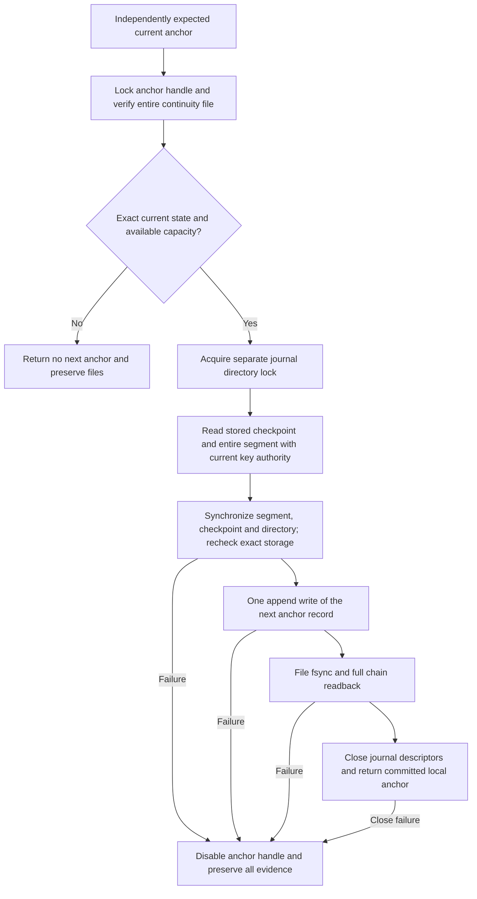

# Protected local journal continuity

Status: inactive WP03 component for v5.00.0. Stable remains v4.10.4. This adds
bounded local anchor persistence and serialized compare-and-commit after
[checkpoint publication](JOURNAL_PUBLICATION.md). It does not provision a
production authority, independently retain a trusted restart head, or integrate
with event ingestion. No server deployment is changed.

## Trust supplied by the caller

`AnchorStore` receives a descriptor for a separately provisioned private
directory. The authority directory must be distinct from the segment directory
and inaccessible to untrusted event producers. The implementation requires exact
0700 directory and 0600 regular-file modes, effective-UID ownership, one file
link, no-follow relative operations and a separate nonblocking directory lock.
It never changes ownership or permissions, resolves ancestors or adopts a file
because its name resembles a product artifact.

These checks do not establish operating-system privilege separation. Deployment
must establish the directory's provenance, protect its ancestors and give only
the continuity authority write access. The same UID or root can defeat this local
boundary. There is no global witness, HA fencing, TPM monotonic counter or claim
of protection against replacing both history and trusted restart state.

The initial anchor and the expected current anchor must come from independent
trusted state. Zero digests, sequence one, a valid signature, a mutable
`Publication.Next`, or a file found on disk never enroll that trust. Key authority
and current revocation policy remain external decisions for each commit.

## Explicit bootstrap and exact resume

`CreateAnchorStore(directory, initial)` is an explicit caller-authorized bootstrap.
It exclusively creates `continuity-v1.swa`, writes one complete initial record,
synchronizes the file and directory and verifies the result. Existing files,
links and special objects block creation and remain untouched. A failed attempt
is never followed by automatic deletion or reinitialization.

`OpenAnchorStore(directory, initial, expected)` verifies the complete bounded
chain against the exact initial anchor and requires its final anchor to equal
the independently expected value. It then synchronizes the accepted file and
directory before returning a writable handle. An absent file, partial record,
extra complete record or different expected head prevents resume. It does not
search for the newest-looking record or silently repair an interrupted tail.

If a previous operation returned an uncertain result, obtaining a new expected
head is a separate recovery authorization. Reading an unexpected candidate and
passing it back as `expected` would bypass the intended trust boundary. The
ordinary resume path remains unchanged. A separate
[reviewed recovery operation](JOURNAL_RECOVERY.md) can resynchronize exactly one
complete extra record after full publication authentication and independent
approval of the exact plan. An inactive [custody coordinator](JOURNAL_CUSTODY.md)
now orders independent prepared intents, local commits and final custody state.
An inactive [local backend](LOCAL_CUSTODY_STORAGE.md) now supplies the protected
ledger; production authority provisioning and native IVV remain outstanding. A complete record is still rejected by ordinary
resume against the old expected head, even if its checksum is valid. Absence of
a record likewise does not authorize resetting the bootstrap.

## Compare, verify storage, then persist

`CommitPublished` compares the expected head under the handle mutex and the
authority directory lock. It opens the actual stored publication, rejects its
pending path, verifies the independently authorized signature, journal/node/epoch,
checkpoint sequence and complete segment bytes, and resynchronizes those files
and their directory. This establishes a new local synchronization decision even
when a complete historical file was left by a publisher that exited before its
own directory-sync acknowledgement.

Only then does the store append the derived next anchor with one kernel write.
File sync, metadata checks and full bounded readback must succeed. The readback
must match the expected final chain digest, count and head. The journal lock is
held until this work ends; closure errors also prevent acknowledgement. There
is no API for committing a caller-supplied next anchor or publication receipt.
The caller must close the publisher's segment handle before requesting commit.

Lock order is authority then journal, with nonblocking process locks. In-process
requests are serialized. Two requests using the same expected head cannot both
advance it; the second fails the comparison. These locks coordinate cooperating
local processes, not untrusted same-UID writers or remote peers.

## Bounded private file format

The append-only file contains at most 1,024 records, including bootstrap. Each
record is a four-byte big-endian document length, a canonical document of 1 to
2,048 bytes and a 32-byte chained SHA-256 checksum. The file ceiling is 2,134,016
bytes. Reads reject an oversized file before allocation. There is no scan past
corruption, resynchronization, trailing padding or accepted valid prefix.

The document is compact Go struct-order JSON with no newline. Its fields, in
order, are `schema` (`syswarden.journal-anchor.v1`), `journal_id`, `identity`,
`position`, `checkpoint_sequence` and `checkpoint_sha256`. Identity uses the
existing cluster/node/epoch structure; position uses the existing exact decimal
frame sequence and prior digest. Checkpoint sequence is an exact decimal string.
Unknown fields, duplicates, null aliases and alternate encodings are rejected by
exact canonical re-encoding. Numeric limits are checked before conversion.

The checksum hashes ASCII `syswarden/journal-anchor-record/v1`, one zero byte,
the previous record's 32 checksum bytes, then the exact document. Bootstrap uses
32 zero bytes as the checksum predecessor, not as an implicit trust decision.
Every later record must advance the checkpoint sequence exactly once and retain
the same journal and membership. Frame sequence advances by at most 1,024;
an empty segment retains the exact frame cursor while advancing the checkpoint.

This checksum detects corruption; it is not a signature, MAC or independent
proof of authority. The file's protected provenance and independently supplied
initial/current anchors provide the local trust boundary. It is private state,
not a public evidence export. It does not inventory segment paths or replace the
future retention/indexing contract.

Capacity exhaustion returns an explicit error without eviction. Migrating or
compacting this file requires a future authorized protocol. The fixed ceiling
bounds this component, not the total number of stores a caller can provision or
all decoded event allocations. Counter exhaustion cannot wrap or reset epochs.

## Failure evidence and remaining acceptance

Short writes, ENOSPC, I/O errors, failed synchronization, readback mismatch,
changed metadata and closure errors return no next anchor. Once a commit becomes
uncertain, the handle refuses further commits and current-state reads. Every
existing byte is retained; there is no automatic retry, truncate or rollback.
Preservation means no deliberate cleanup, not a guarantee that unsynchronized
bytes survive power loss. Preflight signature, scope, capacity and expected-head
rejections leave an otherwise valid store usable.

Synthetic tests cover complete and partial unacknowledged tails after process
exit, concurrent stale requests, replay, corrupt and unsafe files, bootstrap
failure, capacity, sequence exhaustion, signature/key/scope failures, stricter
segment budgets and injected write/sync/readback/close failures. The parser has
a fixed-budget fuzz target, including 32-bit length handling checks.

These checks do not establish physical power-loss durability, native reboot IVV,
full-disk acceptance, authority service isolation or complete WP03 recovery.
Production custody provisioning, partial/corrupt-tail recovery, key lifecycle,
rotation/retention, visible acquisition loss, redacted exports and deployment IVV
remain open in #225. Shared consumer integration remains open in
#224. BunkerWeb synchronization, source-owned TTL, retries, HA and independence
from dashboard identity remain unchanged.
