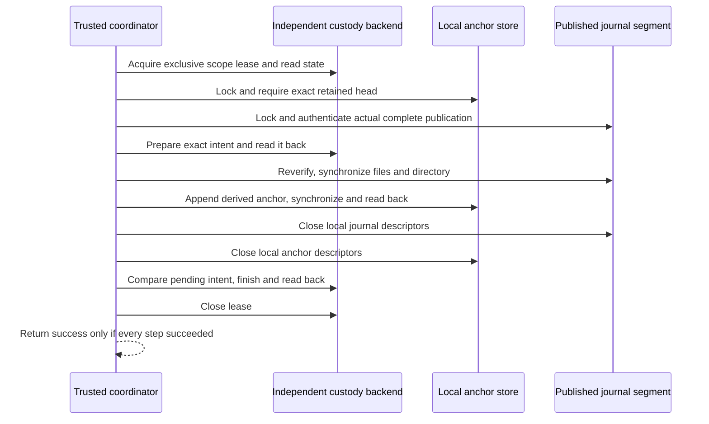

# Coordinating independent journal restart custody

Status: inactive WP03 component for v5.00.0. Stable remains v4.10.4. This slice
implements a coordinator and an explicit trusted-backend contract. It does not
provision an authority, expose an operator endpoint or connect the journal to
production. An inactive [local filesystem backend](LOCAL_CUSTODY_STORAGE.md) now
implements the contract with explicit enrollment and a bounded protected ledger.
The original in-memory backend double remains test-only.

The [local continuity store](JOURNAL_CONTINUITY.md) requires independent initial
and current anchors. Its [reviewed recovery](JOURNAL_RECOVERY.md) can resynchronize
one complete extra record but cannot, by itself, retain the resulting restart
state independently. Coordinating these two storage boundaries requires an
explicit interrupted-operation protocol. Calling two successful writes an atomic
transaction would hide the interval between them.

## Independent authority and custody

`RestartCustody.Acquire` grants an authorized, bounded, exclusive local lease for
one independently provisioned journal/node/epoch scope. `RestartLease.State`
returns the original anchor, current retained head, current scoped key authority
and either no pending intent or exactly one intent. None is inferred from the
journal directory, continuity file, a publication receipt or a caller-supplied
next anchor. A missing backend or invalid state fails closed.

The backend is part of the trusted computing base. Its requirements are not
optional implementation details:

- Provision scope, storage provenance, initial head and key policy through an
  independent authenticated authority. Never silently bootstrap from evidence.
- Exclude journal producers from custody storage and protect its ancestors and
  credentials. Establish OS isolation separately from the existing file-mode
  checks. Root compromise or replacement of both history and independent state
  remains outside the local threat model.
- Serialize every writer and key-policy change across processes until lease
  closure. Acquisition must be nonblocking or bounded. A lease cannot silently
  expire while the coordinator holds it. Remote leases and HA fencing are not
  implemented by this interface.
- Return owned key bytes and authoritative durable state. A cached success or
  the arguments of the preceding write are not sufficient readback evidence.
- `Prepare(intent)` atomically compares the current head with `intent.Before`,
  requires no pending work and durably records the exact intent before success.
- `Finish(intent)` compares the complete pending intent, atomically advances the
  head to `intent.After` and clears the pending intent before success. It must
  preserve the initial anchor and current authority. There is no blind update,
  reset, automatic cancellation or fallback to a zero digest.
- Treat write errors as possibly persisted operations. Retain the resulting
  state, release leases on every exit and never convert uncertainty into a retry.
- Authenticate recovery principals, enforce scope and current approval policy,
  and durably audit authorization. `AuthorizeRecovery(digest)` checks an
  independently recorded approval. The digest itself is not a credential.
- Prove bounded storage, transaction durability, rollback resistance and process
  failure behavior before any production activation. A same-process memory map,
  a second unprotected file or an acknowledgement without persistence does not
  satisfy this contract.

The current coordinator checks state shape, scope, comparisons and readbacks. It
cannot make a dishonest or faulty backend durable, isolated or authenticated.
There is deliberately no permissive built-in backend.

## Prepare, commit locally, finish custody

A `CustodyIntent` binds the exact before/after anchors, segment basename, whole
segment and checkpoint-bundle SHA-256 values, byte/frame budgets, key ID,
public-key digest and authorized sequence range. It contains no private key or
raw event payload. It is private coordination state, not a new public wire
schema. A backend must retain every field exactly. The local backend specifies
its private persistent codec separately.

`CommitCustodiedPublication` holds the custody lease for the entire operation.
Lock order is custody, anchor directory, journal directory. It derives the next
anchor from the actual signed publication with the independently resolved key.
It does not accept a mutable `Publication.Next` or an application-provided next
anchor. It compares custody again before preparing and verifies the prepared
state before any new local anchor is appended.

After preparation it rechecks the publication, synchronizes its files and
journal directory, checks the complete local continuity state, then appends and
synchronizes the derived anchor. It closes the local handles before finishing
custody. The custody lease still excludes all integrated writers during this
interval. Production integration must route every writer through this lease;
mixing direct low-level anchor writes with the coordinator violates the trust
contract. Advisory file locks cannot stop an untrusted same-UID writer.

Success requires exact final custody readback and successful lease closure.
Any error returns a zero result. No phase is automatically retried and no stored
bytes are removed, repaired, truncated or rolled back. A publication rejected
before preparation leaves custody stable. An uncertain prepare can leave a
pending intent even when no local append occurred.

## Interrupted-operation matrix

| Last independently retained state | Observed local state | Permitted behavior |
| --- | --- | --- |
| Stable head, no intent | Exact matching complete continuity | `ResumeCustodiedAnchor` verifies and synchronizes local state before returning the retained head. |
| Stable head, no intent | Unexpected complete or partial tail | Refuse ordinary resume. Local bytes cannot authorize new custody. |
| Pending intent | No extra local anchor | Block resume and further commits. Cancellation or re-execution requires a future reviewed protocol. |
| Pending intent | Partial, corrupt, missing or multiple extra anchors | Preserve evidence and refuse this recovery path. |
| Pending intent | Exactly one complete extra anchor matching the exact authenticated intent | Inspect a private plan, require independent approval, resynchronize locally, then finish custody. |
| New stable head, intent cleared, caller received an error or no reply | Complete local continuity matching the new retained head | Resume from independent custody after full local verification. Do not repeat the old commit. |
| New stable head | Missing, changed or older local continuity | Refuse resume. Do not roll custody back to match disk. |

A prepare, finish, readback or closure failure can occur after durable progress.
The error alone cannot distinguish every interval. A subsequent authorized
operation reads custody anew. It never chooses the newest-looking local head.
Pending state blocks even when the old local head remains intact. This is an
intentional availability cost: the coordinator does not guess whether a failed
operation executed.

## Reviewed recovery with custody

`PlanCustodiedRecovery` obtains its initial/current anchors, publication selector,
budgets and key authority from the independently retained pending state. It
requires the existing one-complete-extra-anchor recovery conditions and compares
the authenticated publication against every intent field. Read-only inspection
neither writes nor synchronizes local artifacts. It returns owned private plan
bytes only after local handles and the custody lease close successfully.

`ApplyCustodiedRecovery` reconstructs the plan and compares its exact approved
digest before invoking the backend's independent authorization policy. It then
checks custody again, resynchronizes the publication and complete anchor with the
existing recovery operation, closes local handles, and finishes the exact pending
intent. A changed key policy, intent, publication or resource invalidates the
operation. Revocation must never be bypassed to make a pending transaction finish;
a key-policy change that makes the intent ineligible requires separate review.

Passing the digest from a freshly returned plan straight to Apply is not approval.
The backend must reject that request unless the independent principal/scope-bound
approval exists. Dashboard authentication is not implemented by this component.
The future authority can be local and operate without the optional dashboard.

Once custody has advanced and cleared the intent, repeating recovery with the old
plan fails before authorization. This does not change the lower-level recovery
API's idempotent resynchronization contract. Single-use decision records, audit
retention and recovery UI remain backend and service responsibilities.

## Verification and remaining work

Synthetic tests use real private journal files and a deliberately nonpersistent
custody double. They exercise empty/nonempty publications, exact ordering,
concurrent requests, preflight failures, every custody read boundary, ambiguous
prepare/finish outcomes, partial and complete local writes, sync and close
failures, changed publications, mismatched intents, authorization denial,
revocation, stale plans and zero-result error behavior. Full-core regression
continues to cover existing BunkerWeb behavior.

These checks validate coordination behavior, not physical power-loss safety or
production activation. The local backend has separate component tests. Authority isolation,
bootstrap, key lifecycle, recovery for prepared-but-unwritten and partial/corrupt
tails, retention, visible acquisition loss, redacted exports and native IVV remain
open in #225. Shared consumer integration remains open in #224. This component
does not change BunkerWeb synchronization, source-owned bans, TTL, retry/HA
semantics or independence from dashboard identity. Neither issue is complete.
