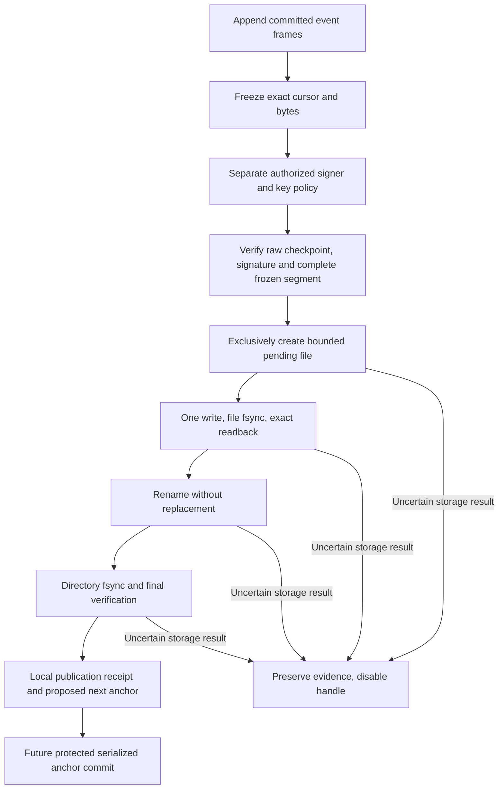

# Frozen journal checkpoints and durable publication

Status: inactive WP03 component for v5.00.0. This extends the
[Linux segment store](JOURNAL_STORAGE.md) with a serialized freeze boundary,
bounded checkpoint/signature persistence and authenticated historical reopen.
Stable remains v4.10.4. No production path imports this component.

## Separate the three decisions

1. `Freeze(expected)` checks the exact current cursor and verifies a complete
   snapshot under the handle mutex, then disables further append. The directory
   lock remains held. A stale request returns no snapshot and does not freeze
   newer data. Repeated freeze is read-only; there is no unfreeze operation.
2. `PublishCheckpoint` verifies an independently authorized signature against
   those exact frozen bytes, writes a private candidate, synchronizes it and
   publishes it without replacing an existing checkpoint. Only complete success
   returns a local publication receipt.
3. A future protected continuity authority must compare and durably commit the
   proposed next anchor against its exact prior state. This final decision is
   not implemented by either preceding operation. The separate
   [local continuity store](JOURNAL_CONTINUITY.md) supplies a bounded commit
   primitive with independently supplied bootstrap and restart expectations.

The signer is outside this package. No private key, enrollment, revocation
resolver or automatic signing service is introduced. Supplying a public key
does not establish its authority. The existing
[checkpoint trust contract](JOURNAL_CHECKPOINT.md) still requires independent
journal/node/epoch scope, key authorization and prior continuity.

Publication requires a frozen segment created by the current handle. A handle
opened for historical reading cannot publish. Both the signed start and end
must match the handle's receipt, including for an empty segment. Concurrent
publication requests are serialized and cannot replace each other's artifact.

## Bounded local file format

For an already validated segment basename, the final checkpoint name is the
basename plus `.checkpoint`; the candidate adds `.pending` to that name.
These names are derived internally. They carry no independent authority and
never select a key or establish a trusted initial anchor.

One binary file contains the canonical checkpoint and detached signature:

| Field | Exact encoding |
| --- | --- |
| Magic/version | Eight bytes: ASCII `SWJCP1` followed by two zero bytes. |
| Document length | Four-byte unsigned big-endian integer, 1 through 4,096. |
| Checkpoint | Exact canonical `syswarden.journal-checkpoint.v1` bytes. |
| Signature | Exactly 64 raw Ed25519 signature bytes. |

The maximum file size is 4,172 bytes, with no trailing data or padding. The
decoder checks bounds before conversion/allocation and rejects incomplete
files, unknown magic, malformed lengths and noncanonical metadata. Decoding
alone does not verify the signature. Existing signature semantics remain
unchanged: the fixed domain and canonical checkpoint, not this transport
envelope, are signed. The segment's exact content remains bound by that signed
checkpoint and its independently supplied continuity context.

The private directory descriptor, effective-UID ownership, exact 0700 directory
and 0600 regular-file modes, single-link requirement, no-follow operations and
independent directory lock retain the storage component's rules. No permission
repair, ownership takeover, ancestor provisioning or filename-based adoption
is performed. Existing pending or final paths, including links and special
files, are preserved and block publication.

## Publication ordering and interruption

Signature, scope, exact segment bytes and both cursor boundaries are checked
before creating a candidate. A preflight rejection leaves the frozen segment
available for inspection or a corrected authorized statement. Attempting file
creation begins the uncertain storage boundary: a reported filesystem error
must not be interpreted as proof that no artifact exists.

The publisher exclusively creates the candidate, issues one kernel write,
requires file `fsync`, reads back the exact bytes and rechecks the segment. It
then uses Linux `renameat2(RENAME_NOREPLACE)`, synchronizes the directory,
verifies the final file and segment, and checks file closure before returning.
There is no fallback to an overwriting rename on unsupported filesystems.
Linux documents both the no-replacement flag and its filesystem requirement
in [rename(2)](https://man7.org/linux/man-pages/man2/rename.2.html); directory
entry persistence additionally requires [fsync(2)](https://man7.org/linux/man-pages/man2/fsync.2.html).

Short writes, storage exhaustion, I/O errors, failed sync/rename/readback/close
and unexpected identity or content changes return no publication receipt or
next anchor. The handle is disabled, files are preserved, and no operation is
retried, truncated, repaired or deleted automatically. An existing checkpoint
that races publication cannot be overwritten by the no-replace rename.
Preservation means no deliberate removal or rewrite; failed synchronization
does not guarantee that the retained bytes will survive a physical power loss.

| Observed state after interruption | Interpretation |
| --- | --- |
| No checkpoint path | Publication is not established; inspect the segment and independent state. |
| Pending path | Incomplete attempt, even if its bytes parse and its signature verifies. Preserve it for explicit recovery. |
| Complete final path | Potentially readable historical evidence; its presence alone does not prove that the publisher acknowledged directory sync. |
| Pending and final paths | Ambiguous retained state; published reopen refuses it. |
| Complete final path plus a protected matching continuity commit | Future authority integration may establish accepted continuity after verifying its own commit contract. This component does not make that decision. |

`OpenPublishedSegment` holds the directory lock, rejects a pending path, bounds
and attests the final file, verifies its signature against independently supplied
prior trust and checks the entire segment. A successful handle is read-only.
The function neither retries publication nor changes any trust state. It can
read a complete valid final file after a process died before directory sync;
this is deliberately a historical read, not a new durability acknowledgement.
The lower-level `OpenSealedSegment` remains a verifier of caller-supplied
checkpoint bytes, not a validator of this on-disk publication inventory.

## Limits and validation

Tests cover freeze/append races, wrong or stale cursors, unfrozen/historical
publication, empty foreign scope, wrong signed boundaries, concurrent attempts,
all truncated bundle lengths, hostile sizes, aliasing, unsafe files and replay
against the wrong prior context. Faults exercise each storage phase, including
full writes followed by errors, no-replace collisions and unsupported rename.
Subprocesses exit immediately before or after rename to exercise actual process
lock release and retained-file interpretation. Parser fuzzing has a fixed
execution budget and two workers.

These are component and local process tests, not proof of physical power-loss
durability, full-disk behavior or native reboot acceptance. Effective persistence
still depends on the qualified filesystem and device contract. Directory locks
coordinate cooperating local processes; they do not fence HA peers or root.

The receipt's `Next` field is a proposal, not an authenticated mutable token or
permission to overwrite trusted state. The future anchor authority must rebind
its operation to exact verified storage, serialize compare-and-commit, preserve
uncertain outcomes and reject stale expected anchors. It must define bootstrap,
crash recovery, rotation, retention and protection against anchor replacement.
Replacing both history and its prior trusted state still defeats local rollback
checks. No global witness or root-tamper resistance is claimed.

The [local continuity component](JOURNAL_CONTINUITY.md) now reopens and
resynchronizes actual published storage before a bounded anchor append. It
requires independently protected initial/restart state and does not provision
that authority or resolve uncertain outcomes automatically.
[Reviewed complete-anchor recovery](JOURNAL_RECOVERY.md) adds a separate exact-plan
resynchronization path, without modifying published bytes.

WP03 remains open for authority integration, production key lifecycle, interrupted-tail
recovery, retention, explicit acquisition loss, redacted exports and native IVV.
BunkerWeb synchronization, source-owned temporary bans, TTL, retries, HA and
independence from the future dashboard remain unchanged. Refs #225 and #224.
