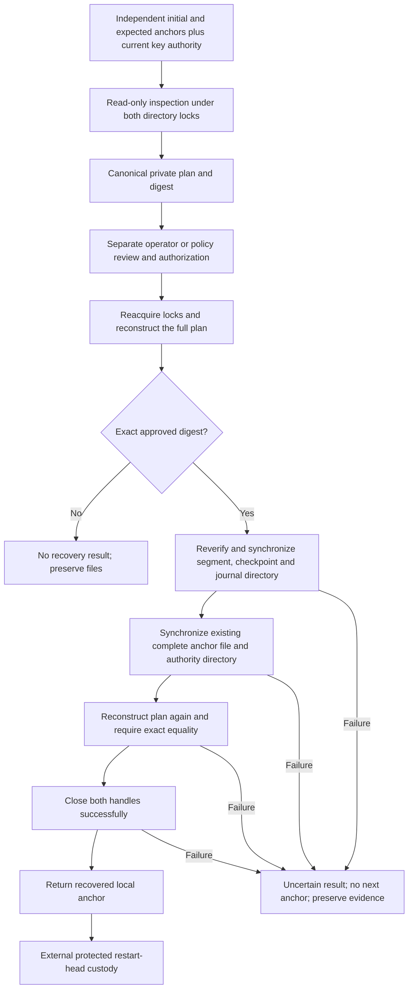

# Reviewed recovery of a complete journal anchor

Status: inactive WP03 component for v5.00.0. Stable remains v4.10.4. This adds a
bounded recovery operation to the [local continuity store](JOURNAL_CONTINUITY.md).
It does not create an operator command, enroll an authority, independently retain
a restart head, or integrate with production ingestion. No server state changes.

## One eligible recovery case

An interrupted commit can leave a complete anchor record even though no success
was returned. Ordinary resume correctly rejects that unexpected head against the
last independently retained state. Recovery now supports exactly one complete
record after that state, provided that all of these conditions hold:

- The whole bounded anchor file is canonical, checksum-valid and continuous
  from the independently supplied initial anchor.
- The complete prefix before its final record ends at the exact independently
  supplied expected head. There cannot be two or more unexpected records.
- The final record equals the next anchor independently derived from the stored
  checkpoint signature and complete segment bytes, using caller-resolved current
  key authority for the exact journal, node, membership epoch and sequence range.
- The publication has no pending checkpoint path, and all files and directories
  satisfy the existing private ownership, mode, link and no-follow contracts.
- An independent authorization path approves the exact inspection-plan digest.

Partial or corrupt tails, missing artifacts, pending publication, wrong keys,
foreign scope and longer unexplained histories receive no plan. They remain
intact for a different recovery procedure. This operation never truncates,
appends, repairs, replaces, reinitializes or deletes any stored bytes.

The candidate is observable evidence, not authority to update trusted state.
Reading it and passing it directly to `OpenAnchorStore` would still bypass the
review boundary. Files do not authorize their own recovery.

## Inspect without synchronization or mutation

`PlanAnchorRecovery` locks the authority directory, then the separate journal
directory, using the established independent nonblocking process locks. It opens
both data files read-only, validates the complete ledger and publication, and
returns owned canonical plan bytes plus their digest. It performs no explicit
write or synchronization and closes both handles before returning. Normal read
access-time effects are outside the plan binding.

The private plan has schema `syswarden.journal-anchor-recovery.v1` and operation
`resynchronize-complete-anchor`. It includes:

| Binding | Purpose |
| --- | --- |
| Initial, expected and candidate anchors | Display the exact independently known context and proposed recovery result. |
| Complete anchor, segment and checkpoint-bundle digests | Bind all reviewed stored bytes, including the signature envelope. |
| Record count, segment name and byte/frame budgets | Preserve the bounded operation and selected publication. |
| Key ID, public-key digest and sequence authorization range | Require the same explicitly reviewed key scope, reverified at application. |
| Directory and file device/inode, ownership, mode, link count, size and modification/change timestamps | Reject an altered or substituted local resource even when its content is copied exactly. |

The plan is compact Go struct-order JSON, at most 16,384 bytes, without a trailing
newline. Numeric values are exact decimal strings. Its SHA-256 covers ASCII
`syswarden/journal-anchor-recovery/v1`, one zero byte, and the exact document.
This is a domain-separated review digest, not a signature or authentication
token. The API never accepts a mutable returned plan as proof of authorization.

The plan contains local storage identifiers and continuity metadata. Keep it
private; it is not a redacted public export. Raw events and private keys are not
included. Displaying or approving it still requires a future authorized operator
interface with appropriate scope and audit records.

## Apply only the reviewed state

`ApplyAnchorRecovery` requires the exact lowercase 64-character digest through
an independent authorized path. It obtains fresh descriptors, reconstructs the
plan, revalidates the actual signature and bytes, and compares the digest before
synchronizing anything. A copied file, changed trust range or different storage
budget invalidates the earlier approval. The caller must resolve current key
authorization and revocation policy for each call; this package does not query a
registry or make a stale caller-supplied key current.

Application synchronizes the verified publication first, then the already
complete anchor file and its directory. It reconstructs the plan once more and
requires exact equality before closing the handles and returning the recovered
anchor. Failed synchronization, metadata changes, readback errors or close errors
return no anchor. There is no automatic retry after an uncertain result.

Repeating an authorized resynchronization of exactly the same unchanged files is
idempotent: it can return the same local result, never append another record or
advance twice. Single-use approval tracking is an external policy responsibility.
Once another anchor has been committed, the old expected head and plan no longer
meet this operation's one-record condition. Normal commit and recovery use the
same authority-directory lock, so cooperating processes cannot mutate it during
an inspection or application.

## Authority and acceptance still outstanding

The returned value establishes successful local resynchronization under the
filesystem contract. Persisting it in independent protected restart-head custody
requires a separately designed atomic protocol. Neither a digest supplied by an
untrusted caller nor a human-looking approval string supplies that authority.
The future service must authenticate the principal, enforce scope and approval
policy, bind review to the exact displayed document and record the decision.
No dashboard authentication or automatic recovery worker is introduced here.

Same-UID or root compromise, replacement of both history and independent trust,
global equivocation and HA fencing remain outside this local protection model.
Filesystem/device power-loss behavior still requires native IVV. Synthetic
tests cover exact inspection/application, empty and nonempty segments, preceding
committed history, read-only descriptors, stale and substituted plans, concurrent
calls, signature/scope failures, incomplete and extra tails, synchronization
ordering, injected failures and immutable-byte preservation. A fixed-budget
fuzz target checks structural tail eligibility, without treating structural
success as signature verification or recovery authorization.

WP03 remains open for independent authority provisioning and restart-state
custody, partial/corrupt-tail recovery, production key lifecycle, retention,
visible acquisition loss, redacted exports and native IVV. BunkerWeb API,
source-owned TTL, retries, HA and dashboard independence are unchanged.
Refs #225 and #224; neither work package is complete.
