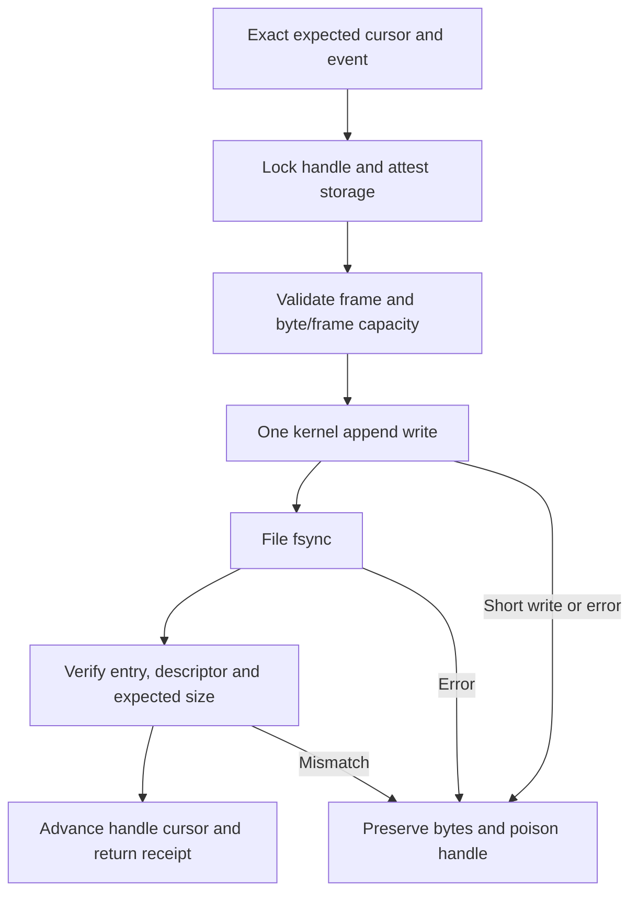

# Bounded Linux journal segment storage

Status: inactive WP03 component for v5.00.0, following the reviewed
[frames](EVENT_JOURNAL.md) and [checkpoint verifier](JOURNAL_CHECKPOINT.md).
The core `journal` package now performs real file I/O, ownership checks,
cooperating-process exclusion and synchronized append. It has no production
consumer. The current stable release remains v4.10.4.

## Storage and authority boundary

The caller supplies an independently trusted, already opened directory. The
component does not provision that directory, resolve its ancestors, establish
node membership or create an authority from a path name. Provisioning must
exclude untrusted ancestor replacement and choose a suitable local filesystem.
Directory ownership must match the effective UID, with exactly mode 0700 and
no special permission bits. Files must be regular, owned by the same effective
UID, mode 0600, with one link and no special bits. Metadata failures never
trigger chmod, chown, unlink or an attempt to take ownership.

Names are exactly `segment-` followed by 32 lowercase hexadecimal digits and
`.swj`. Names carry no security authority. New creation is exclusive; an
existing name is never replaced. Opening existing history requires a valid
independently authorized checkpoint and exact content verification as well as
the ownership checks. A filename, digest or private mode alone is insufficient.

Descriptor-relative operations use no-follow and close-on-exec flags. Existing
entries are checked before opening; nonblocking/no-controlling-terminal flags
avoid special-file blocking or terminal attachment, followed by descriptor and
directory-entry checks. Symlinks, hard links, special files, unsafe modes and
entry/descriptor identity mismatches are rejected. The API retains its own
descriptors; the caller must not close the supplied descriptor concurrently
with the constructor, but may close it once construction returns.

A fresh open file description on the directory holds an exclusive nonblocking
`flock` until `Close`. It deliberately does not use `dup`, which would share
lock ownership. The lock excludes other cooperating readers/writers in this
directory. It is advisory, local coordination, not HA fencing or protection
against an uncooperative process with the same UID or root. See Linux
[flock semantics](https://man7.org/linux/man-pages/man2/flock.2.html).

## Append and acknowledgement

Every constructor requires explicit byte and frame ceilings, bounded by 8 MiB
and 1,024 frames. Existing file size is checked before allocation. Each append
checks remaining capacity before writing. A full segment returns `ErrFull`;
there is no implicit eviction, rotation, retry queue or silent event drop.
The caller must make upstream loss and backpressure observable. These caps do
not bound the number of directories/files a caller creates or its input queue.

`CreateSegment` synchronizes the new empty file and then its parent directory
before returning a writable handle. Linux file `fsync` alone does not establish
directory-entry persistence; see [fsync semantics](https://man7.org/linux/man-pages/man2/fsync.2.html).
A creation failure preserves any newly created file for explicit inspection.
Retrying with the same name will not overwrite it.

An in-process mutex serializes operations. `Append` compares the caller's
expected cursor with the current committed cursor before any write, so two
concurrent requests using the same position cannot both succeed. Frames bind
exact event bytes and the existing journal/node/epoch/sequence contract.
The writer issues one kernel write without an implicit short-write retry loop.
Acknowledgement follows a complete write, successful file sync and metadata
checks. File sync also covers the changed file size; the already established
directory entry need not be synchronized after every append.

Short writes, ENOSPC, EIO, sync failures and post-write identity/size mismatches
return a zero receipt. The handle becomes unusable for append and snapshots
until closed. No retry, truncation, rollback, resynchronization or automatic
tail deletion occurs. A complete frame may exist despite an error, so callers
must not equate a failed acknowledgement with absence or blindly retry it.
Underlying OS errors remain discoverable with `errors.Is`.

Before later operations, file size, identity, ownership, permissions, links,
modification/change timestamps and current directory entry must still match.
Access time is excluded because reads can update it. Unexpected changes poison
the handle. These checks detect ordinary interference under the private-owner
model; they are not a transactional guarantee against root or a malicious
writer racing the checks. `Close` releases owned descriptors even after errors
and is idempotent. It does not retry sync or remove any artifact.

## Snapshots and reopening authenticated history

`Snapshot` reads at most the configured byte ceiling, checks metadata before
and after reading, and verifies the full frame chain against this handle's
known start/end. It returns owned bytes. A failure exposes no partial snapshot.
The snapshot is sensitive data, not a redacted export or permission grant.
Use [Freeze and checkpoint publication](JOURNAL_PUBLICATION.md) to select the
final snapshot and disable append under the same mutex. A plain snapshot alone
does not freeze appends.

`OpenSealedSegment` verifies raw checkpoint bytes and their detached signature
against independent trust, reads the bounded file and verifies all bytes and
the exact signed end position. It returns a read-only handle: `Append` returns
`ErrSealed`. This prevents extending a file already covered by a checkpoint.
It authenticates historical content; it does not claim that a previous producer
actually synchronized the file. New writes require a new segment and an
independently established continuity decision. No rotation policy is implied.

Invalid signatures, foreign scope, deleted whole frames, corrupt bytes, extra
complete frames and partial tails all prevent reopening. Failure preserves the
candidate file and releases the lock. A partially written file requires a
future bounded recovery procedure; this component deliberately cannot repair
or silently accept its valid prefix. Existing in-memory prefix inspection can
describe damage but does not authorize changing the stored evidence.

Neither `Receipt` nor `Snapshot` is a signed checkpoint or a durable trusted
anchor. The separate [publication workflow](JOURNAL_PUBLICATION.md) freezes the
segment and persists verified checkpoint/signature bytes. It does not hold keys,
sign snapshots, commit a proposed anchor, serialize persistent anchor updates
or supply a global witness. Protected anchor persistence and its ordering with
signing and segment publication remain explicit WP03 work. Replacing both
history and trusted prior state still defeats local rollback checks.

## Evidence and outstanding work

Tests use real temporary files and separate processes for advisory locking and
an abruptly exited writer with a partial frame. Injected faults cover short and
complete-but-failed writes, failed sync, failed reads and close errors. Tests
also exercise concurrent cursor reuse, capacity, modes, links, path replacement,
authenticated reopen and evidence preservation. Unsafe permission fixtures are
set explicitly so the test process umask cannot make them accidentally safe.

Successful sync means the OS/filesystem accepted the request under its storage
contract. These component tests do not prove power-loss persistence, device
cache behavior, filesystem support, retention, deployment permissions or
native crash/reboot acceptance. Volatile filesystems are not durable storage
merely because their sync call succeeds. WP03 must qualify the actual storage
profile and complete signing/key lifecycle, serialized durable anchors,
rotation/retention, interrupted-tail recovery, visible acquisition loss,
redaction and measured disk-pressure/flood behavior before integration.

BunkerWeb API authentication, source-owned temporary claims, expiry, retries,
HA rules and dashboard independence remain unchanged. No agent, browser or
enforcement path imports this component; no dependency or release version is
changed. Refs #225 and #224; neither work package is complete.
