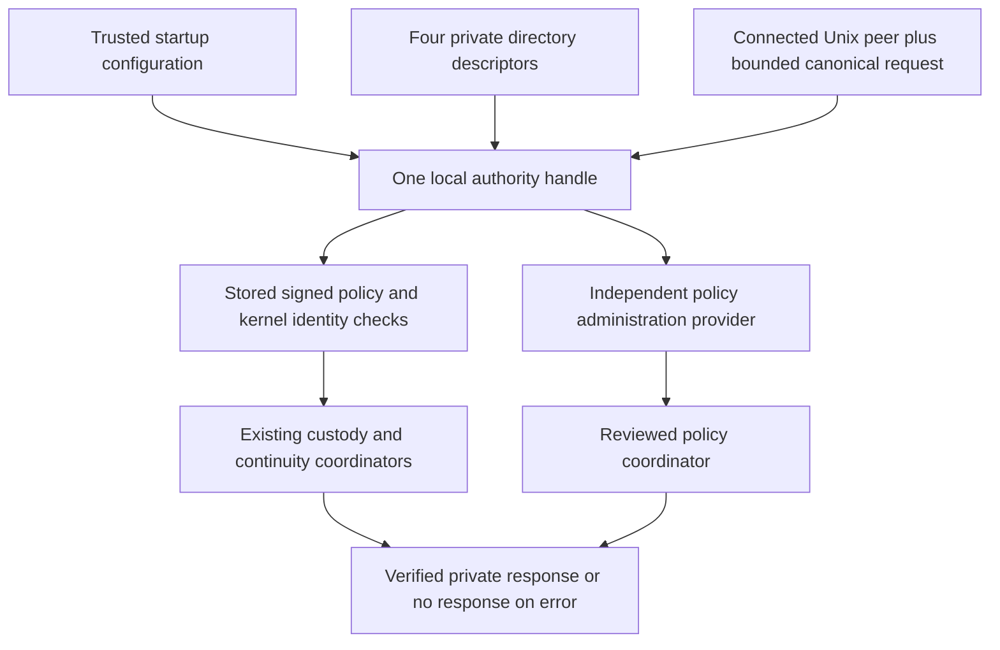

# Fixed-resource local authority composition

Status: inactive Linux v5 component. `journal.LocalAuthority` composes the
protected policy store, durable restart custody and reviewed coordinators into
one bounded request dispatcher. Production services do not import or activate
it. The current stable release remains v4.10.4. Refs #225 and #224, both partial.

## Startup ownership

A trusted supervisor supplies four distinct, already provisioned private directory
descriptors: policy, restart custody, continuity anchor and published journal.
It also supplies an independent signed-policy root, explicit journal enrollment,
segment byte/frame limits, trusted clock and separate recovery/administration
authorizers. None of these resources is selectable through request fields.

`OpenLocalAuthority` validates the root, enrollment and limits, opens its own
references to those directories, checks private ownership/mode and rejects aliasing
of the same directory. It verifies the protected policy history and checks that its
signed enrollment matches the separately supplied custody enrollment before opening
the custody ledger. Failure closes every acquired reference. No path discovery,
implicit bootstrap, account creation, file repair or default authority is supplied.

The owned key bytes and directory references survive caller-side key mutation or
closure of the original descriptors. Callback implementations are trusted shared
objects, not cloned authentication services; their implementations and mutable
state require their own isolation and synchronization. Directory identity, group,
private mode and effective owner are checked before and after each request. Actual
file entries, histories and operation preconditions retain the deeper checks of the
existing coordinators. Ancestor protection and cross-UID service isolation remain
a deployment requirement, not something a descriptor proves.

Startup can accept historically valid but disabled/expired operational policy, or
pending custody, so independently reviewed administrative/recovery paths remain
available. Ordinary operations still require current signed grants and validity.
Opening the handle is not a successful journal resume or a health attestation.



## Bounded canonical request vocabulary

Input is one complete UTF-8 JSON document, at most 18,432 bytes. The dispatcher
checks the size before making an owned copy. It accepts only its exact compact
canonical encoding: the field order below, no extra whitespace, and no unknown,
duplicate, omitted-required, explicit-null or irrelevant fields. The same strict
signed-policy rules apply inside a policy proposal. Socket framing and stream reads
are not implemented by this component.

Top-level order: `schema`, `id`, `operation`, optional `segment`, optional
`plan_sha256`, optional `change`. Schema is
`syswarden.local-authority-request.v1`. `id` is an ASCII custody-policy identifier
of 1 to 128 bytes; it is only a correlation value, never an approval or deduplication
key. There is no automatic replay or retry based on that value.

| Operation | Required operation-specific input | Existing authority boundary |
| --- | --- | --- |
| `resume` | None | Current resume grant and verified durable head. |
| `commit` | `segment` | Current commit grant, exact published segment and fixed startup limits. |
| `inspect-recovery` | None | Current inspection grant and exact eligible interrupted state. |
| `apply-recovery` | `plan_sha256` | Current apply grant, reconstructed exact plan and independent audited recovery approval. |
| `inspect-policy` | `change` | Independent administrative inspection decision, even when operational policy is disabled. |
| `apply-policy` | `plan_sha256`, `change` | Independent exact apply approval and durable decision binding with the policy transition. |

`segment` is the existing fixed basename grammar:
`segment-` followed by 32 lowercase hexadecimal characters and `.swj`. It cannot
express a directory or arbitrary filename. `plan_sha256` is exactly 64 lowercase
hexadecimal characters and does not authenticate its holder.

A change has one of two exact shapes, with fields in the shown order:

- `{"operation":"disable"}`. Current protected state supplies everything else.
- `{"operation":"install","enabled":true,"policy":<canonical signed policy>,"signature":"<128 lowercase hexadecimal characters>"}`.
  `enabled` is an explicit boolean, including `false` when proposed. The nested
  policy is at most 16,384 bytes; the signature is 64 bytes encoded in hex.

An install request may propose the signed next revision and its enabled state.
The dispatcher derives its candidate digest from the exact document and retains
the startup issuer, policy ID and initial scope. The reviewed coordinator still
verifies the issuer signature, current history, exact next revision, unchanged
enrollment and current validity. A request cannot replace a trust root merely by
embedding another valid-looking document or copying a previous approval digest.
Bootstrap, direct store writes, arbitrary signing, key rotation and file repair
are deliberately absent from this vocabulary.

Minimal request example, using synthetic data:

```json
{"schema":"syswarden.local-authority-request.v1","id":"request.fixture.1","operation":"resume"}
```

## Results, serialization and shutdown

Success returns one owned canonical JSON document of at most 65,536 bytes.
Top-level order is `schema`, `id`, `operation`, then the applicable fields below.
The schema is `syswarden.local-authority-response.v1`; ID and operation echo the
validated request. Fields irrelevant to the result are omitted.

- Resume, commit and recovery apply return `anchor` using the existing canonical
  continuity-anchor schema.
- Recovery/policy inspection return private `plan` and `plan_sha256`. Plans contain
  sensitive local state and resource metadata. They are not public diagnostic data.
- Policy apply returns `policy` with `enabled`, decimal-string `revision` and
  lowercase `sha256`. It does not return credentials, trust objects or providers.

Any error returns nil response bytes. Internal Go errors are for a trusted local
caller; a future transport must use bounded generic denials and must not echo
sensitive errors to unauthenticated requesters. Nil authorizers deny their own
operations; operational grants never implicitly grant administration. Unix peer
credentials identify the socket's creation-time process identity, not a current
human MFA session. The existing credential-delegation limitations still apply.

Each handle admits one operation at a time and immediately returns
`ErrAuthorityBusy` for competing calls. It creates no internal queue, goroutine,
connection, timer or retry loop. Separate handles retain the protected policy and
custody locks, so creating another handle does not bypass operation serialization.
This bounds active dispatcher work, not the number of connections or handles a
future service could allocate. The service must impose those limits before calling
`Execute`, along with framing, deadlines, denial auditing and rate limits.

`Close` rejects new work immediately. When an operation is active, it returns
`ErrAuthorityBusy` and enters draining state. The admitted operation retains all
owned descriptors and completes its existing verification; its finalizer closes
them. Closing again observes that drained state. Cleanup errors from draining
are returned to the admitted execution and suppress its response. The handle does
not close caller-owned peers or interrupt the trusted callback/kernel operation.
There is no hard shutdown deadline or rollback implied by close.

A late expiry, metadata change, response/close failure or transport loss can occur
after durable state changed. An error must not be interpreted as proof that no
write occurred. Preserve state and use verified resume or reviewed inspection;
never automatically repeat a mutation. The existing partial-write and uncertain
completion rules remain authoritative.

## Verification and activation work

Tests use private temporary files and real Unix sockets for all six routes,
caller key/descriptor independence, reopen, limits and trust substitution,
malformed/noncanonical input, unavailable authorizers, denied/replayed approvals,
disabled/expired policy, changed resources, separate-handle lock exclusion and
concurrent/draining close. Denied pre-write requests preserve exact stored bytes.
The new fixed-budget fuzz target exercises strict decoding, owned values and
canonical round trips. Race, Linux 386, full-core and static checks supplement these
component checks. Native IVV and physical persistence remain separate.

Before activation, implement and review OS-isolated provisioning, actual human
identity and durable audit providers, secure issuer/key lifecycle, bounded transport
and denial handling, restart/incomplete-state recovery, retention and consumer
integration. The clock and same-UID/root rollback assumptions remain unchanged.
No listener or fleet control surface is created here. BunkerWeb continues to use
its independent API, per-source claims, temporary-ban durations and retry/HA
contract, without a dashboard, identity-provider or journal dependency.

Related contracts: [Policy admission](CUSTODY_ADMISSION.md),
[Protected policy storage](CUSTODY_POLICY_STORAGE.md),
[Reviewed policy administration](REVIEWED_POLICY_ADMINISTRATION.md),
[Local custody storage](LOCAL_CUSTODY_STORAGE.md),
[Validation plan](VALIDATION_PLAN.md).

The [bounded local transport](LOCAL_AUTHORITY_TRANSPORT.md) now provides one-request
framing, I/O deadlines, accepted-peer limits and draining connection ownership.
It still requires an isolated listener/supervisor and actual identity/audit providers
before activation. The low-level dispatcher remains independent of socket I/O.
