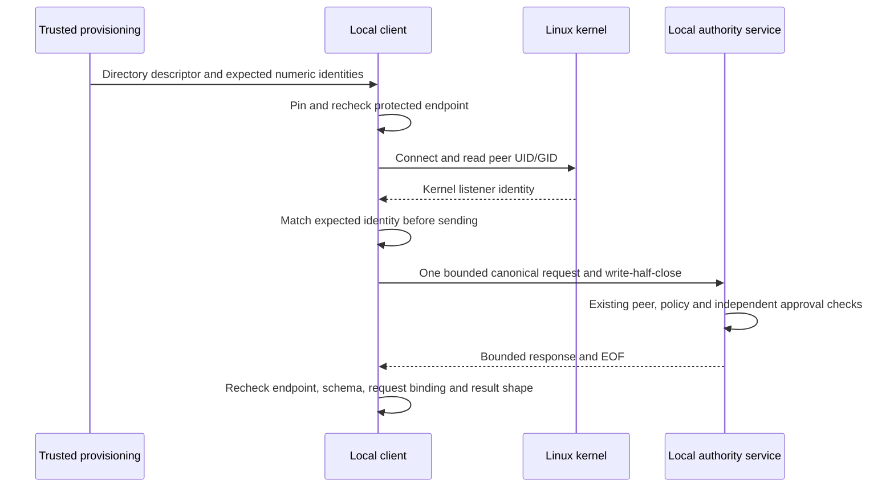

# Authenticated local authority client

Status: inactive Linux v5 component. `LocalAuthorityClient` connects to the
[bounded local server](LOCAL_AUTHORITY_SERVER.md). It checks the provisioned
endpoint and kernel service identity before sending a request, then accepts only
one bounded, request-bound response. No installed command or service activates
this client. The published baseline remains v4.10.4. Refs #224, #225 and #337,
all partial.

## Provisioning and service identity

Trusted startup supplies an open endpoint-directory descriptor, the expected
numeric service UID and process GID, the endpoint access GID and an explicit
positive timeout of at most five seconds. These values must not come from a
server reply, untrusted discovery, group-name lookup or a self-declared identity.
The process GID observed at listen time can differ from the socket access group.
Neither group membership nor a successful connection grants an operation.

Construction owns an independent directory descriptor, requires exact `0750`
mode, expected service ownership and endpoint group, and rejects POSIX access or
default ACLs. The fixed `authority-v1.sock` must be a single-link socket with exact
`0660` mode, expected owner/group and no POSIX ACL. Construction pins its device,
inode and change/modification times. It does not connect, enroll, create files,
repair permissions, bootstrap authority or lock the server's endpoint directory.

Each call checks these pins before connecting, after connecting and after reading
the reply. The descriptor-relative `/proc/self/fd` path keeps directory renaming
from redirecting a handle into a replacement directory. A changed or restarted
endpoint is rejected. A separately reviewed caller must close and explicitly
reconstruct a client from trusted provisioning; there is no automatic repinning.
The client never removes the directory, socket or any replacement entry.

Before sending any request bytes, the connected Unix peer must report exactly
the configured service UID and process GID through Linux `SO_PEERCRED`. Socket
ownership alone is insufficient. As specified by
[unix(7)](https://man7.org/linux/man-pages/man7/unix.7.html), these credentials
reflect the listener/connection identity at establishment. This is local kernel
identity verification, not executable attestation, current human authentication
or a cryptographic remote identity. A trusted service must not delegate its
listener or change identity in ways that invalidate that provisioning contract.

Provisioning must also protect the directory path and its ancestors before the
descriptor is supplied. Root or service-UID compromise, inherited or delegated
trusted descriptors, malicious provisioning, kernel compromise and mount-namespace
replacement are outside the ordinary-user claim. There is no TCP, remote endpoint,
trust on first use, implicit grant or authentication-provider implementation.

## Bounded calls and response validation

One handle permits one active call. Contention fails immediately without an
internal queue. Each call uses one fresh connection, one canonical owned request
and the [existing framing](LOCAL_AUTHORITY_TRANSPORT.md). The caller must not
modify its input concurrently with entry. No automatic reconnect or retry exists.

| Resource | Enforced boundary |
| --- | --- |
| Active calls | One per handle; additional calls are refused. |
| Request body | Existing canonical vocabulary, 1 through 18,432 bytes. |
| Response body | At most 65,536 bytes, bounded before allocation. |
| Socket exchange | One absolute configured deadline, at most five seconds, covering dial, send, receive and final EOF. |
| Connection | One request and one response, then close. |
| Retained resources | One directory descriptor, fixed endpoint metadata and at most one active connection. |

The response must finish with EOF. Truncation, extra bytes, pipelining, withheld
EOF and ancillary data are rejected. The existing no-ancillary-buffer receive
path discards passed descriptors and rejects truncation flags. Deadline and
cancellation semantics follow [Go net](https://pkg.go.dev/net#Dialer.DialContext):
cancelling a completed dial does not cancel connected I/O, so the client also sets
socket deadlines and explicitly closes active connections during shutdown.
Local metadata operations and trusted remote storage/providers are not promised
to finish within that socket deadline. This is not a total process memory, CPU,
per-user rate or fleet-capacity guarantee.

Successful bytes must exactly match the response schema, request ID and operation,
canonical JSON and that operation's result vocabulary. Anchor results use the
existing anchor decoder. Inspection plans require bounded canonical shape, known
schema/operation and their domain-separated digest. Policy summaries require a
canonical positive revision and valid digest; install results must match the
requested signed policy and enabled state, while disable must report disabled.

A plan remains private and opaque to higher-level consumers. Shape and digest
checks do not independently verify every authorization fact in a plan, approve
its application or prove a human decision. The service's existing trusted policy,
custody and independent approval checks remain authoritative. Returned bytes are
not signed remote evidence, an enforcement verdict or a dashboard KPI.

## Uncertain outcomes and shutdown

Every error returns no response bytes. Before transmission, a bad request,
untrusted endpoint or wrong kernel service identity cannot trigger an authority
operation through this call. Once transmission starts, every error also carries
`ErrAuthorityOutcomeUnknown`, including a generic zero-length denial, a lost or
malformed reply, timeout, endpoint change or concurrent close. A server can fail
after a durable mutation; no wire denial proves that no write occurred.

Callers must inspect verified state or resume under the existing authority
contract before deciding another mutation. Never automatically replay, change a
request ID to hide a retry, or interpret a plan digest as approval. The client
performs no such recovery itself.

`Close` rejects subsequent calls, cancels dialing and closes active socket I/O.
It returns `ErrAuthorityClientBusy` while an active call still owns the directory;
that call releases its resources on return. Wait for it to return before treating
local cleanup as complete. Remote approved work can continue and persist after
client shutdown; closing the client neither cancels that authorization nor rolls
back its result. A racing close suppresses successful return bytes.

## Evidence and remaining acceptance

Real socket tests cover all six routes, independently approved policy changes and
recovery, descriptor lifetime, directory rename, changed endpoints, malformed
metadata and ACLs, kernel-GID mismatch before send, bounded reply faults,
ancillary descriptors without retained references, response/plan substitution,
concurrent close, contention and an approved mutation whose reply is lost without
being retried. Response fuzzing supplements race and Linux 386 checks.

The mandatory [separate-UID gate](UNPRIVILEGED_ASSURANCE.md) uses the actual client
for six ungranted listener operations and authorized post-attack resume/commit.
Its 110 cases also include a wrong-UID listener deposited by the privileged test
parent into an otherwise correctly provisioned endpoint. The ordinary child has
no capabilities and receives zero request bytes. This synthetic misprovisioning
fixture tests kernel service identity independently of file metadata; it does not
claim that an ordinary user can change root-owned socket metadata. A separate
non-root service/client campaign verifies actual commit, private-storage refusal,
ungranted operations and exact resume after a clean service process restart.

Production provisioning, isolated service identities and sandboxing, actual
identity/approval/audit providers, safe restart discovery, per-client request-rate controls,
durable denial auditing, key lifecycle, incomplete intent recovery, retention,
shared consumer integration and native IVV remain open. Component success does
not establish installed-product isolation or v5 acceptance. BunkerWeb keeps its
independent authenticated API, source-owned bans, durations, expiry/retry and HA
behavior, with no new dashboard, journal or identity-provider dependency.
