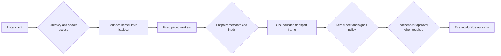

# Bounded local authority listener and supervisor

Status: inactive Linux v5 component. `LocalAuthorityServer` connects the existing
[transport](LOCAL_AUTHORITY_TRANSPORT.md) to an explicitly provisioned pathname
socket and a fixed worker set. No package, command or installed service starts it.
The published baseline remains v4.10.4. Refs #225, #224 and #337, all partial.

## Explicit provisioning and trust

Trusted startup supplies the existing fixed authority resources, transport limits,
an open endpoint-directory descriptor, an explicit numeric group and an accept
interval. There is no account lookup, directory creation, stale-socket takeover,
automatic enrollment, default grant or discovery of a trust root.

The endpoint directory must be owned by the effective service UID, with exactly
`0750`, the selected group, no special mode bits and no POSIX access/default ACL.
Its independent open file description holds an exclusive nonblocking directory
lock. This directory is separate from authority storage, whose existing `0700`
directories and `0600` files remain private to the service identity. Making the
socket reachable must never make policy, custody or journal files group-readable.

The fixed endpoint `authority-v1.sock` must not already exist. Construction binds
relative to the owned directory through `/proc/self/fd`, sets and verifies the
socket's service UID, selected group and `0660` mode, and only then starts listening.
The socket must have one link and no POSIX ACL. Existing files, symlinks, directories
and stale sockets are preserved and reported as startup failures. A separate,
reviewed lifecycle procedure is required after an unclean exit leaves a socket.

These are Linux pathname-socket assumptions, documented in
[unix(7)](https://man7.org/linux/man-pages/man7/unix.7.html). The conversion to a Go
listener uses [net.FileListener](https://pkg.go.dev/net#FileListener), with automatic
pathname unlink explicitly disabled. Renaming the originally supplied directory
cannot redirect this component's cleanup into a replacement directory.

Provisioning must protect the client-visible pathname and its ancestors. This
component owns a descriptor, not an authenticated client discovery mechanism.
The [client component](LOCAL_AUTHORITY_CLIENT.md) pins a trusted provisioned
endpoint and validates the kernel service identity before sending any request. A malicious service UID or root,
mount-namespace replacement and compromised client provisioning remain outside the
ordinary-user claim. There is no abstract socket, TCP listener or remote endpoint.

Group membership permits reaching the socket; it does not authorize an operation.
The existing kernel-observed peer UID, signed current policy, explicit operation
grant, independent approval and durable-state checks still apply. Missing identity
or approval providers retain their existing denial behavior.

## Concurrency, pacing and diagnostics

`OpenLocalAuthorityServer` owns the transport and listening socket but starts no
goroutine. `Serve` can run only once and creates exactly `MaxPeers` workers. Each
worker obtains an accept permit, checks the endpoint, accepts one connection,
checks the endpoint again and synchronously serves that peer before looping.
There is no goroutine per connection, user-space pending-connection queue or
internal request retry.

| Resource | Enforced boundary |
| --- | --- |
| Fixed workers and active accepted peers | Existing `MaxPeers`, 1 through 8. |
| Simultaneous peers per UID | Explicit `MaxPeersPerUID`, 1 through `MaxPeers`; enforced before framing, using kernel credentials. |
| Listen backlog | Explicitly requested as `MaxPeers`; actual queue behavior belongs to the Linux kernel, not an exact portable connection-count guarantee. |
| Accept interval | Explicit 10 milliseconds through 1 second, shared by all workers. |
| Outstanding pacing reservations | At most one per fixed worker. |
| Request/response and I/O | Existing bounded framing and absolute transport deadlines. |
| Executing authority operations | One, with immediate contention refusal. |
| Diagnostic state | Fixed-size counters, flags and one retained fatal error. |

Pacing uses monotonic-capable `time.Now` independently of the trusted policy clock.
A worker that has already earned a permit may be idle in `AcceptUnix`. After an
idle period, accumulated acceptors and the next permit can therefore form a burst
of up to `MaxPeers + 1`; later permits are spaced by the configured interval.
Scheduler delays can also bunch already permitted workers. These limits bound
component concurrency and pacing reservations. The transport additionally limits
live peers per kernel-observed UID across read, execution and write phases.
Choosing a ceiling below `MaxPeers` prevents that UID from holding all transport
slots at once. Workers can still briefly accept and refuse its excess sockets,
which count as failed exchanges. There is no reserved worker or fair scheduling
guarantee: the kernel backlog, repeated attempts and colluding UIDs remain denial
of service concerns. Process RSS/CPU limits, request-rate limits, systemd/OpenRC
isolation and fleet capacity measurements remain separate acceptance work.

Malformed, unauthorized, busy or timed-out peers receive the transport's generic
bounded denial or connection failure. The worker records a failed exchange and
continues, without retaining a per-peer error or an unbounded log queue. Endpoint
attestation, accept failures and unsafe-storage errors stop admission and drain
workers. There is no periodic metadata watcher: checks occur around accept, and
private storage retains its own per-operation checks.

`Status` exposes process-local `Running`, `Closing`, `Active`, `Accepted`,
`Completed`, `Failed` and `Saturated`. Integer counters saturate instead of wrapping.
They are diagnostics only. In particular, `Failed` can include an already committed
operation whose reply was lost. No counter establishes an enforcement result,
incident total, audit record or percentage KPI. Durable denial audit and bounded
operator logging still require implementation. Returned internal errors must stay
private; never echo them to clients or public logs.

## Draining and exact cleanup

`Close` stops admission, cancels pacing and accept waits, and uses the transport's
existing read/write cancellation. An executing approved durable mutation retains
its credential-bearing peer until it finishes; its reply is suppressed during
shutdown. The method returns a busy indication while `Serve` is still draining.
Wait for `Serve` to return before treating shutdown as complete. Blocking trusted
callbacks or storage operations have no promised hard cancellation deadline.

The listener never uses Go's automatic pathname removal. Cleanup rechecks the
owned directory, exact socket inode, type, mode, owner/group, link count and ACL.
Only that unchanged socket is unlinked. Modified, replaced or unprovable entries
remain in place with an error, including across repeated `Close` calls. The owned
directory is never deleted. Partial startup failure uses the same bounded ownership
check; it does not reclaim an arbitrary entry merely because the name matches.

A peer disconnect or shutdown can follow a committed mutation. Missing replies
must lead to verified resume or exact reviewed inspection, not automatic replay.
The existing authority storage locks remain held while approved operations drain.
Neither pathname removal nor a successful socket close proves that durable work
has finished.

## Evidence and remaining acceptance

Component tests exercise real Unix pathname sockets, valid resume/commit/reopen,
generic denials, timeouts, capacity, pacing, concurrent lifecycle, approved-write
drain, descriptor ownership, directory rename, occupied paths, malformed startup,
POSIX ACLs, socket substitution and preservation of modified artifacts.

The mandatory [ordinary-user gate](UNPRIVILEGED_ASSURANCE.md) now includes the
actual listener: an unintended group member can connect but cannot mutate the
endpoint or obtain any of the six authority results. An account outside the group
cannot connect. The private-resource inventory remains unchanged, and authorized
resume/commit/reopen still succeeds. The client follow-up adds a kernel-identity
impostor case. The non-root process and peer-quota follow-ups bring the named gate
to 100 cases, including authorized commit, fresh-process resume and a second UID
being served while an ungranted account holds an incomplete connection. Incomplete
or skipped dedicated evidence is a failure.

This is component isolation evidence, not deployed-service or native distribution
acceptance. Production provisioning, deployed clients, separate service
identity and sandbox, approval/audit providers, key lifecycle, stale-socket
recovery and package lifecycle remain unfinished. The incomplete custody/intent
recovery and retention work also remains open. No native server test is implied.

BunkerWeb retains its independent authenticated API, source-owned bans, durations,
expiry/retry and HA behavior. It gains no listener, journal, dashboard or identity
provider dependency from this component.
