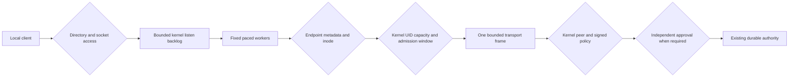
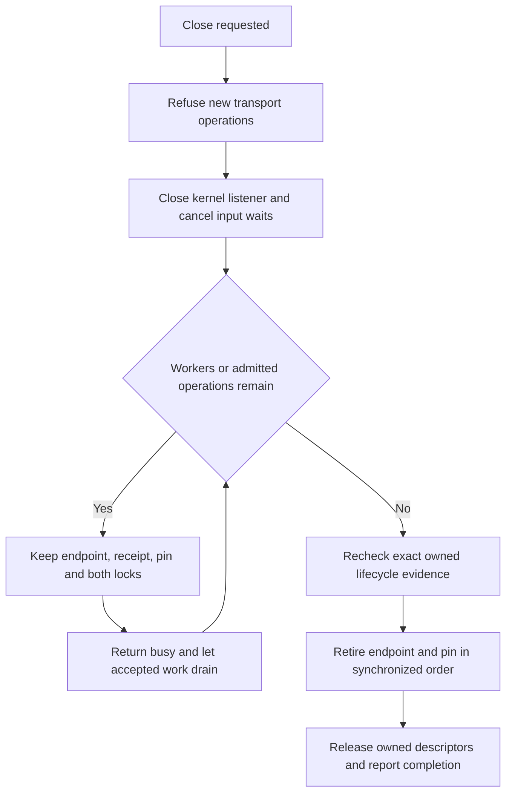

# Bounded local authority listener and supervisor

Status: inactive Linux v5 component. `LocalAuthorityServer` connects the existing
[transport](LOCAL_AUTHORITY_TRANSPORT.md) to an explicitly provisioned pathname
socket and a fixed worker set. Native packages and installed services do not start it.
The separate [process entry point](AUTHORITY_PROCESS.md) adds explicit startup and
context-driven drain.
The published baseline remains v4.10.4. Refs #225, #224 and #337, all partial.

## Explicit provisioning and trust

The optional [protected-layout startup](PROVISIONED_AUTHORITY.md) opens the existing
server from one private state-directory descriptor and fixed no-follow children,
with a separate endpoint. It retains a root lease through drain and rechecks child
identity around accepts. The original explicit-descriptor path below remains
available. Neither path provisions accounts, independent trust or OS isolation.

Trusted startup supplies the existing fixed authority resources, transport limits,
an open endpoint-directory descriptor, a distinct private pin-directory descriptor,
an explicit numeric group and an accept interval. There is no account lookup, directory creation, stale-socket takeover,
automatic enrollment, default grant or discovery of a trust root.

The endpoint directory must be owned by the effective service UID, with exactly
`0750`, the selected group, no special mode bits and no POSIX access/default ACL.
Its independent open file description holds an exclusive nonblocking directory
lock. This directory is separate from authority storage, whose existing `0700`
directories and `0600` files remain private to the service identity. Making the
socket reachable must never make policy, custody or journal files group-readable.

The mandatory `PinDirectory` is separately provisioned, service-owned `0700`
storage without POSIX ACLs. It cannot alias the endpoint or any policy, custody,
anchor or journal directory. An independent nonblocking exclusive lock remains
held for its full lifetime. An existing `.authority-v1-pin` entry blocks startup
before a socket is created. No directory or account is created by this component.

The fixed endpoint `authority-v1.sock` must not already exist. Construction binds
relative to the owned directory through `/proc/self/fd`, sets and verifies the
socket's service UID, selected group and `0660` mode, and only then starts listening.
The socket must have one link and no POSIX ACL. Its final inode metadata is pinned,
including modification/change timestamps. Before listening, the constructor also
creates a private `.authority-v1-owner` receipt in the same endpoint directory.
Existing socket or receipt entries, including files, symlinks, directories, FIFOs
and stale sockets, are preserved and reported as startup failures. A receipt
without a socket also blocks startup. A separate reviewed recovery procedure
remains required after an unclean exit; these records are never adopted here.

These are Linux pathname-socket assumptions, documented in
[unix(7)](https://man7.org/linux/man-pages/man7/unix.7.html). The conversion to a Go
listener uses [net.FileListener](https://pkg.go.dev/net#FileListener), with automatic
pathname unlink explicitly disabled. Renaming the originally supplied directory
cannot redirect this component's cleanup into a replacement directory.

Provisioning must protect the client-visible pathname and its ancestors. This
component owns a descriptor, not an authenticated client discovery mechanism.
The [client component](LOCAL_AUTHORITY_CLIENT.md) pins a trusted provisioned
endpoint and validates the kernel service identity before sending any request. A malicious service UID or root,
mount-namespace replacement and compromised client provisioning remain outside the
ordinary-user claim. There is no abstract socket, TCP listener or remote endpoint.

Group membership permits reaching the socket; it does not authorize an operation.
The existing kernel-observed peer UID, signed current policy, explicit operation
grant, independent approval and durable-state checks still apply. Missing identity
or approval providers retain their existing denial behavior.

## Durable endpoint ownership evidence

The receipt has schema `syswarden.authority-endpoint-owner.v1`. It binds a fresh
32-byte random nonce to the already created directory/socket device and inode,
UID/GID and socket change timestamp. Numeric values are exact decimal strings.
The format implies directory `0750` and socket `0660`; neither mode is configurable.
It contains no network address, policy, key or user-supplied path. The nonce is a
creation identifier, not a password, signature, approval or bearer credential.

Creation uses a fixed basename, `O_EXCL`, no-follow descriptor-relative operations,
mode `0600`, service ownership, one link and no POSIX ACL. Its file group can be the
service's private primary group rather than the endpoint's client group. Its bytes
are canonical JSON, bounded to 1,024 bytes. There is one kernel write, followed by
file synchronization, directory synchronization and exact readback of the entry,
metadata and bytes. The separate directory synchronization follows the requirement
described in [fsync(2)](https://man7.org/linux/man-pages/man2/fsync.2.html).
The constructor then writes a second, independent `.authority-v1-pin` file into
`PinDirectory`, with the same exclusive creation, single-write, synchronization
and readback contract. Only after both stages succeed may the listener start.
The pin has schema `syswarden.authority-endpoint-pin.v1`, is bounded to 2,048 bytes,
and binds the exact receipt bytes and SHA-256 to its private directory's device,
inode and UID/GID. It is a service-owned, single-linked `0600` regular file without
ACL. Receipt, pin and private pin-directory descriptors remain open; every endpoint
attestation checks the retained metadata and bytes without accepting replacements.
A fresh recovery process reads this protected pin rather than deriving trust by
hashing whatever endpoint receipt it discovers.

Zero/partial writes, write errors, synchronization errors and failed readback leave
the created socket and all available receipt/pin bytes in place, with a startup error and
no listener. Descriptors and the cooperating-process lock are released. Repeating
startup cannot overwrite this state. A crash before receipt creation can still
leave an unmarked socket; it likewise blocks startup and is not reclaimed.
Successful `fsync` calls and process-crash tests do not prove physical power-loss
behavior on all filesystems. A later reader cannot infer that a previous `fsync`
completed merely because the record exists.

This receipt derives its trust from independently protected service provisioning
and the live creator's pinned metadata and bytes. It does not resist a compromised
service UID, root or kernel, authenticate an arbitrary discovered file, or authorize
future deletion by itself. There is no new recovery command or wire operation.
The separate [reviewed endpoint recovery](ENDPOINT_RECOVERY.md) component admits
only a complete pair against this protected creator-written pin or an independently
retained external live receipt digest, with
explicit quiescence and authorization/audit providers. Startup never invokes it.
Ambiguous or partial state and deployed recovery integration remain separate work.

## Concurrency, pacing and diagnostics

`OpenLocalAuthorityServer` owns the transport and listening socket but starts no
goroutine. `Serve` can run only once and creates exactly `MaxPeers` workers. Each
worker obtains an accept permit, checks the endpoint, accepts one connection,
checks the endpoint again and synchronously serves that peer before looping.
There is no goroutine per connection, user-space pending-connection queue or
internal request retry.

| Resource | Enforced boundary |
| --- | --- |
| Fixed workers and active accepted peers | Existing `MaxPeers`, 1 through 8. |
| Simultaneous peers per UID | Explicit `MaxPeersPerUID`, 1 through `MaxPeers`; enforced before framing, using kernel credentials. |
| Admission frequency per UID | Explicit transport budget and fixed window, with at most 256 historical UID slots; checked before framing. |
| Listen backlog | Explicitly requested as `MaxPeers`; actual queue behavior belongs to the Linux kernel, not an exact portable connection-count guarantee. |
| Accept interval | Explicit 10 milliseconds through 1 second, shared by all workers. |
| Outstanding pacing reservations | At most one per fixed worker. |
| Request/response and I/O | Existing bounded framing and absolute transport deadlines. |
| Executing authority operations | One, with immediate contention refusal. |
| Diagnostic state | Fixed-size counters, flags and one retained fatal error. |

Pacing uses monotonic-capable `time.Now` independently of the trusted policy clock.
A worker that has already earned a permit may be idle in `AcceptUnix`. After an
idle period, accumulated acceptors and the next permit can therefore form a burst
of up to `MaxPeers + 1`; later permits are spaced by the configured interval.
Scheduler delays can also bunch already permitted workers. These limits bound
component concurrency and pacing reservations. The transport additionally limits
live peers per kernel-observed UID across read, execution and write phases.
Choosing a ceiling below `MaxPeers` prevents that UID from holding all transport
slots at once. Workers can still briefly accept and refuse its excess sockets,
which count as failed exchanges. There is no reserved worker or fair scheduling
guarantee: the kernel backlog, repeated attempts and colluding UIDs remain denial
of service concerns. The transport's [admission-frequency limits](LOCAL_AUTHORITY_TRANSPORT.md#admission-frequency-and-bounded-uid-history)
add fixed windows and bounded UID history, with explicit saturation refusal.
They permit bursts at window boundaries and reset on restart. They reserve no
worker and do not police the kernel backlog. Process RSS/CPU limits, systemd/OpenRC
isolation and fleet capacity measurements remain separate acceptance work.

Malformed, unauthorized, busy or timed-out peers receive the transport's generic
bounded denial or connection failure. The worker records a failed exchange and
continues, without retaining a per-peer error or an unbounded log queue. Endpoint
attestation, accept failures and unsafe-storage errors stop admission and drain
workers. There is no periodic metadata watcher: checks occur around accept, and
private storage retains its own per-operation checks.

`Status` exposes process-local `Running`, `Closing`, `Active`, `Accepted`,
`Completed`, `Failed` and `Saturated`. Integer counters saturate instead of wrapping.
They are diagnostics only. In particular, `Failed` can include an already committed
operation whose reply was lost. No counter establishes an enforcement result,
incident total, audit record or percentage KPI. Durable denial audit and bounded
operator logging still require implementation. Returned internal errors must stay
private; never echo them to clients or public logs.

## Draining and exact cleanup

`Close` stops admission, cancels pacing and accept waits, and uses the transport's
existing read/write cancellation. An executing approved durable mutation retains
its credential-bearing peer until it finishes; its reply is suppressed during
shutdown. The method returns a busy indication while `Serve` is still draining.
The kernel listener is closed immediately, but the endpoint entry, ownership
receipt, private pin and both lifecycle locks stay owned until all workers return.
Repeated or concurrent `Close` calls cannot skip that wait. The transport and
underlying authority must also report no admitted work before cleanup can start,
including defensive internal use without a running supervisor worker set.

A new connection can now receive `ECONNREFUSED` while a prior approved operation
is still completing. During this interval, independent endpoint/pin leases refuse
startup and both recovery trust-source modes before any approval provider is
called. The listener stop is idempotent and caches its result; final cleanup does
not close it a second time. After all workers return, `Serve` performs the exact
cleanup below. An unused server can still be closed directly without starting it.
Wait for `Serve` to return before treating shutdown as complete. Blocking trusted
callbacks or storage operations have no promised hard cancellation deadline.
The component never interrupts or rolls back an approved durable mutation.

The listener never uses Go's automatic pathname removal. Cleanup rechecks the
owned directory, exact socket inode, type, mode, owner/group, link count and ACL.
The private receipt and independent pin must also match their exact creator-owned
inodes, metadata and bytes. Only after these checks succeed is the socket unlinked,
then the unchanged receipt, followed by endpoint-directory synchronization.
Only after successful endpoint cleanup is the exact pin rechecked and removed,
followed by private-directory synchronization and absence verification. Any failed
endpoint removal or synchronization preserves the pin. A failed pin unlink or
synchronization is also uncertain, and cannot be silently retried. If receipt removal fails after the
socket is gone, that intermediate state remains visible as an error. Failed final
synchronization is an uncertain cleanup outcome. `Close` retains the first result;
it does not retry removal later after observing a replacement.

Modified, replaced or unprovable entries remain in place with an error. Uncertain
receipt creation preserves both entries. The owned directory is never deleted.
A startup failure before a receipt was created may remove only the exact socket
that this handle has already proven; the fixed name alone is never sufficient.

A peer disconnect or shutdown can follow a committed mutation. Missing replies
must lead to verified resume or exact reviewed inspection, not automatic replay.
The authority storage and lifecycle locks remain held while approved operations
drain. A successful listener close or refused connect alone does not establish
completion. The server's ordered cleanup is a cooperating component guarantee;
external recovery still requires independently verified supervisor quiescence.
Advisory locks do not authenticate arbitrary processes or stop a compromised
service UID/root from violating the protocol.

## Evidence and remaining acceptance

Component tests exercise real Unix pathname sockets, valid resume/commit/reopen,
generic denials, timeouts, capacity, pacing, concurrent lifecycle, approved-write
drain, descriptor ownership, directory rename, occupied paths, malformed startup,
POSIX ACLs, socket substitution and preservation of modified artifacts.
Deterministically blocked policy operations verify retained locks and unchanged
lifecycle evidence during shutdown, refusal of both recovery modes before approval,
concurrent close, post-drain cleanup, success/denial/expiry behavior and changed-pin
preservation. Lost replies remain suppressed without reversing an approved write.
These local component tests complement the separate-UID gate; they do not provide
a production supervisor or authenticate a human recovery decision.

The mandatory [ordinary-user gate](UNPRIVILEGED_ASSURANCE.md) now includes the
actual listener: an unintended group member can connect but cannot mutate the
endpoint or obtain any of the six authority results. An account outside the group
cannot connect. The private-resource inventory remains unchanged, and authorized
resume/commit/reopen still succeeds. The client follow-up adds a kernel-identity
impostor case. The non-root process, peer-quota and endpoint-lifecycle follow-ups
bring the named gate to 113 cases, including authorized commit, fresh-process
resume and a second UID
being served while an ungranted account holds an incomplete connection. Nine
further probes deny ordinary-user reads and changes to the private receipt. A
real service process is also deliberately killed after readiness; the exact
receipt survives, and a fresh service refuses to adopt or delete either entry.
Two recovery cases then deny a different ordinary UID and exercise independently
reviewed recovery, fresh-process restart and verified resume with unchanged
journal resources. The new process reads the persisted pin itself, without a
parent-supplied receipt hash. The existing authorized and stranger storage probes
also refuse pin reads, writes, unlink, rename, hardlink, symlink and mode changes.
The admission-frequency case first admits malformed input from an ungranted UID,
then refuses its reconnection before reading despite spare concurrent-peer capacity.
Another authorized UID still resumes, with private bytes unchanged. Separate
deterministic tests cover bounded history, expiry and simultaneous registration.
Storage-fault tests separately retain zero, partial and complete uncertain bytes,
reject unsafe receipts and exercise clean removal and partial cleanup. Incomplete
or skipped dedicated evidence is a failure.

This is component isolation evidence, not deployed-service or native distribution
acceptance. Production provisioning, deployed clients, separate service
identity and sandbox, approval/audit providers, key lifecycle, deployed endpoint
recovery and package lifecycle remain unfinished. The incomplete custody/intent
recovery and retention work also remains open. No native server test is implied.

BunkerWeb retains its independent authenticated API, source-owned bans, durations,
expiry/retry and HA behavior. It gains no listener, journal, dashboard or identity
provider dependency from this component.
