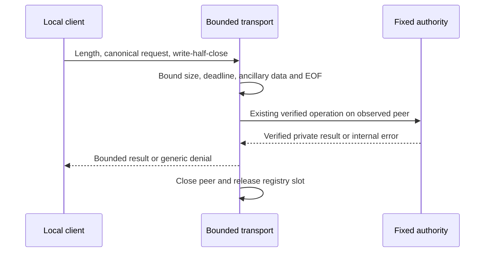

# Bounded local authority transport

Status: inactive Linux v5 component. `LocalAuthorityTransport` carries the six
existing [fixed-resource authority](LOCAL_AUTHORITY.md) operations over accepted
Unix stream sockets. It is not a deployed service or a socket listener. The stable
release remains v4.10.4. Refs #225 and #224, both partial.

## Ownership and connection budget

Trusted startup supplies the existing authority configuration and explicit
`AuthorityTransportLimits`. Construction owns one newly opened fixed-resource
local authority. It creates no socket pathname, accepts no network connection,
starts no goroutine and performs no implicit bootstrap. The optional [listener component](LOCAL_AUTHORITY_SERVER.md) supplies a bounded
endpoint and worker set. Trusted integration remains responsible for isolated
provisioning and independently trusted identity/audit providers.

| Resource | Enforced boundary |
| --- | --- |
| Simultaneous peers per kernel UID | Explicit `MaxPeersPerUID`, from 1 through `MaxPeers`, across all phases. |
| Registered peers | Explicit `MaxPeers`, from 1 through 8 per transport. |
| Admitted connections per UID and window | Explicit `RequestsPerUID`, from 1 through 1,024; each connection carries at most one request. |
| Admission window | Explicit `RateWindow`, from 1 second through 1 minute, starting at the UID's first admission. |
| Historical UID slots | Explicit `MaxRateUIDs`, from 1 through 256, allocated once at startup. |
| Read phase | Positive explicit duration, at most 5 seconds, including header, body and final EOF. |
| Write phase | Positive explicit duration, at most 5 seconds, including header and body. |
| Request body | 1 through 18,432 bytes, checked before allocation. |
| Response body | At most 65,536 bytes, plus a four-byte header. |
| Executing authority operation | One per owned authority handle; contention is refused immediately. |
| Requests per connection | Exactly one, with no internal queue or retry. |

Read/write deadlines use the process's monotonic-capable `time.Now` clock, separate
from the trusted wall-clock policy/approval verifier. Partial I/O never extends the
phase deadline. The per-UID ceiling is checked before any frame read or body
allocation. Registration observes `SO_PEERCRED` directly and atomically counts
active peers under the transport lock. A request ID, claimed username, PID or GID
does not select a quota bucket. Several processes sharing one UID share the same
ceiling. The existing creation-time credential/delegation caveat still applies.

Both peer ceilings must be supplied explicitly; zero, negative or inconsistent
limits are rejected before the authority is opened. Choose `MaxPeersPerUID` below
`MaxPeers` when different UIDs must retain concurrency. Equal limits deliberately
provide only the global ceiling, including the single-peer configuration. The
small live registry holds at most eight UID observations. A separate fixed registry
retains bounded admission history. A live slot remains charged during reading, authority
execution, reply writing and shutdown drain, until the peer is closed and released.
Malformed input, timeout, disconnect and success all release it after completion.
Quota refusal closes the excess socket without reading input or returning a UID,
quota value or private denial reason. It does not evict an admitted operation.

Neither ceiling grants an operation, reserves an administrative lane or schedules
fair access. A group member can still fill
the kernel backlog, race for newly available capacity or combine several accounts.
Clients under one service UID also share its ceiling. Trusted callbacks and storage
retain their existing non-cancellable blocking limits. Total process RSS and fleet
capacity also need separate measurements.

## Admission frequency and bounded UID history

All three admission-frequency limits must be explicit and valid before authority
resources are opened. After checking kernel credentials and live-peer ceilings,
registration consumes one unit under the same transport mutex, before any frame
read or body allocation. Duplicate active objects and capacity refusals do not
consume another unit. Once admitted, success, malformed input, policy denial,
timeout and disconnect all consume that unit. Releasing a live peer does not
refund it, so reconnecting cannot reset the window.

Processes sharing one kernel UID share its budget. Request IDs, claimed usernames
and wire fields cannot choose a bucket. This is local admission control, not human
authentication, dashboard RBAC, MFA or an authorization grant.

The fixed slice stores at most 256 UID records. It creates no per-request history
allocation, timer or goroutine. A new UID can use only an empty or expired slot;
it never evicts unexpired history. When all slots are occupied, an unseen UID is
refused while a known UID can still spend its remaining budget. Trusted startup
must size the table for the expected identities. Saturation can deny legitimate
new identities until a slot expires; it is not a fairness guarantee.

The internal monotonic-capable `time.Now` clock is independent of the signed-policy
wall clock and cannot be supplied in a request or startup configuration. A zero or
backwards observation refuses admission without resetting history. Expired slots
are reused during admission, without background expiration work. History belongs
to this transport instance and resets on restart; it is not durable auditing, a
security verdict or a percentage KPI.

These are fixed windows, not smooth pacing or a sliding requests-per-second cap.
A client can spend the end of one window immediately before the next window's
budget becomes available. Existing accept pacing and concurrent-peer ceilings
still apply. Exhaustion closes the new connection before framing, without a wire
body, UID, quota value or retry hint. It never cancels an already approved durable
write or makes automatic mutation replay safe.

This bounds admitted work and UID-history storage. Kernel-backlog floods, colluding
UIDs, reserved administrative capacity, OS isolation and native capacity evidence
remain separate work.

`ServePeer` takes exclusive ownership of one already connected Unix stream socket.
The caller must not read, write, close, duplicate or submit another wrapper around
that socket while it is owned. A repeated active pointer is rejected without
closing the original call's peer. All other returns close the passed socket,
including full-capacity, closing-state and invalid-peer rejection. The connection
registry contains at most the configured number of entries and releases each entry
when its call returns. The caller must bound its own pending accepts and goroutines;
this component cannot control resources allocated before `ServePeer` is called.

## One-request wire format

A client sends:

1. Four bytes containing the request-body size as an unsigned big-endian integer.
2. Exactly that many bytes of canonical `syswarden.local-authority-request.v1` JSON.
3. A write-half-close of its socket, retaining the read side for the reply.

The transport checks the declared size before allocating the body. It reads the
whole body and requires EOF before dispatch, so trailing bytes, pipelined requests,
truncated frames and clients that never finish cannot trigger an operation.
The absolute read deadline covers all three steps. The payload then passes the
existing canonical decoder, kernel peer admission and policy/custody/approval
checks. Socket framing does not grant authority or replace those checks.

Every receive, including the final EOF check, uses `ReadMsgUnix` with no ancillary
buffer. Linux discards excess passed file descriptors when that buffer is absent;
`MSG_CTRUNC` or `MSG_TRUNC` causes rejection. No received descriptor is installed as
a trust root, file, identity or other authority resource. The Linux behavior is
specified in [unix(7)](https://man7.org/linux/man-pages/man7/unix.7.html); the receive
API is documented in [Go net](https://pkg.go.dev/net#UnixConn.ReadMsgUnix).

Example header for the 95-byte synthetic resume request in the authority document:
`00 00 00 5f`. The header is not signed and does not authorize replay. A client must
not infer request completion merely because the socket accepted its write.

## Responses and errors

Success uses the same four-byte length prefix followed by the existing canonical
`syswarden.local-authority-response.v1` document, then connection close. Clients
must require a complete length-bounded response and EOF. The inactive
[client component](LOCAL_AUTHORITY_CLIENT.md) adds kernel service identity checks,
endpoint pinning and request-bound reply validation. The response may contain
private inspection plans and must remain inside the authorized local channel.

For an admitted request that fails, the transport attempts a four-byte zero length
and no body. Internal Go errors, file paths, signatures, policy details and denial
reasons are never serialized. Full-capacity, invalid-peer, closing or rate-exhausted
connections may be closed without a reply. Rejecting unread input can cause a Linux connection
reset; a deadline or failed write can also truncate a denial or success response.
These are transport failures, not successful operation responses. The transport
never appends a second denial frame after a failed success write and never drains
an unbounded stream solely to obtain a clean close.

A trusted supervisor receives internal errors from `ServePeer`. It must not echo
them into client responses or public logs. Durable denial auditing and a bounded
operational logging policy still need service-level implementation. Uniform error
bytes do not establish timing indistinguishability or prevent an authorized local
client from learning that the service is busy or unavailable.

A disconnect, timeout or close can follow a completed durable mutation. Missing or
partial replies cannot prove that no write occurred. Use verified resume or exact
reviewed inspection to determine state; never automatically replay a mutating
request, change its request ID and retry, or interpret a plan digest as approval.

## Shutdown semantics

`Close` immediately rejects new peers and closes peers that are reading or writing.
Peers inside an authority execution remain open for final kernel credential checks.
The owned authority enters draining state. That admitted operation may still write
its already authorized durable result; after it finishes, its response is suppressed
and the peer closes. The transport does not roll back a mutation or invalidate a
previously authorized durable result to make shutdown look instantaneous.

`ErrAuthorityTransportBusy` reports that registered calls have not returned yet.
Wait for those calls and close again to observe completion. No background shutdown
worker is created, and no hard deadline is promised for a blocked trusted provider
or filesystem operation. A future service must preserve uncertain state if its
external supervisor eventually terminates the process.

## Verification and remaining work

Real Unix-socket/private-file tests cover resume and commit across fresh
connections, every truncated byte position of a sample frame, fragmented input,
zero/oversized/max-integer lengths, trailing and pipelined messages, unsafe peers,
canonical/admission denial, withheld EOF, slow trickles, capacity rejection,
duplicate objects and busy authority operations. Quota tests add simultaneous
same-UID registrations, rejection before any request bytes, slot reuse after
success/failure/timeout/disconnect, and quota retention through approved-operation
drain. The mandatory cross-UID gate holds an incomplete peer from an ungranted
account, refuses a second process with the same UID before framing and successfully
resumes from a different authorized UID while the slow connection remains active.
Protected storage is unchanged, and disconnect releases the slot.

Frequency tests cover invalid startup bounds, spent quota after peer release,
fixed-window boundary bursts, expiry, full history without eviction, independent
UID budgets, clock refusal and concurrent registration. The mandatory separate-UID
gate first admits a malformed request from an ungranted account, then refuses its
reconnection before input despite available live-peer capacity. A different
authorized UID still resumes with unchanged private storage.

Ancillary tests pass multiple file descriptors at the header, body and tail and verify no references remain.
A bounded kernel send buffer verifies write timeout and an incomplete reply.

Shutdown tests cover blocked readers and an approved policy mutation that completes
after close while its reply is lost. The persisted reviewed state remains readable.
Race, Linux 386, static analysis and the complete core regression supplement these
component checks. Existing payload fuzzing remains in CI; this framing layer does
not add another JSON parser or change a signed schema.

The [listener follow-up](LOCAL_AUTHORITY_SERVER.md) adds endpoint ownership,
paced workers and separate cross-UID evidence. OS-isolated service provisioning,
real authentication and audit providers, deployment-specific rate policy, issuer/key
lifecycle, incomplete-state recovery, retention and shared consumer integration
remain unfinished. Transport-only tests do not establish cross-UID isolation,
physical power-loss safety, native IVV or v5 acceptance. No production
caller activates this transport. BunkerWeb retains its independent authenticated
API, source-owned temporary bans, durations and retry/HA contract, without a new
dashboard, identity-provider or journal dependency.
