# Bounded local restart-custody storage

Status: inactive WP03 filesystem component for v5.00.0. Stable remains v4.10.4.
This supplies a local backend for the [custody coordinator](JOURNAL_CUSTODY.md).
It does not install a service, provision users, expose an API, activate journal
collection, rotate keys or establish native IVV acceptance.

## Independent enrollment and the operating-system boundary

`CustodyEnrollment` carries an independently authorized initial anchor and scoped
public-key authority. The caller must authenticate their origin and provide an
already opened, separately provisioned custody directory. Its ancestors and
ownership must be trusted. Journal data, a checkpoint, a plan digest or a filename
cannot enroll these values.

`BootstrapLocalCustody` exclusively creates `restart-custody-v1.swc`, writes its
explicit enrollment record, synchronizes file and directory and verifies the
whole result. It never adopts, overwrites or deletes an existing object. A failed
bootstrap preserves all bytes; calling bootstrap again cannot reset them.
`OpenLocalCustody` only opens an existing ledger and checks its original record
against the independently supplied enrollment. A missing file does not trigger
creation. A different initial anchor, node, epoch or key rejects the open.

The backend requires the established 0700 directory and 0600 effective-UID-owned,
single-link regular-file contract. Relative no-follow operations and independent
nonblocking directory locks exclude cooperating processes. Symlinks, hardlinks,
FIFOs, directories, unexpected modes and oversized files are rejected. No ownership
or permission is silently repaired. The backend owns its descriptor independently
of the caller's descriptor lifetime.

These checks are necessary storage checks, not deployment isolation. Before
activation, an authenticated authority service must own the custody directory and
exclude producers and untrusted operator endpoints from direct writes. It must
protect ancestors, enrollment configuration and authorization policy. All
integrated writers must use the coordinator and custody lease; the backend's
`Prepare` and `Finish` are trusted internal operations, not public requests.
They persist transitions but do not independently authenticate a publication.

The enrollment is pinned for this component. It is not a live revocation registry.
Production integration must govern the lifetime of the authority instance and
serialize policy changes with leases. Rotation, revocation and authenticated
bootstrap orchestration are separate unfinished work. Closing a factory stops new
acquisitions; it deliberately does not revoke an already acquired transaction.

A checksum does not prevent a privileged actor from replacing or truncating the
entire protected ledger to a valid earlier state. Local continuity is independent
of journal producers only when the OS boundary holds. No TPM monotonic counter,
external witness, root-tamper resistance or global equivocation proof is claimed.
Remote expiring leases and HA fencing are not implemented.

## Complete transitions and bounded storage

```mermaid
stateDiagram-v2
    [*] --> Stable: Explicit protected bootstrap
    Stable --> Pending: Prepare exact intent and synchronize
    Pending --> Pending: Independently authorize and record exact recovery decision
    Pending --> Stable: Finish exact pending intent and synchronize
    Stable --> Refused: Partial or corrupt ledger
    Pending --> Refused: Partial or corrupt ledger
    Refused --> Refused: Preserve bytes; no automatic repair
```

Every acquisition obtains a fresh process lock, opens and verifies the complete
bounded ledger, synchronizes the existing file and directory, and rereads it.
`State` verifies the whole current ledger before returning an owned key copy.
No cached acknowledgement substitutes for durable state readback. A lease mutex
serializes concurrent calls within one process.

`Prepare` requires the exact current head and no pending intent. `Finish` requires
the whole exact pending intent. Both preserve initial enrollment and key scope.
A mutation appends one complete record with a single kernel write, synchronizes
the file and directory, checks metadata and reads the whole chain back. Expected
state, checksum, record count and byte length must match before success.
A short write, ENOSPC, failed synchronization, changed inode or failed readback
poisons the lease. Subsequent reads and mutations fail; closing retains all bytes.
Close errors also prevent the coordinator from returning success.

There are at most 1,024 records, including bootstrap, prepare, finish and recovery
approvals. Each document is at most 8,192 bytes. The complete file ceiling is
8,425,472 bytes. Oversized files are rejected before allocation. A prepare or new
approval reserves one remaining record for finish. Exhaustion returns an explicit
error without eviction, truncation or implicit epoch reset. This is a component
ceiling, not an accepted fleet-wide retention policy. Compaction and migration
require a future authorized protocol.

Each frame contains a four-byte big-endian document length, canonical document and
32-byte chained SHA-256 checksum. The checksum covers ASCII
`syswarden/journal-custody-record/v1`, one zero byte, the previous checksum and the
exact document. The first predecessor checksum is 32 zero bytes; those bytes are
not bootstrap authority.

The compact struct-order JSON schema is `syswarden.journal-custody.v1`. Fields are
`schema`, `sequence`, `operation`, `state`, `plan_sha256` and `decision_sha256`.
State includes the existing canonical initial/head anchor documents, exact scoped
public-key authority and either a complete pending intent or JSON `null`. The
intent contains all coordinator bindings. Numbers are exact decimal strings;
public keys and digests use lowercase hexadecimal. Unknown or duplicate fields,
noncanonical encodings, skipped counters, invalid scope, impossible state
transitions and trailing bytes are rejected. No partial valid prefix is returned.

Bootstrap must be the first and only bootstrap record. Later records permit only
stable-to-pending prepare, unchanged pending-state approval, and exact
pending-to-stable finish. Keys, scope and initial state cannot change through
these operations. Checksums detect corruption; they are neither signatures nor
independent authentication of authority.

## Restart after an uncertain write

A complete valid record in the independently protected custody ledger is the
backend's authoritative state even if its caller never received an acknowledgement.
Reopening resynchronizes and verifies it before returning state. A complete prepare
remains pending; a complete finish remains completed. This implements the
coordinator's ambiguous-outcome contract.

This differs from adopting an unexpected extra anchor from the journal's local
continuity file. That file is checked against independent custody; it cannot
choose the trusted head. The distinction depends on the protected custody
provenance, not on a stronger checksum algorithm.

An incomplete or corrupt custody record blocks the entire backend. The parser
does not truncate, replay, skip corruption, choose an earlier valid prefix or
silently bootstrap. A separate reviewed backend-recovery protocol remains open.
Preserving a failed write does not guarantee unsynchronized bytes survive power
loss. Native filesystem/device and reboot IVV still must establish that boundary.

## Independent recovery decision and durable audit binding

Recovery is denied when `CustodyRecoveryAuthorizer` is absent. An installed
provider receives an owned exact pending intent and reviewed-plan digest. It must
authenticate the principal, enforce scope/current policy, independently verify
approval and durably audit its decision. It returns the lowercase SHA-256 of that
private decision record. The reference does not authenticate itself.

Before returning authorization success, the backend rechecks its state and
persists an `approve` record binding the plan digest, audit-decision digest and
unchanged pending intent. Provider denial, invalid decision references and local
audit-write failures return no grant. The provider must be bounded and must not
reenter its lease. No permissive authorizer, dashboard login or recovery endpoint
is supplied by this component.

Repeating the exact plan and the exact already durable decision still invokes the
independent authorizer and checks current policy. It can reuse that identical
local audit binding without appending a duplicate record. A changed decision
requires a new record and available capacity; a prior receipt never overrides a
current denial. Finish clears the pending state in its new record while retaining
all previous audit records. The coordinator rejects replay after completion.

## Evidence and remaining work

Synthetic tests use real private files with full coordinator integration. They
cover empty/nonempty commits, reopening pending/completed states, actual process
lock contention and abrupt process exit, partial/complete writes, file/directory
sync failures, readback/inode substitution, failed bootstrap, close errors,
malformed ledgers, capacity, audit denial, repeated current-policy checks and
immutable-byte preservation. A fixed-budget parser fuzz campaign and Linux 386
execution cover length/counter boundaries. A canonical bootstrap vector is
independently reproduced with Python JSON/SHA-256 and OpenSSL public-key derivation.

These are component checks, not production deployment or power-loss acceptance.
Authenticated authority provisioning, OS isolation, key lifecycle, recovery of
incomplete custody and local intents, compaction/retention, visible event loss,
redacted exports, consumer integration and native IVV remain open. BunkerWeb API,
source-owned bans, TTL, retry/HA and independence from dashboard identity remain
unchanged. Refs #225 and #224; neither work package is complete.
