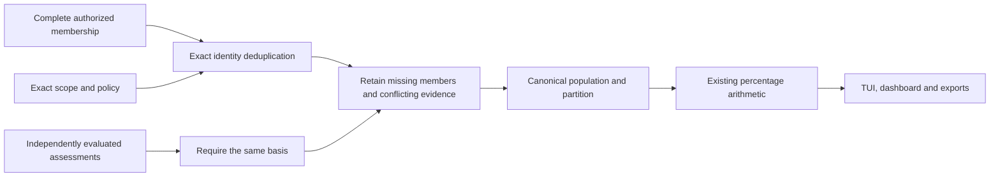

# Authorized node populations for percentage KPIs

Status: inactive v5 component for #224 and #315. It does not implement the
dashboard, enrollment, a trusted collector or an authenticated export. Stable
remains v4.10.4. The major v5.00.0 release still requires full IVVQ acceptance.

## What this component computes

`ResolveNodeRatePopulation` assembles one deterministic population for the three
node formulas in the [shared rate catalog](RATE_SNAPSHOT.md): reporting coverage,
verified protection coverage and policy conformity. It consumes an independently
resolved authorized membership and already evaluated assessments. It does not
query servers or derive protection from their reachability.

The caller supplies the complete authorized population, including nonresponding
nodes. Exact cluster, node and membership epoch identify each member. Repeated
identical membership, such as overlapping selected groups, contributes once.
Different epochs for the same cluster/node or incompatible eligibility decisions
reject the entire operation. There is no lexical selection of a newer epoch.

A known complete population is required. A producer that cannot establish the
denominator must use the existing unavailable rate report, not substitute the
responding nodes or pass an empty population. An explicitly established empty
population remains empty and produces no numeric percentage.

## Trust and input binding

The basis binds the exact formula, authorized scope, membership manifest, policy,
measurement instant and acquisition state. Each assessment must carry the digest
of that basis and an exact evidence reference. A mismatched basis, foreign node,
wrong epoch or assessment for an excluded node rejects the entire calculation.
No partial manifest or counts escape a rejection. Error messages contain only
fixed field names, not input identities or evidence values.

These are typed producer inputs, not self-authenticating network messages. Before
calling this API, the producer must independently authorize the scope, authenticate
membership and evidence, verify that the supplied members match the pinned complete
manifest, and apply the exact eligibility, evidence and freshness policy. The
component does not fetch references, verify signatures or judge whether a supplied
`matched` assessment proves anything. Copying untrusted fields into a basis does
not create authority. Enrollment, revocation and read-plane admission remain #233
responsibilities. Export authorization remains separate.

An exclusion is allowed only through an explicit member decision with a nonempty
reference and digest. This pins a separately reviewed eligibility decision under
the exact policy; its semantic justification must be verified by the producer.
A failed connection or absent report must remain eligible with unknown or stale
evidence. An assessment cannot exclude itself.

## Missing, repeated and conflicting assessments

Each included member occupies exactly one of `matched`, `other`, `unknown` or
`stale`. Their sum is the eligible denominator. Exclusions are separately retained
with their decision references and never contribute to a numerator.

| Input for one included identity | Result |
| --- | --- |
| No assessment | Unknown, with `missing_assessment` provenance. |
| One distinct assessment | The producer's validated part and exact evidence reference. |
| Identical repetitions | One assessment, without increasing the denominator or numerator. |
| Different parts or evidence references/digests | Unknown, with `conflicting_assessments` and all distinct evidence retained. |

Two assessments claiming the same successful part but citing different evidence
are still conflicting at this boundary. Selecting the authoritative assessment is
an upstream policy decision, not arrival-order or timestamp guessing here. A later
identical repeat cannot erase the conflict. Input ordering never changes the result.

Unknown or stale members downgrade a present calculation to partial. An already
partial or stale basis never becomes present. The existing rate arithmetic retains
that availability on every percentage. It does not refresh old evidence, turn a
rounded 100.00% into a protection verdict or allow a rate to authorize an action.

## Canonical manifest and consumer integration

The private `NodeRatePopulation` result retains immutable canonical bytes and
calculation counts. `Manifest()` returns a copy; `Counts()` returns a value.
`Reference()` binds the exact bytes to a producer-selected opaque identifier for
`RateInputs.Population`. It returns no reference for an uninitialized result.

The manifest uses `syswarden.node-rate-population.v1`, compact struct-order JSON,
lexically sorted cluster/node/epoch entries and sorted distinct assessment tuples.
It includes the basis and definition digests, derived counts, every authorized
member, exclusion provenance and missing/conflict reasons. It is not JCS, a signed
export or a public wire endpoint. There is no decoder or persistence added here.

Use the generated counts and population reference with the same scope, policy,
formula and instant in the existing `RateSnapshot`. The authenticated producer
must bind that complete report and its freshness before any TUI, chart or export
uses it. Consumers must still call the existing report validation/currentness
checks with independently established context.

The manifest contains sensitive identities and evidence references. Keep it within
authorized private storage and reauthorize any disclosure. Building a new population
for a reduced scope is required after permission changes; an aggregate from a wider
scope must not survive merely because its visible table rows were hidden.

## Bounds and verification

At most 8,192 input member records and 8,192 assessments are accepted, including
duplicates, before indexing. At most 4,096 distinct nodes are accepted. Existing
identifier/digest limits apply to all fields, and the generated manifest is capped
at 8 MiB. These are component safety ceilings, not measured service capacity.
The existing 16 KiB rate-report codec is unchanged; the larger private population
manifest is a separate object referenced by its digest.

Tests exercise overlapping groups, unequal group sizes, missing and stale members,
replayed identical assessments, conflicting evidence, obsolete epochs, substituted
scope/policy/window, excluded and foreign inputs, deterministic bytes and defensive
copies. A 500-identity synthetic fixture demonstrates 400 matches plus 100 missing
members as 80.00%, retaining a partial state despite duplicated group membership.
It uses no servers or paid resources and is not a fleet performance or native IVV
claim. Boundary cases and permutation fuzzing verify bounded deterministic behavior.

Complete source authentication and population resolution, freshness evaluation,
chart-wide category partition checks, UI integration, export permissions and
native IVVQ remain open. Event, telemetry-slot and transaction formulas require
their own identities; this resolver deliberately refuses them. BunkerWeb's
authenticated API, source-owned TTL claims, retries and HA remain independent.
