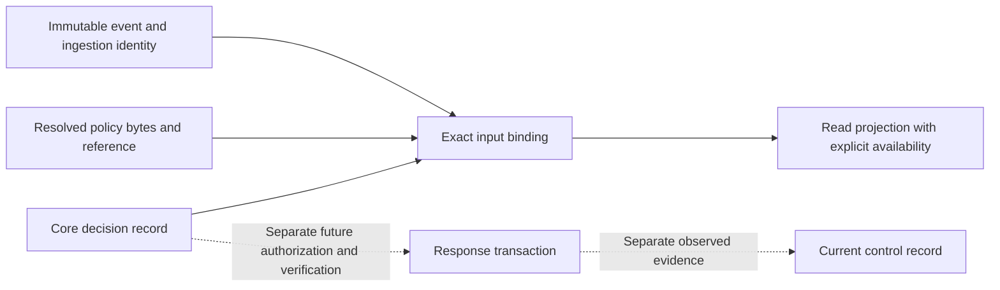

# v5 policy decision records

Status: an additional executable WP02 development slice. Refs #224 and #230.
This is a read contract, not an enabled policy engine, response executor or
published v5 API. The stable release remains v4.10.4. No production consumer
imports these contracts yet.

## Scope and authority

The [contract package](../../src/core/syswarden-core/contracts/v5/decision.go)
defines `syswarden.policy-decision.v1`: a bounded historical evaluation of one
identified event against one identified immutable policy input. The producer
is the core evaluator. Readers display its explicit classification and
availability; they must not compute a second verdict from an address, event
label, reputation match, transport status or UI selection.

The codec checks syntax and coherence, not whether an evaluator is legitimate
or its policy is approved. A forged but well-formed document can pass syntax
validation. Authentication, scope authorization, durable provenance and exact
reference resolution must precede trusted display or any later response.

The [action/control read contracts](ACTION_AND_CONTROL.md) now describe the
last two records; the response engine and actual verifier remain future work.
Neither a decision nor a successful input comparison establishes an action
result or current protection. The diagram grants no execution permission.

## Record fields

| Field | Meaning |
| --- | --- |
| `schema`, `decision_id` | Exact schema and opaque record identifier. A record identifier alone does not authenticate its owner or establish idempotence. |
| `identity` | Exact cluster, node and opaque epoch associated with the input event at ingestion. No IP, hostname or lexical epoch ordering substitutes for this tuple. |
| `evaluator_id` | Declared producer reference, which ingestion must authenticate separately. It is not an HA writer role. |
| `evaluated_at`, `clock_quality` | Declared evaluation time and clock quality. They do not create a global causal order, freshness window or expiry permission. |
| `input.event_id`, `input.event_sha256` | Required exact event reference and SHA-256 of the complete `EncodeEvent` representation. All context, availability, references and timestamps are covered. |
| `policy_ref`, `policy_sha256` | Explicit availability plus immutable policy reference and exact policy input byte digest. These fields must have the same availability state. |
| `verdict` | Declared `allow`, `block` or `observe` disposition with explicit availability. None is an execution result. |
| `severity` | Independent core classification: `informational`, `low`, `medium`, `high` or `critical`, with explicit availability. No numeric inference or normalization is performed. |
| `reason_code` | Opaque bounded explanation code supplied by the evaluator's policy. It is not arbitrary log text, a translated sentence or a shell fragment. |
| `evidence_ref` | Identified explanation/evidence record. Its existence, access, content, integrity and completeness need independent checks. |

Every member is mandatory, including empty values for absence states. The
[event availability rules](EVENT_ENVELOPE.md#fields-and-authority) apply.
An absent verdict is never coerced to `allow`, `observe` or successful
enforcement. `observe` is a concrete policy disposition to observe without
requesting a block under that policy; it does not prove other controls absent.
An `allow` disposition does not make the subject trusted or harmless, bypass
other policies, approve a human action or remove another source's rule.

A valued verdict or severity, including a stale or partial classification,
requires `present` policy reference, policy digest, reason and evidence
reference. These identify immutable historical inputs and explanation. They
do not assert that the policy is still deployed or that referenced evidence
is complete. Without those references, the producer must represent the
classification as missing, unavailable, rejected or not applicable, as
appropriate. It must not invent a policy or evidence identifier to pass the
validator.

There is no coupling from severity to disposition: a low-severity event can
have a policy block, and a high-severity event can require observation. Those
choices belong to the identified core policy. The event's original severity
and the later decision's severity remain distinct statements with their own
provenance. A future presentation must label that distinction explicitly.

## Exact binding without implied authorization

`CheckPolicyDecisionBinding` takes a `DecisionReadContext` obtained from
separately authenticated, scope-authorized records:

1. The immutable input event and its authenticated ingestion identity tuple.
2. The resolved policy reference and digest computed from its exact bytes.

It validates both records, requires present event/node identifiers, checks
that the event's node matches its ingestion tuple, and compares the decision's
complete identity, event identifier, event digest, policy reference and policy
digest. A reused event ID with different bytes, a renamed policy, changed
policy bytes or any different epoch fails the comparison. There is no network
lookup, filesystem lookup, fallback identity or reference resolution.

The context must never be populated by copying the untrusted decision's
fields. `Event.NodeID` has no cluster or epoch; a trusted journal must retain
those ingestion facts separately. This helper cannot recover them from an
event or authenticate them. A caller reviewing history may supply the actual
historical epoch. Current membership and revocation checks remain a separate
obligation for current fleet views and future response execution.

Success means only that the records are bound to the supplied inputs. It may
still describe a stale, partial or absent verdict. It does not verify the
reason/evidence reference, recompute a verdict, approve the policy, guarantee
coverage, provide replay protection or authorize a block. No `CanExecute`
helper exists in this slice. Response authorization remains WP08, including
exact preview, authority, preconditions, target scope, TTL and verification.

Decisions and their input events are immutable records. Adding a decision link
to a previously evaluated event would change its digest. Store subsequent
relationships separately in the future journal/read projection; do not mutate
the input, remove fields before hashing or retry with only its identifier.

## Encoding and digest domain

The strict codec shares the existing 16 KiB document bound, 128-byte ASCII
identifier bound and bounded JSON parser. It rejects unknown/missing fields,
duplicate decoded keys, case aliases, invalid UTF-8, unpaired UTF-16 escapes,
wrong types, null values, trailing documents and unsupported schemas. Failure
returns no partially usable record, and errors never include input values.
Timestamps use the existing canonical UTC RFC3339Nano spelling.

`DecisionEventSHA256` hashes exactly `EncodeEvent` bytes: all explicit members
in pinned struct order, compact JSON, no final newline. Valid formatting or
input member-order changes normalize to the same bytes. This differs from
`event.provenance.original_sha256`, which binds original source input bytes.
Both domains must remain distinct. The schema is included in the hashed event.

`policy_sha256` instead binds the exact immutable bytes supplied to the core
policy evaluator. This slice does not define a policy language, canonicalize
its bytes or approve a signed policy artifact format. The binding helper
compares against the digest supplied by the trusted policy resolver; it cannot
verify bytes that the caller has not resolved. The synthetic policy byte
fixture exists only to test this boundary and is not a deployable policy.

Decision encoding is deterministic compact struct-order JSON, without a final
newline. It is not RFC 8785 JCS, an approved signing format or proof of origin.
Signing, key lifecycle, policy loading and journal integrity remain reviewed
work before production adoption.

## Migration and compatibility

There is no conversion from v4 `BANNED`, `ALLOWED` or other action labels into
a policy decision. Those logs do not provide a verified policy input, evaluator
or ingestion epoch. Frozen v4 events, their conservative projections, v5
events and node snapshots are rejected by the decision decoder. Conversely,
decision bytes cannot be decoded as events or node snapshots.

A future authenticated core evaluator may evaluate a properly identified
legacy observation under an explicit policy, producing a separate new record.
That requires actual evaluation and retained provenance; projecting a legacy
log line alone never establishes such a decision.

The [BunkerWeb integration](BUNKERWEB_COMPATIBILITY.md) remains independent.
This record is not accepted by its existing synchronization API, does not
change TTL, source ownership, automatic authorization, retries or HA fences,
and does not require a dashboard or browser session for existing operations.

## Validation and remaining work

Synthetic golden vectors cover block, allow, non-IP L2 observation and unavailable
evaluation. Tests cover all availability states, invalid constructed records,
unknown schemas, hostile JSON, exact byte bounds, substituted identities,
reused identifiers, changed event/policy bytes and frozen v4 rejection. The
fuzz target enforces deterministic round trips, zero output on rejection and
rejection of a different ingestion identity. No reference is fetched in tests.

WP02 remains open for incident and evidence schemas, the rate catalog and
shared consumer adoption. The [action/control slice](ACTION_AND_CONTROL.md)
adds read records without an execution engine. WP08 remains open for
the response engine and its acceptance criteria. Package tests do not prove
cross-consumer agreement, a native enforcement path, partner IVV or full v5
Upgrade acceptance. No stable release documentation changes with this slice.
