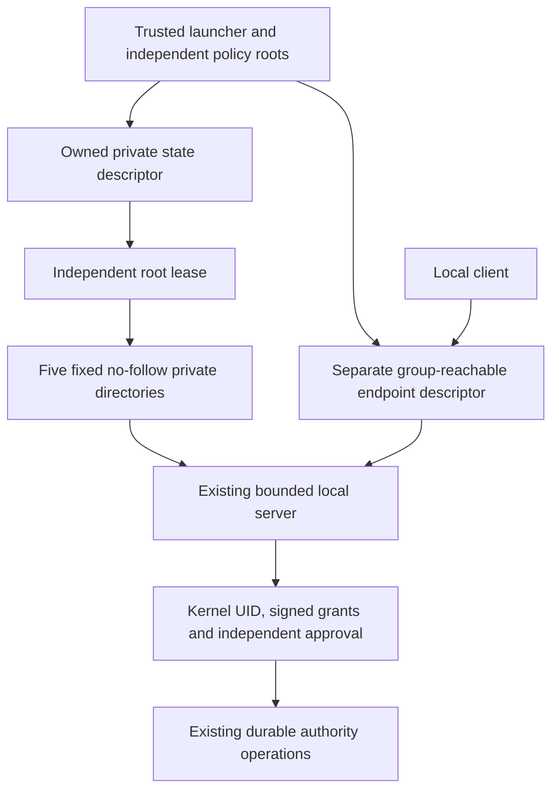

# Startup from protected authority directories

Status: inactive Linux v5 component. `OpenProvisionedAuthorityServer` starts the
existing [local server](LOCAL_AUTHORITY_SERVER.md) from a fixed private storage
layout and a separate client-reachable endpoint directory. Native packages do not
activate it. The opt-in [process entry point](AUTHORITY_PROCESS.md) consumes this
layout. Stable remains v4.10.4. Refs #224, #225 and #337, all partial.

The [protected launch record](AUTHORITY_LAUNCH.md) supplies these explicit trust and
limit values from an independently pinned root-owned descriptor, with a matching
effective service identity. It retains the directory contract below.

## Explicit trusted inputs

A trusted service launcher supplies one open state-directory descriptor and the
existing `AuthorityServerConfig`. The four authority-directory fields and
`PinDirectory` must be nil: conflicting inputs are rejected, never silently
overridden. The caller still supplies independent policy trust, journal enrollment,
limits, clock, approval providers, endpoint descriptor/group and accept interval.
No request can select any of these inputs.

The state directory and its five children must already exist, be owned by the
effective service UID, have exactly `0700` without special bits, and have no POSIX
access or default ACL. Children must be distinct directories on the root's
filesystem. Startup opens each fixed basename relative to the owned root, with
`O_DIRECTORY`, `O_NOFOLLOW` and `O_CLOEXEC`. Missing entries, symlinks, files, FIFOs,
aliases and unsafe metadata are errors. No path search or configurable child name
is involved.

| Fixed child | Existing responsibility |
| --- | --- |
| `policy` | Protected current signed-policy history. |
| `custody` | Local restart custody and prepared intents. |
| `anchors` | Durable journal continuity. |
| `journal` | Published segments and signed checkpoints. |
| `endpoint-pin` | Private creator-written endpoint recovery evidence. |

The endpoint directory is supplied separately with the existing service ownership,
selected client group and `0750` contract. Place it outside the private state root:
clients cannot traverse `0700` storage. Group access to that endpoint does not grant
an operation. The original explicit-descriptor server interface remains available;
this entry point deliberately accepts only the fixed same-filesystem private layout.

This opens already provisioned resources. It does not create accounts, directories,
enrollment, policy grants, issuer keys or service-manager units, and does not change
permissions or repair existing state. The existing server creates its own socket,
receipt and private pin only after startup validation. Unknown sibling entries are
not interpreted, enumerated into a trust decision or removed. Files within each
known directory retain the underlying store's authentication and ownership checks.

## Lifetime and replacement checks

The root uses an independent open file description and a nonblocking exclusive
lease. Six references are retained: the root and its five children. The actual
server acquires its existing independent resource references and locks. Closing the
caller's original descriptors cannot release these owned handles. Startup failure
closes every acquired reference without changing provisioning.

Before and after accepting a connection, the server rechecks the root and child
descriptors, private modes, owner/group, absence of ACLs and each fixed entry's
device/inode identity. A renamed or replaced child cannot redirect work to new
storage. Detection stops admission through the existing supervisor failure path.
There is no continuous filesystem watcher. A trusted owner/root or kernel can
change state between observations; these checks do not claim protection from such
an attacker or undo a previously approved durable operation.

Trust attaches to the supplied root descriptor. Protecting its discovery path,
ancestors and mount namespace is the launcher's responsibility. A pathname or
service UID alone is not authenticated provisioning. These checks neither discover
an independent key nor prove that a human approved startup.

Shutdown keeps the root lease and all layout references until workers and admitted
operations drain, in addition to the existing endpoint/pin custody. Approved writes
retain their non-cancellable semantics. Cleanup retires only the existing server's
exact owned lifecycle files, then closes the layout references. It does not remove
the provisioned directories or unrelated entries. Stale or ambiguous endpoint state
still requires [separately reviewed recovery](ENDPOINT_RECOVERY.md).

## Verification and remaining integration

Real-file/socket tests verify authorized resume, commit, closure of caller-owned
descriptors, clean restart, unchanged unrelated files and preserved directories.
Negative startup cases compare bytes, inode metadata and inventories and check that
no descriptor or root lease remains. They cover missing, redirected and unsafe
children, root/child ACLs, conflicting configuration, wrong independent trust and
pre-existing lifecycle evidence. A replaced child is refused before serving, and a
deterministically blocked approved operation retains the root lease through drain.

The mandatory 132-case [ordinary-user gate](UNPRIVILEGED_ASSURANCE.md) now uses this
entry point for its existing non-root service process. The fixture supplies the
literal fixed layout, independent synthetic trust and a separate endpoint. Both
client identities are denied root-directory listing and permission changes; private
state remains unchanged. Authorized commit, fresh-process restart, abrupt-exit
preservation and independently reviewed endpoint recovery still run through the
actual server. No child process, timeout relaxation or skipped case is added.

This is component integration, not a deployed provisioning agent. Trusted account
creation, ancestor/mount protection, isolated OS service installation, real human
identity/MFA, durable approval/audit providers, partial-state recovery and native
IVV remain open. BunkerWeb keeps its independent authenticated API, source-owned
temporary bans, duration/expiry/retry and HA behavior without a dashboard, journal
or new identity-provider dependency.
