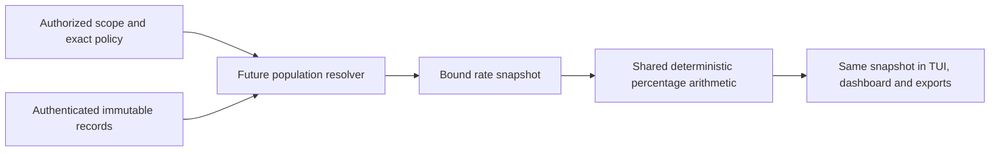

# Shared percentage catalog and rate reports

Status: inactive WP02/WP18 development contract for v5.00.0, linked to #224
and #315. The package is not connected to a production reader or collector.
This is not a dashboard implementation or release acceptance. The published
baseline remains v4.10.4.

## One definition for every presentation

The TUI, fleet console, charts and exports must use the same formula version,
authorized population, policy, time window and immutable report. All headline
and exported KPIs are rates. Counts are restricted to explicitly authorized
calculation provenance and operational rows, not substitute KPI cards.

The executable catalog in
[rate_catalog.go](../../src/core/syswarden-core/contracts/v5/rate_catalog.go)
returns a copy of each built-in definition. `syswarden.rate-catalog.v1` fixes
the unit to percent, two decimal places and half-up rounding. A definition's
SHA-256 covers its compact struct-order JSON. Any semantic change requires a
new definition ID and fixtures; a consumer cannot override the formula.

| Definition ID | Matched numerator | Eligible denominator and measurement |
| --- | --- | --- |
| `reporting_coverage.v1` | Enrolled nodes with a timely valid report. | All eligible enrolled nodes at the snapshot instant, including unreachable nodes. |
| `verified_protection_coverage.v1` | Intended protected nodes with current evidence of the exact required enforcement state. | All intended protected nodes at the snapshot instant. Unknown and stale nodes remain included. |
| `policy_conformity.v1` | Managed nodes with current attestation of conformity to the exact policy. | All eligible managed nodes at the snapshot instant. |
| `telemetry_freshness_compliance.v1` | Expected source observations meeting the declared freshness policy. | All expected eligible observations in the interval, including missing slots. |
| `verified_response_success.v1` | Unique transactions with verified success by their verification deadline. | All eligible transactions whose verification deadline falls in the interval. Retries are not new transactions. |
| `alert_severity_share.v1` | Retained observations in the selected authoritative severity category. | All eligible retained observations in the same interval and authorized snapshot. |

Node identity means the exact cluster, node and membership epoch. Observation
identity also includes the stable event ID; a transaction uses its stable
transaction ID. Expected telemetry slots need a source and expected slot
identity. IP addresses, group labels and retry attempts cannot replace these
identities. The catalog specifies these rules. The separate
[node population component](NODE_RATE_POPULATION.md) deduplicates independently
authorized node membership and evaluated assessments for the three node formulas.
Authenticated membership resolution and the other population types remain open.

Severity categories are `informational`, `low`, `medium`, `high` and `critical`.
They are copied from authoritative classifications, never reclassified here.
For the other five formulas, `category` must be `not_applicable`. Outcome
distribution needs a separately versioned definition and is not implemented
by relabeling severity. No definition exists for an unobservable percentage of
all attacks blocked, an unadjudicated false-positive rate or a security score.

## Report and input binding

`syswarden.rate-snapshot.v1` carries the following explicit fields:

| Field | Meaning |
| --- | --- |
| `snapshot_id`, `collector_id` | Opaque stable report and declared producer identifiers. Neither authenticates the producer. |
| `definition_id`, `definition_sha256`, `category` | Exact built-in formula and selected dimension. |
| `inputs.scope` | Reference and exact byte digest of the independently authorized scope definition. |
| `inputs.population` | Reference and exact byte digest of the deduplicated population manifest, including exclusions and gaps. |
| `inputs.policy` | Reference and exact byte digest of eligibility, evidence, freshness, deadline and sampling requirements. |
| `window` | A UTC snapshot instant or half-open UTC interval `[start, end)`. |
| `generated_at`, `valid_until`, `clock_quality` | Report generation and expiry, separate from the measured interval and source freshness. |
| `minimum_eligible` | Explicit positive integer threshold from the exact policy. There is no hidden default sample threshold. |
| `counts` | Calculation availability and the complete declared population partition. |

References are opaque identifiers, not filesystem paths, URLs or permission
to fetch anything. The report is fleet-scoped through its resolved population;
it does not invent a single node identity for a group. A population manifest
must bind each included node's membership epoch and referenced source records.
Old generations must not silently join a new population.

`CheckCurrentRateSnapshot` requires an independently supplied `RateReadContext`
with the exact report ID and canonical report digest, collector, definition,
category, input references/digests, measurement window and minimum population.
The caller supplies a trusted current time and explicit maximum report age.
Copying fields from the received document into this context defeats the check.

The check rejects a changed report under the same ID, substituted scope or
membership manifest, different policy or formula, changed interval or category,
changed sampling threshold, uncertain collector clock, future generation,
expired report and age at or beyond the caller's limit. The wire lifetime is
at most 24 hours, an upper bound rather than an operational default.

A successful check only binds these declarations. It does not authenticate
the collector, execute the referenced policy, inspect the manifest, establish
membership completeness, deduplicate identities, choose the newest report,
authorize an export or prove enforcement. Those are mandatory responsibilities
of the future authenticated producer and read plane. A digest is not a signature.

## Denominators and uncertainty

For a valued report, `matched + other + unknown + stale = eligible` exactly.
`excluded` is separately recorded and never added to a numerator. Every
exclusion needs an explicit, reviewable reason in the policy and manifest.

- `matched`: eligible members meeting the definition with the required evidence.
- `other`: eligible members with a usable assessment that does not match.
- `unknown`: eligible members without a usable assessment, including missing,
  rejected or unavailable evidence. Do not treat absence as success or failure.
- `stale`: eligible members whose retained assessment is outside its freshness
  policy. An old successful assessment cannot remain in `matched`.
- `excluded`: members explicitly outside eligibility, retained for provenance.
  Unreachable nodes cannot be excluded merely because their reports are missing.

The producer assigns exactly one included part per eligible identity. A node
with conflicting records needs explicit resolution or unknown classification;
it must not be counted twice. Rejected records are not trusted assertions of a
node's state. Exclusion and uncertainty are different concepts.

`counts.state` preserves `present`, `partial`, `stale`, `missing`, `unavailable`,
`rejected` and `not_applicable`. The first three require all six quantities;
the others require empty strings. Partial acquisition with a known eligible
population must retain unknown members rather than shrink the denominator.
If the denominator itself is not known, no valued partition may be fabricated.

All quantities are canonical decimal strings from zero through 2^63 - 1.
Signs, leading zeros, exponent notation, fractional numbers and JSON numeric
tokens are rejected. Partition validation uses bounded subtraction, so hostile
sums cannot overflow into an apparently consistent population.

## Deterministic arithmetic and display

`ComputeRatePercentages` returns matched, other, unknown and stale shares.
It does not authenticate a report or perform its freshness check. Every valued
share is a decimal percentage with exactly two places, without a percent sign.
The application must display the unit and retain the availability state.

The calculation uses integer arithmetic with a 128-bit intermediate, not
binary floating point. Half-up rounding is applied once after division. For
example, 1/3 becomes 33.33%, and 1/20,000 becomes 0.01%. At the upper boundary,
19,999/20,000 rounds to 100.00%; that display does not prove a perfect population.
Use exact provenance for drill-down, never a rounded percentage as an action
precondition or a verified-protection verdict.

A missing or zero denominator gives no numeric percentage. A population below
`minimum_eligible` also gives `unavailable`. Display `Not available` with the
specific reason and original count availability. Do not replace these cases by
0% or 100%. Meeting the threshold is not a statistical-confidence claim.

An unavailable value retains its explicit source state. With sufficient known
data, `partial` and `stale` remain on every calculated share. A newly generated
report about old data cannot refresh those data. Report freshness also does
not turn a historical measurement into current enforcement evidence.

The four partitions form one population, but independently rounded shares can
sum to 99.99% or 100.01%. Show the rounding explanation and an accessible table;
do not alter a share merely to make the visible sum 100%. Cross-category severity
charts require the same manifest and mutually exclusive authoritative categories.
One binary report alone does not validate an entire pie chart.

## Safe aggregation remains a producer obligation

This slice exposes no operation that adds scalar rate reports. Their quantities
cannot prove that populations are disjoint. To combine groups, the future
producer must union authorized stable identities, resolve duplicate or
conflicting records, apply one exact policy/formula/window, and generate a new
manifest and report. It must preserve denominators and unknown/stale parts.

For known disjoint groups, one match among one member and zero among nine yield
1/10 = 10%, not the unweighted average 50%. Overlapping groups need identity
deduplication before any sum. Different formula versions, membership epochs,
policy definitions, intervals or scope permissions cannot be merged silently.
Time comparisons must disclose changed membership and evidence coverage.

## Bounds, compatibility and validation

The codec retains the existing 16 KiB document, 128-byte identifier, nesting,
member and value bounds. It requires every exact field, rejects duplicates,
aliases, unknown fields, nulls, malformed Unicode and unsupported schemas, and
returns no partial record on failure. Error messages never echo input content.
Canonical report encoding is compact Go struct-order JSON, not JCS or a signed
export format. Exact raw input hashes must preserve final newlines.

Synthetic fixtures pin all six catalog definitions, report bytes, input hashes,
unknown/empty denominators, partial acquisition and severity shares. Negative
tests cover substitution, freshness, sampling, overflow and parser ambiguity.
Fuzzing checks strict round trips and compares integer results against an
independent arbitrary-precision rational oracle. This is component verification,
not a measured fleet capacity or completed consumer acceptance.

No runtime consumer, dependency, v4 protocol, BunkerWeb synchronization, TTL,
ownership or HA behavior changes. BunkerWeb uses the same future rate catalog
without acquiring a dashboard availability dependency. WP02 and WP18 remain
open for trusted population resolution, deduplication, policy evaluation,
consumer parity, complete chart contracts, authorization, exports and native
acceptance. The 500-node target remains simulation on existing resources.
