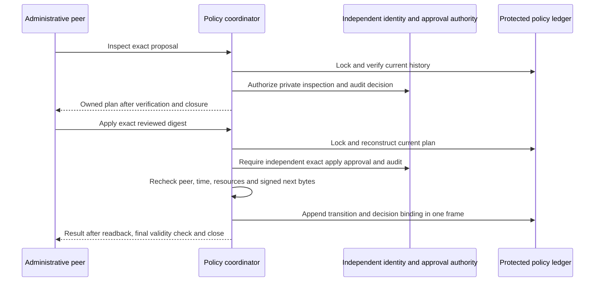

# Reviewed custody policy administration

Status: inactive WP03 component for v5.00.0. Stable remains v4.10.4.
This adds an exact-plan administrative coordinator over
[protected policy storage](CUSTODY_POLICY_STORAGE.md). It does not install an
authority service, implement human login/MFA or expose a new endpoint.

## Independent authority, not inherited operating rights

Signed access policies authenticate an issuer statement. Local `commit`, `resume`
and recovery grants authorize specific journal operations. Neither permits policy
administration. Even inspection of the private administrative plan requires the
separately provisioned `PolicyAdministrationAuthorizer`.

This trusted interface must authenticate the administrator, enforce current scope
and mode-specific rights, independently validate exact apply approval and durably
audit its decision before returning. There is no permissive implementation.
Nil, denial, unavailable audit or invalid decision data fail closed. The test
authorizer is a synthetic decision registry, not a deployable identity provider.

The authorizer must be bounded, concurrency-safe and participate in policy-lease
serialization for administrative authority/revocation changes. It must not reenter
policy storage while the caller holds that lease. The component cannot make a
dishonest authorizer trustworthy or audit its external implementation. The service
and its independent authentication/audit system remain future integration work.

`PolicyAdministrationDecision` is accepted only from this callback, never from
client-supplied JSON or a returned plan. It binds `inspect` or `apply`, the exact
plan SHA-256, observed kernel UID and the independent decision-audit SHA-256.
Its positive Unix-second validity window is at most 300 seconds. Current time must
fall within `[not_before, not_after)`; there is no grace period. PID/GID are exact
plan bindings and diagnostics, not human identities or implicit roles.

## Inspect, review, apply

`CustodyPolicyChange` supports only `install` and `disable`. Install carries the
exact next signed snapshot; disable must carry an empty snapshot and derives its
candidate from protected current state. Bootstrap, key changes, repair and arbitrary
file operations are excluded. Input lengths are checked before owned copies.

`PlanCustodyPolicyChange` acquires the existing policy lease, checks the actual
connected Unix peer and trusted clock, validates the proposed transition and
constructs a bounded canonical plan. Only a successful independent inspection
decision permits returning it. Inspection writes no policy record, but the
authorizer must retain its own decision audit. Inspection does not approve apply.

The private plan schema is `syswarden.custody-policy-change.v1`. Its digest covers
ASCII `syswarden/custody-policy-change/v1`, one zero byte, then exact compact JSON.
The 40,960-byte limit includes:

- Operation, independently pinned policy/issuer/root and initial journal scope.
- Complete before/after signed policy bytes, signatures and enabled flags.
- Current record count and chained history checksum.
- Directory and file device/inode/ownership/mode/link/size/time metadata.
- Kernel-observed UID, GID and PID of the live connection.

Plan data is private operational evidence. It must not be published in issue
comments, screenshots, CI artifacts or public exports. Its digest is a binding,
not a credential. Returned bytes are owned; modifying them cannot change apply.

`ApplyCustodyPolicyChange` reconstructs the plan from actual storage and current
kernel identity, compares the explicitly reviewed digest, then invokes the
independent authorizer in `apply` mode. It rechecks after the callback, reconstructs
the same plan again, and validates the decision and candidate lifetime before
appending. Changing history, resources, signed next bytes, peer context or the
approved digest invalidates the plan. A stale or replayed plan cannot authorize
another transition. A changed process context requires fresh inspection/review;
plans are not portable approvals.

The same policy lock excludes operational leases, competing raw administrative
updates and other reviewed changes through final closure. Lock contention is
reported; no old authorization is queued or automatically retried.

## Audit and storage compatibility

Reviewed install/disable records add a canonical `approval` object after the
existing `signature` field. It contains `plan_sha256`, `decision_sha256`,
`actor_uid`, `not_before` and `not_after`, all canonical strings. The transition
and its approval binding share a single write, sync and whole-history readback.
There is no second local audit file that can lag a successful policy update.

The independent audit system owns the administrator authentication, reviewed plan
and full decision evidence. A retained digest is not a copy of that audit or a
portable proof of authorization. Operational denial logging and the external
audit implementation are not supplied here.

Existing records without `approval` retain their exact bytes and golden checksum;
they represent explicit trusted bootstrap/raw administrative history, not reviewed
decisions. Bootstrap cannot carry an update approval. Explicit null, malformed,
duplicate or unknown audit fields are rejected. New readers accept prior canonical
history; earlier readers fail closed on the new reviewed record. This inactive
format change is not a released v4 data migration or a downgrade guarantee.

The bounded record ceiling increases to 17,408 JSON bytes and 4,465,664 total bytes
for 256 frames. No eviction or compaction is introduced. The final reserved slot
remains available for disable, including after the current operational policy
expires. Disable still requires independent administrative approval. Re-enabling
requires a newly signed next revision with unchanged pinned enrollment.

## Failure and activation limits

Before append, invalid authorization exposes no result and writes no policy
record. A failed/short write or failed sync/readback retains its exact bytes.
A complete reviewed frame remains authoritative on reopen, even if validity
expires or closure fails before the response. Its approval binding remains with
it. An incomplete frame blocks the whole history, including any apparent audit
prefix. There is no automatic rollback, repair, replay or success inferred from
an external approval record alone.

Time and peer checks occur at defined boundaries. They cannot undo disk I/O or
enforce a hard deadline during an indefinite kernel stall. Wall-clock rollback
inside a call fails; clock integrity between calls and creation-time Unix-peer
credential limitations remain as documented for local admission. The authority
must protect ancestors, directories, issuer/admin credentials and its process.
Same-UID/root rollback or a dishonest independent authorizer is outside this
component's protection.

Raw `Install`/`Disable` remain trusted storage primitives. Do not expose them
through future IPC or use them to bypass reviewed administration. Bootstrap and
OS-isolated provisioning, the actual authentication/audit provider, key lifecycle,
denial/rate limits, incomplete recovery, retention and native IVV remain open.
BunkerWeb keeps its independent authenticated API, source-owned claims, TTL and
retry/HA semantics. These administrative plans grant no BunkerWeb or fleet rights.

## Verification

Private-file and real Unix-socket tests cover inspection/apply separation,
unavailable approval/audit, stale resources, exact signed bytes, validity boundaries,
callback mutation, concurrent update exclusion, replay, unsafe peers, interruption
and authoritative complete-state reopen. Earlier golden records are preserved;
Python/OpenSSL independently reproduce an approved record chained to bootstrap.
The bounded ledger fuzz target now includes reviewed history. Race, Linux 386 and
full-core regression supplement these component checks, not native acceptance.

Refs #225 and #224. Neither work package is complete.

The [fixed-resource authority composition](LOCAL_AUTHORITY.md) now routes the
existing coordinators through a bounded canonical dispatcher with owned startup
resources. It does not implement a listener, authentication/audit provider or
OS-isolated provisioning, and remains disconnected from production.
